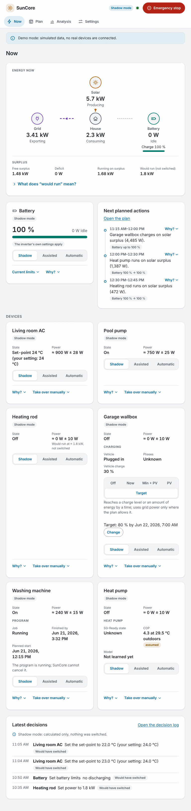

# SunCore

<!-- Weblate badge: enable once the Hosted Weblate project exists (plan phase 7, question 24;
     check the project slug first).

-->

**Energy management for Home Assistant: forecasts, a cost-optimising
planner and a real-time surplus controller in one app – explainable, safe
by default, set up in minutes.**

> Status: **release candidate for 1.0 in preparation.** Everything starts in **shadow mode**
> and switches or writes nothing until you set a device or the battery to assisted or
> automatic. Parts of the controller, the planner and the battery control have not run against
> real hardware yet; the open points are listed in [status](docs/STATUS.md) under `UNVERIFIED`
> and in the [roadmap](docs/roadmap.md).

*Screenshot from the built-in demo mode (simulated data).*

## Features

- Guided setup with entity auto-detection and live sign and unit checks.
- Live energy-flow view and a real-time surplus controller for air conditioners, heat pumps,
  water heaters, wallboxes (EV) and switchable loads.
- Forecasts for PV, load and prices; a 24–48 h planner with a reason for every interval;
  battery control within your limits.
- Decision log with "Why?", history and analysis, what-if backtests, expert mode.
- Safety layer on every device write; shadow, assisted and automatic per device.
- YAML templates for devices, tariffs, forecasts and regions; English and German.

SunCore runs as a Home Assistant app (formerly add-on) on Home Assistant
OS. It reads your PV, battery, grid and consumer entities, forecasts
production, load and prices, plans the next 24–48 h with a linear
optimiser, and distributes real surplus every few seconds to air
conditioners, heat pumps, water heaters, wallboxes and switchable loads –
while a safety layer guarantees hard limits are never crossed.

## Why another EMS?

| | evcc | EMHASS | Predbat | SunCore |
|---|---|---|---|---|
| Real-time surplus control | excellent (chargers, heaters, plugs) | – | – | yes, for all consumer types |
| Forward-looking optimisation | cloud optimiser, sponsor-gated, informational | strong LP, you wire it up | strong for supported inverters | built in, local, explainable |
| Setup | YAML + UI | JSON config + automations | HA entities + YAML | guided wizard, auto-detection, shadow mode |
| Explains decisions | partly | no | plan tables | every decision has a "why" |
| Licence | MIT (+ sponsor features) | MIT | personal use only | Apache-2.0 |

When to use what: keep **evcc** if you want best-in-class charge-point
control – SunCore can use it as an actor. Use **EMHASS** if you like
building your own automations around an LP. Use **Predbat** for GivEnergy &
co. battery arbitrage on UK tariffs. SunCore aims at the household that
wants all of it with a 15-minute setup, and it is honest about being
young: see the roadmap.

## Principles

- Productive in 15 minutes: entity auto-detection, live sign and unit
  checks, shadow mode first.
- Explainable: every plan interval and every switch has a reason in plain
  language.
- Safe: shadow → assisted → automatic per device; fail-safe states;
  watchdogs; invariants that are property-tested.
- Simple for beginners, deep for experts: good defaults, an expert switch
  that exposes every parameter.
- Local and private: no cloud requirement, no telemetry.
- Community-extensible: devices, tariffs, forecasts, regions as YAML
  templates with schema validation.

## Documentation

- [Brief](docs/BRIEF.md) – the product and engineering specification
- [Architecture](docs/architecture.md) · [ADRs](docs/adr/) ·
  [Research notes](docs/research/)
- [Quick start](docs/user/en/quick-start.md) ·
  [Schnellstart](docs/user/de/quick-start.md)
- [Surplus control](docs/user/en/surplus-control.md) ·
  [Überschusssteuerung](docs/user/de/surplus-control.md)
- [Planning and battery control](docs/user/en/planning-and-battery.md) ·
  [Planung und Akkusteuerung](docs/user/de/planning-and-battery.md)
- [History and analysis](docs/user/en/history-and-analysis.md) ·
  [Verlauf und Analyse](docs/user/de/history-and-analysis.md)
- [Decision log and "Why?"](docs/user/en/decision-log.md) ·
  [Entscheidungen und "Warum?"](docs/user/de/decision-log.md)
- [Plan chart](docs/user/en/plan-chart.md) ·
  [Plan-Diagramm](docs/user/de/plan-chart.md)
- [Expert mode](docs/user/en/expert-mode.md) ·
  [Expertenmodus](docs/user/de/expert-mode.md) ·
  [Parameter reference](docs/user/en/reference/parameters.md) ·
  [Parameter-Referenz](docs/user/de/reference/parameters.md) (generated)
- [What-if and backtesting](docs/user/en/what-if-and-backtesting.md) ·
  [Was-wäre-wenn und Backtest](docs/user/de/what-if-and-backtesting.md)
- [Contribute a device template](docs/user/en/device-templates.md) ·
  [Compatibility list](docs/user/en/compatibility.md) ·
  [Kompatibilitätsliste](docs/user/de/compatibility.md)
- [Roadmap](docs/roadmap.md) · [Status](docs/STATUS.md)
- [Contributing](CONTRIBUTING.md) · [Security](SECURITY.md) ·
  [Code of Conduct](CODE_OF_CONDUCT.md)

## Installing

Requires Home Assistant OS or Supervised (apps are not available in Home Assistant Container).

1. In Home Assistant open Settings → Apps → App store → menu (top right) → Repositories and add
   `https://github.com/pxljake/suncore` (or use the badge above).
2. Install **SunCore** (stable) or **SunCore (beta)** and start it; open it from the sidebar.
3. Follow the setup assistant. Leave every device in shadow mode first and compare the
   decision log with what you would have done.

Details: [quick start](docs/user/en/quick-start.md) ([Deutsch](docs/user/de/quick-start.md)).
Menu names differ between Home Assistant versions (older ones say "Add-ons" and "Add-on store").
The documentation site is built on every stable release (attached as `suncore-docs-<version>.zip`
and, once set up, published on the maintainer's own server); until then read it under
[`docs/user/`](docs/user/en/index.md).

## Licence

Apache-2.0. See [LICENSE](LICENSE) and [NOTICE](NOTICE).
