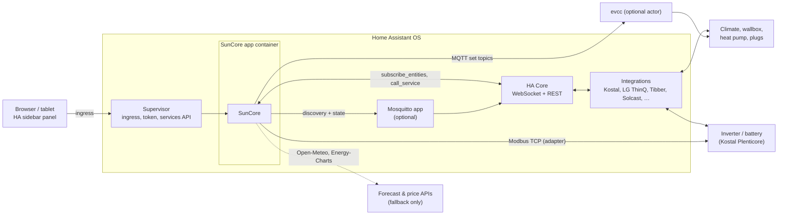
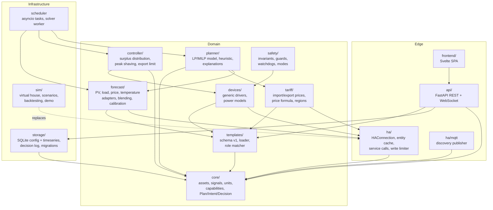
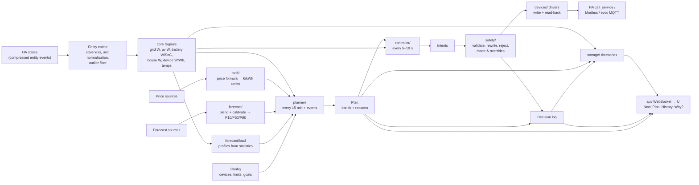
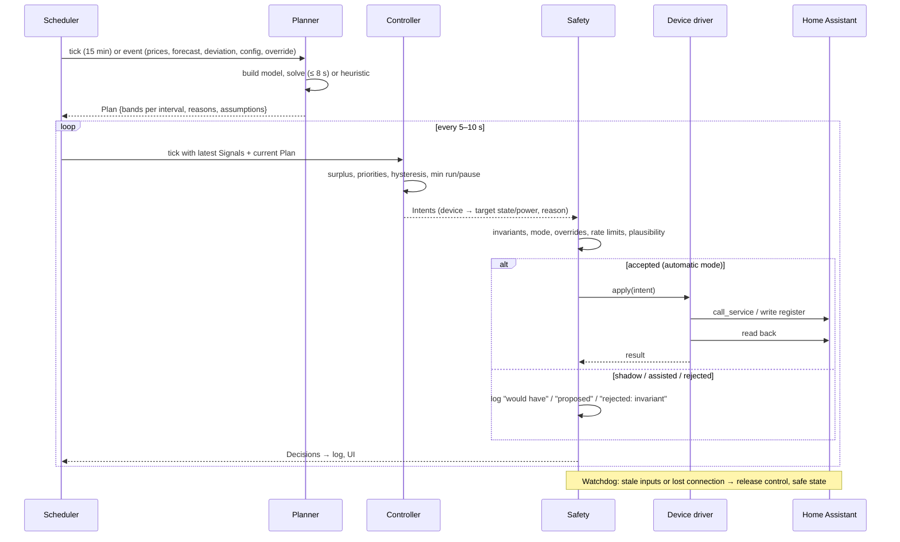
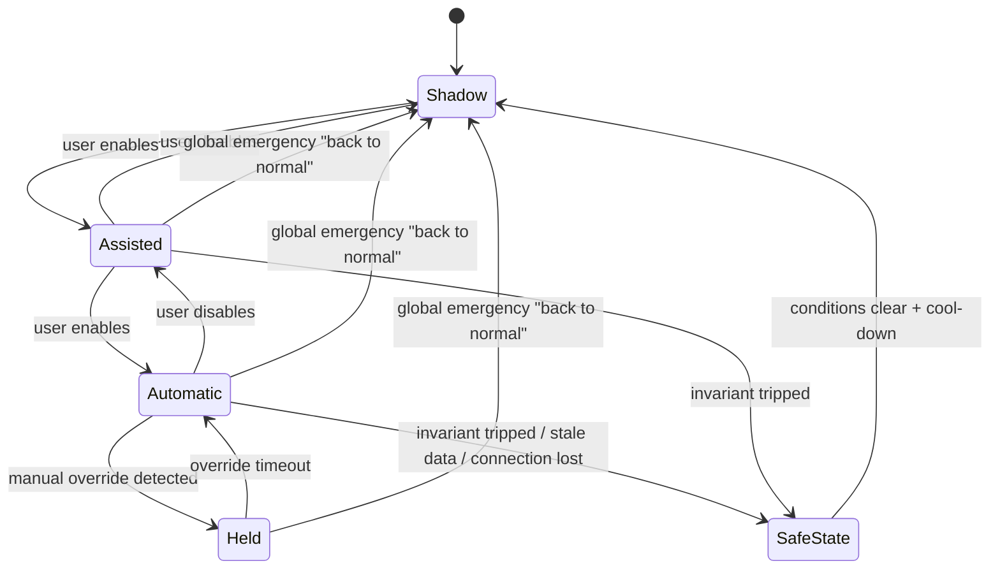
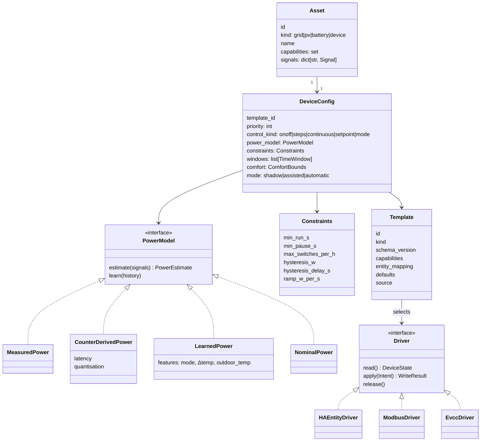
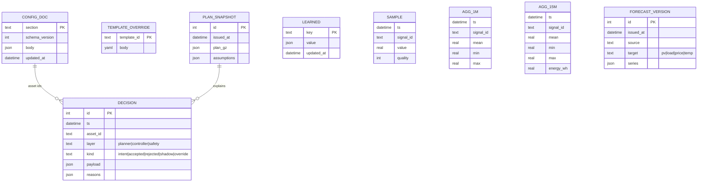
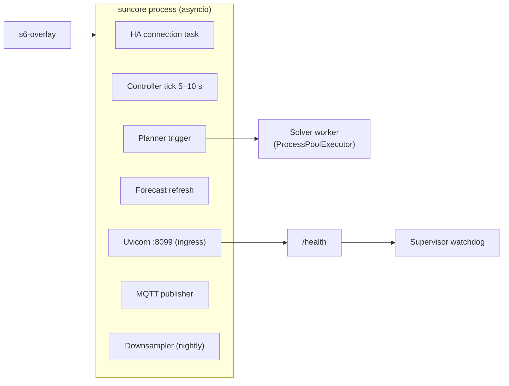

# SunCore architecture

Status: Phase 0 blueprint. Decisions referenced as ADR-NNNN live in
[`adr/`](adr/). Requirements are in [`BRIEF.md`](BRIEF.md).

## 1. System context

SunCore is one container, installed as a Home Assistant app (ADR-0010). It
reads everything through Home Assistant, writes through Home Assistant where
an integration exists, and talks to hardware directly only via explicitly
approved adapters (Kostal Modbus, evcc over MQTT).

## 2. Modules

Dependency rule: arrows point inward to `core/`; `core/` imports nothing
from the other packages. `planner/`, `controller/` and `safety/` depend on
`core/` types only, never on `ha/`, `api/` or `storage/` – this is what
makes them unit-testable and `mypy --strict` clean (BRIEF §7).

Package map (ADR-0001):

| Package | Responsibility | Depends on |
|---|---|---|
| `suncore/core` | Domain model: `Site`, `Asset` (grid, pv, battery, device), `Signal` (typed time series with unit and quality), `Capability`, `Plan`, `Intent`, `Decision`, `Reason`, units and sign conventions | stdlib, pydantic |
| `suncore/ha` | `HAConnection` (Supervisor or Direct transport), entity subscription with staleness tracking, service calls with read-back, write rate limiter, registry queries, MQTT discovery publisher | core, aiohttp |
| `suncore/forecast` | Adapter protocol + Solcast, Forecast.Solar, Open-Meteo, generic-attribute, built-in model; blending by measured skill; bias calibration; load profiles | core, ha, templates |
| `suncore/tariff` | Import/export price sources (Tibber, Nord Pool, ENTSO-E/EPEX via HACS, fixed, HT/NT), price formula, region profiles, negative-price rules | core, ha, templates |
| `suncore/planner` | Model builder, HiGHS solver worker, heuristic fallback, plan explanation, what-if | core, highspy, numpy |
| `suncore/controller` | Surplus computation, priority allocation, hysteresis state machines, peak shaving, export limiting, §14a limit | core |
| `suncore/safety` | Invariant checks, operating modes, override detection, watchdogs, fail-safe transitions; the only caller of actuators | core, devices |
| `suncore/templates` | Template schema v1 (device, tariff, forecast, region; battery from Phase 4), loader with user overrides, role matcher, read-only action allowlist check (ADR-0012) | core, yaml, pydantic |
| `suncore/devices` | Generic drivers (HA entity, Modbus via HA, MQTT/evcc), power models (measured, counter-derived, learned, nominal), battery adapters | core, ha, templates |
| `suncore/api` | FastAPI app, auth (ingress headers or token), REST, WebSocket live feed, OpenAPI | core, storage, templates |
| `suncore/storage` | SQLite repositories, migrations, downsampling, export/import | core, aiosqlite |
| `suncore/sim` | Virtual house physics, scenario files, fake `HAConnection`, backtest runner | core |
| `suncore/app` | Composition root: settings, scheduler, wiring, health endpoint | all |

## 3. Data flow

Sign and unit conventions (fixed in `core/units.py`, enforced by types):
power in W, energy in Wh, temperature in °C, money in the configured
currency per kWh; grid positive = import, battery positive = charging,
device power positive = consumption, PV positive = generation. Adapters
convert at the boundary (e.g. Kostal reports battery positive = discharging).

## 4. Planner, controller, safety in time

Deviation events: the controller reports when actual SoC, PV or load leave
the plan's assumption corridor; the scheduler then re-plans early (rate
limited to once per 5 minutes).

## 5. Safety state machine (per device and global)

`SafeState` means: stop writing, release hardware control (inverter back
to self-consumption via timeout/heartbeat stop, devices left in their
current user-visible mode), notify. Invariants (BRIEF §5) are pure
functions over `(Intent, Signals, Config)` and are property-tested.

## 6. Device model

`PowerEstimate` carries a value and an uncertainty; the controller widens
hysteresis with uncertainty, which is how counter-only devices (LG ThinQ
climate) and measured devices share one control path (BRIEF §4.5).

## 7. Storage layout (ADR-0004)

`suncore.db` holds the first five tables and is backed up; `timeseries.db`
holds the rest and is excluded from backups.

## 8. Process model inside the container

One Python process (ADR-0001): an asyncio event loop runs the HA
connection, the scheduler (controller tick, planner trigger, forecast
refresh, downsampling), the FastAPI server (Uvicorn in-process) and the MQTT
publisher. The solver runs in a `ProcessPoolExecutor` with one worker so a
slow MILP never delays the controller. s6-overlay (from the HA base image)
supervises the process; `/health` answers for the Supervisor watchdog and
reports HA connection, last controller tick age, last plan age.

## 9. Frontend structure (ADR-0002)

Routes: `/` Now, `/plan`, `/history`, `/devices/:id`, `/log`, `/setup`
(wizard), `/settings` (with expert toggle), `/diagnostics`. One WebSocket
subscription delivers `Signals`, current `Plan`, latest `Decisions` and
health; REST for configuration and history queries. All asset paths are
relative so the ingress base path works. Theme tokens map to HA CSS
variable names.

## 10. Cross-cutting

- **Explainability:** every `Plan` interval and every `Decision` carries
  `Reason` objects (`key`, `args`); the UI renders them through the ICU
  catalogue (ADR-0007). No free-text reasons in code.
- **Observability:** structured logs (structlog, no secrets), decision log
  in SQLite, anonymised diagnostics export (config with entity ids hashed,
  last 24 h of decisions, health).
- **Security:** ingress only by default; optional API port with token;
  Supervisor token never logged; dependencies pinned; CodeQL and Dependabot
  in CI; AppArmor profile.
- **Testing:** unit tests per package; property-based tests on Safety and
  the planner model; simulator scenarios as integration tests; Playwright
  E2E against the demo mode; CI smoke test starts the image and polls
  `/health`.
