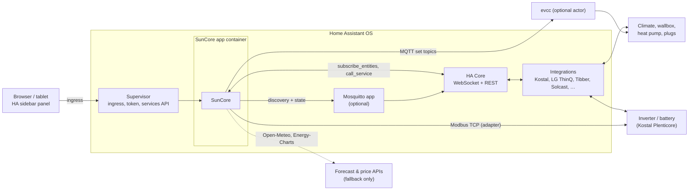
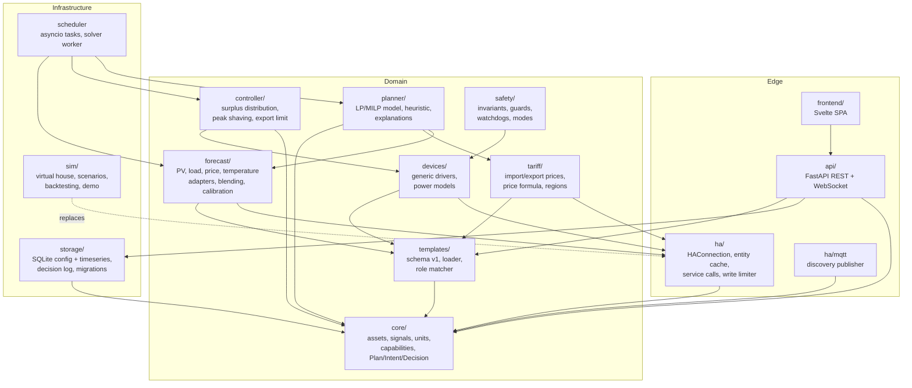
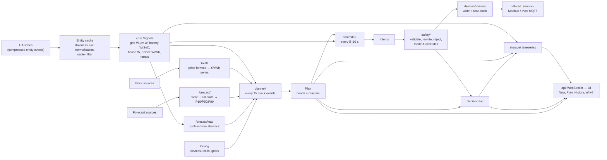
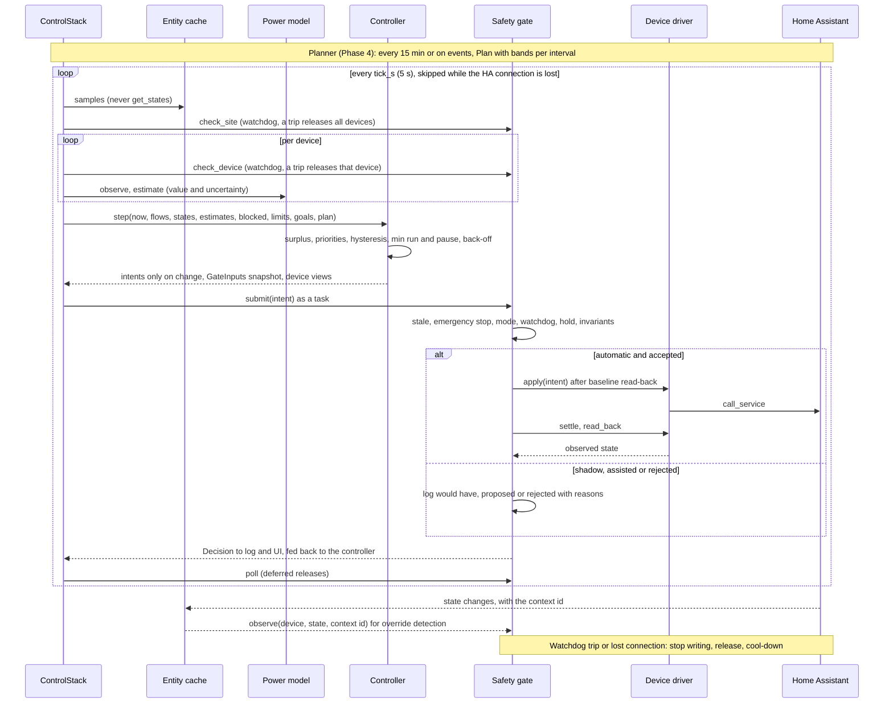
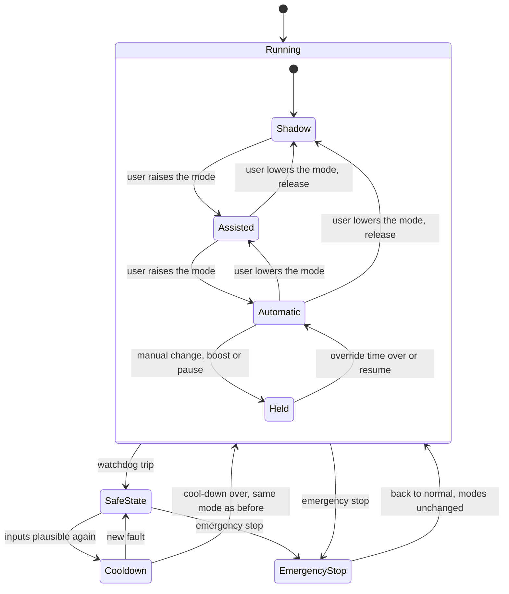
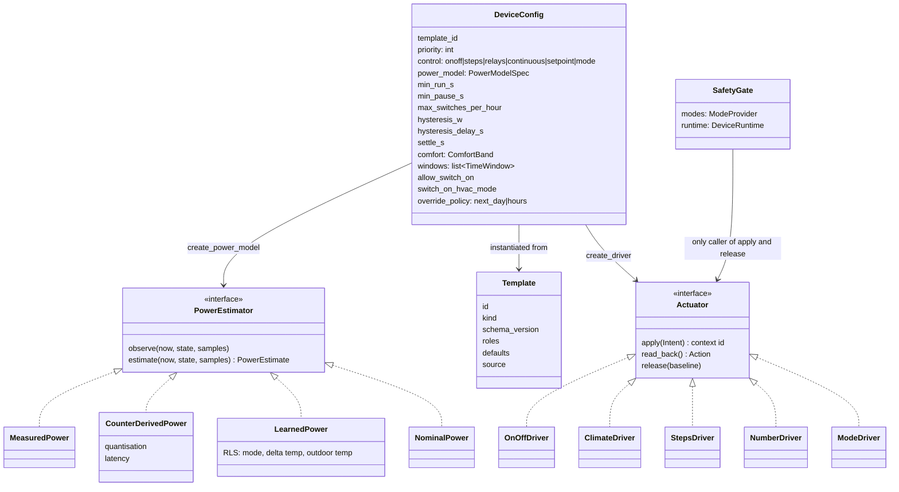
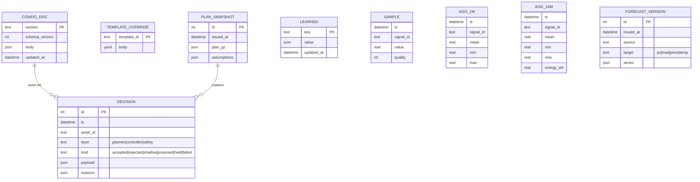
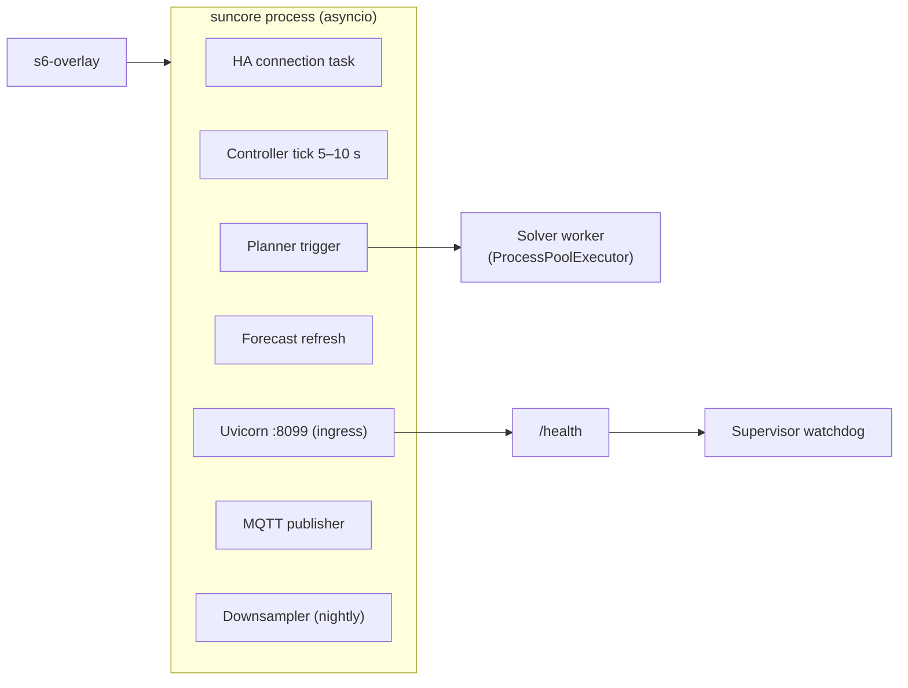

# SunCore architecture

Status: Phase 0 blueprint. Decisions referenced as ADR-NNNN live in
[`adr/`](adr/). Requirements are in [`BRIEF.md`](BRIEF.md).

## 1. System context

SunCore is one container, installed as a Home Assistant app (ADR-0010). It
reads everything through Home Assistant, writes through Home Assistant where
an integration exists, and talks to hardware directly only via explicitly
approved adapters (Kostal Modbus, evcc over MQTT).

## 2. Modules

Dependency rule: arrows point inward to `core/`; `core/` imports nothing
from the other packages. `planner/`, `controller/` and `safety/` depend on
`core/` types only, never on `ha/`, `api/` or `storage/` – this is what
makes them unit-testable and `mypy --strict` clean (BRIEF §7).

Package map (ADR-0001):

| Package | Responsibility | Depends on |
|---|---|---|
| `suncore/core` | Domain model: `Site`, `Asset` (grid, pv, battery, device), `Signal` (typed time series with unit and quality), `Capability`, `Plan`, `Intent`, `Decision`, `Reason`, units and sign conventions | stdlib, pydantic |
| `suncore/ha` | `HAConnection` (Supervisor or Direct transport), entity subscription with staleness tracking, service calls with read-back, write rate limiter, registry queries, MQTT discovery publisher | core, aiohttp |
| `suncore/forecast` | Adapter protocol + Solcast, Forecast.Solar, Open-Meteo, generic-attribute, built-in model; blending by measured skill; bias calibration; load profiles | core, ha, templates |
| `suncore/tariff` | Import/export price sources (Tibber, Nord Pool, ENTSO-E/EPEX via HACS, fixed, HT/NT), price formula, region profiles, negative-price rules | core, ha, templates |
| `suncore/planner` | Model builder, HiGHS solver worker, heuristic fallback, plan explanation, what-if | core, highspy, numpy |
| `suncore/controller` | Surplus computation, priority allocation, hysteresis state machines, peak shaving, export limiting, §14a limit | core |
| `suncore/safety` | Invariant checks, operating modes, override detection, watchdogs, fail-safe transitions; the only caller of actuators | core, devices |
| `suncore/templates` | Template schema v1 (device, tariff, forecast, region; battery from Phase 4), loader with user overrides, role matcher, read-only action allowlist check (ADR-0012) | core, yaml, pydantic |
| `suncore/devices` | Generic drivers (HA entity, Modbus via HA, MQTT/evcc), power models (measured, counter-derived, learned, nominal), battery adapters | core, ha, templates |
| `suncore/api` | FastAPI app, auth (ingress headers or token), REST, WebSocket live feed, OpenAPI | core, storage, templates |
| `suncore/storage` | SQLite repositories, migrations, downsampling, export/import | core, aiosqlite |
| `suncore/sim` | Virtual house physics, scenario files, fake `HAConnection`, backtest runner | core |
| `suncore/app` | Composition root: settings, scheduler, wiring, health endpoint | all |

## 3. Data flow

Sign and unit conventions (fixed in `core/units.py`, enforced by types):
power in W, energy in Wh, temperature in °C, money in the configured
currency per kWh; grid positive = import, battery positive = charging,
device power positive = consumption, PV positive = generation. Adapters
convert at the boundary (e.g. Kostal reports battery positive = discharging).

## 4. Planner, controller, safety in time

The planner arrives in Phase 4; until then the controller consumes `Plan.default()`, which allows
everything. The control layer (Phase 3) is composed in one place, `suncore/app/control.py`
(`ControlStack`): entity cache, one driver and one power model per device, the controller
(`suncore/controller`), the safety gate with its watchdog (`suncore/safety`) and the connection
life cycle. The runtime, the demo and the simulator all use this same stack; only the connection
and the clock differ.

**Per-tick order** (`ControlStack.tick`, documented in `suncore/controller/loop.py`; the
simulator follows it too):

1. One injected `now` for the whole tick; nothing else reads a clock.
2. Inputs come from the entity cache. `check_site` feeds the site watchdog; per device
   `check_device` (watchdog), then the power model `observe` and `estimate`.
3. `blocked` collects every device the controller must leave alone with the gate's reason:
   emergency stop, watchdog pause, orphaned runtime, release pending, manual hold.
4. `Controller.step`: smoothed surplus (median over `smoothing_s` with a spread as uncertainty),
   priority allocation, hysteresis machines, deficit back-off. It returns the intents (only on
   change, so the decision log does not fill every 5 s) and the `GateInputs` snapshot stamped with
   `now`; the gate treats a missing or old snapshot as unknown surplus and refuses to add load.
5. Every intent goes to `gate.submit` as a task (a settle wait never stalls the tick) and the
   decision is fed back with `controller.report`. `gate.poll()` then runs deferred releases, also
   on ticks without intents.

Outside the tick: `gate.observe` from the cache listener, `gate.recover()` after the first
successful connect (never before; observations are ignored until then),
`connection_lost()` / `connection_restored()` from the connection listener. While the connection
is lost the tick does nothing: nothing can be written or released, and the watchdog is already in
its safe state.

**The gate's order** for one intent: stale intent, emergency stop, effective mode, watchdog
pause, manual hold, invariants (grid import caused by SunCore, import limit, comfort band, min
run and pause, switches per hour, write rate, write only on change, battery reserve, heat limit),
then by mode: shadow logs `shadow` (the invariants that would have fired are included), assisted
logs `proposed` (valid `proposal_ttl_s`; `confirm` re-submits as `Origin.USER` through the same
checks), automatic acquires the rate limiter, records the takeover baseline on the first write,
applies, settles, reads back and logs `accepted` or `failed`. The write path re-checks emergency
stop, mode, watchdog and hold right before `apply()` under a per-device lock. The free surplus is
claimed per `GateInputs` snapshot, so several intents of one tick cannot together exceed it.

Deviation events: the controller reports when actual SoC, PV or load leave the plan's assumption
corridor; the scheduler then re-plans early (rate limited to once per 5 minutes) from Phase 4 on.

## 5. Safety state machine (per device and global)

Three things are independent: the **operating mode** (global and per device, effective mode =
the lower of both, new devices and imports start in shadow), the **hold** of a manual override
and the **safe state** of the watchdog (per scope: the site or one device).

The diagram is per scope for `SafeState` and `Cooldown` (the site or one device) and global for
`EmergencyStop`. "Back to normal" changes no mode, it only lifts the stop: each device then acts in
its own effective mode again (shadow and assisted devices still do nothing on their own). The
emergency stop is persisted and survives a restart. A hold also applies to assisted devices in
the same way (the gate answers `held`).

**Safe state** means: the gate rejects intents for the scope, and devices under control are
released. A site fault (grid, PV, battery, house signals, HA connection) pauses every device, a
device's own fault only that device. The scope returns to normal after the faults have been clear
for `safe_state_cooldown_s` (120 s).

**Release** gives a device back: the driver restores the **baseline**, the state recorded at the
takeover (climate: set-point and HVAC mode). Paths:

| Trigger | Urgency | Notes |
|---|---|---|
| Emergency stop, shutdown, crash recovery, site trip, three failed writes | at once | bounded by `release_deadline_s` (10 s) where it blocks a stop |
| Mode lowered to shadow, device trip, restored connection, pause | deferred | writing stops at once; the write waits for the device's min run or pause time (`release_due_ts`, persisted, executed by `poll`) |
| Configuration change (`gate.handover(keep)`) | unchanged devices deferred, changed ones at once | the successor stack executes the deferral (`recover(after_handover=True)`); a failed release survives in `predecessor` |
| Removed or re-mapped device | with the old actuator | `predecessor` gate or reported as `safety.orphan_dropped` |

**Observed-baseline rule.** A release gives back what the user left, not the state of the
takeover: when the override detection sees a manual change, the observed state becomes the
baseline, and every release first judges the observed state itself (`_adopt_user_state`), so a
change that was not judged yet (made while SunCore was down, or during an outage) is not
overwritten. Override detection is value-based: after the settle time a state that differs from
the last write is manual; the context id only counts as positive proof of "ours", because push
integrations echo our writes with fresh id-only contexts. A write whose read-back failed stays
pending for a while, so a late echo is a `late_confirmed`, not an override.

**Crash and restart.** The runtime (baseline, last write, switch history, hold, release
deadline, emergency stop) is persisted in `device_runtime` and `safety_state`. `recover()` loads
it after the first successful connect and releases whatever a crash left under control.

## 6. Device model

The operating mode is not part of `DeviceConfig`: the `operation` section is the only store, the
gate reads it through an injected `ModeProvider` (`ConfigModes`), and a device whose identity (id,
template, mapped entities) changed falls back to shadow. The `relays` control kind (1 to 3
switches, each step names the relays that are on) was added to schema v1 for the water heater
(ADR-0012 policy, additive).

`PowerEstimate` carries a value and an uncertainty; the controller widens the hysteresis with
uncertainty, which is how counter-only devices (the hourly Wh counter of the LG ThinQ climate)
and measured devices share one control path (BRIEF §4.5). A device's power cadence (a 5 minute
sensor, an hourly counter) is known to the watchdog, so a slow sensor is not stale before
`cadence * stale_cadence_factor`. The drivers are created by `safety.wiring.build_actuators`, so
the connection's writer never appears outside `ha`, `safety` and `sim` (boundary rule 3), and only
the gate calls `apply()` and `release()` (`tests/safety/test_boundary.py`).

## 7. Storage layout (ADR-0004)

`suncore.db` holds the first five tables and is backed up; `timeseries.db`
holds the rest and is excluded from backups.

## 8. Process model inside the container

One Python process (ADR-0001): an asyncio event loop runs the HA
connection, the scheduler (controller tick, planner trigger, forecast
refresh, downsampling), the FastAPI server (Uvicorn in-process) and the MQTT
publisher. The solver runs in a `ProcessPoolExecutor` with one worker so a
slow MILP never delays the controller. s6-overlay (from the HA base image)
supervises the process; `/health` answers for the Supervisor watchdog and
reports HA connection, last controller tick age, last plan age.

## 9. Frontend structure (ADR-0002)

Routes: `/` Now, `/plan`, `/history`, `/devices/:id`, `/log`, `/setup`
(wizard), `/settings` (with expert toggle), `/diagnostics`. One WebSocket
subscription delivers `Signals`, current `Plan`, latest `Decisions` and
health; REST for configuration and history queries. All asset paths are
relative so the ingress base path works. Theme tokens map to HA CSS
variable names.

## 10. Cross-cutting

- **Explainability:** every `Plan` interval and every `Decision` carries
  `Reason` objects (`key`, `args`); the UI renders them through the ICU
  catalogue (ADR-0007). No free-text reasons in code.
- **Observability:** structured logs (structlog, no secrets), decision log
  in SQLite, anonymised diagnostics export (config with entity ids hashed,
  last 24 h of decisions, health).
- **Security:** ingress only by default; optional API port with token;
  Supervisor token never logged; dependencies pinned; CodeQL and Dependabot
  in CI; AppArmor profile.
- **Testing:** unit tests per package; property-based tests on Safety and
  the planner model; simulator scenarios as integration tests (the full control
  stack - cache, drivers, power models, controller, safety gate - against a fake
  Home Assistant with device physics, delayed pushes, faults and manual user
  events, in virtual time: `suncore/sim/runner.py`); Playwright
  E2E against the demo mode; CI smoke test starts the image and polls
  `/health`.
