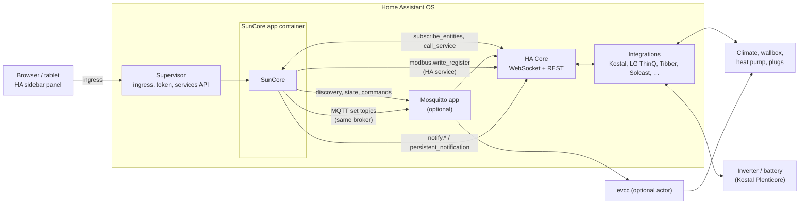
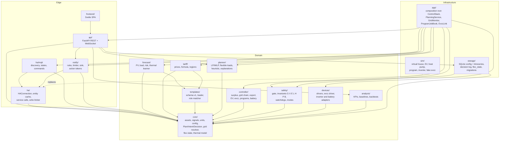
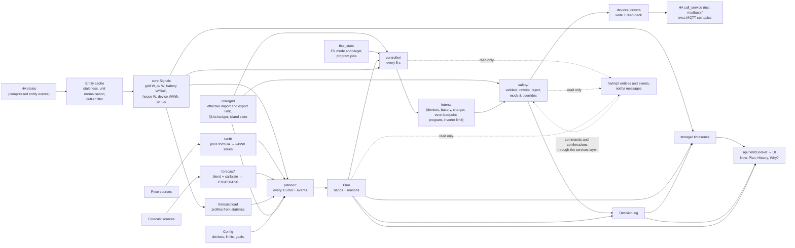
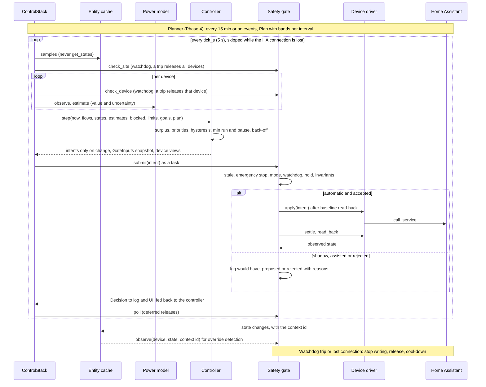
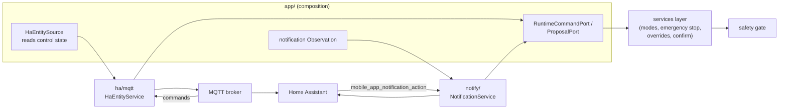
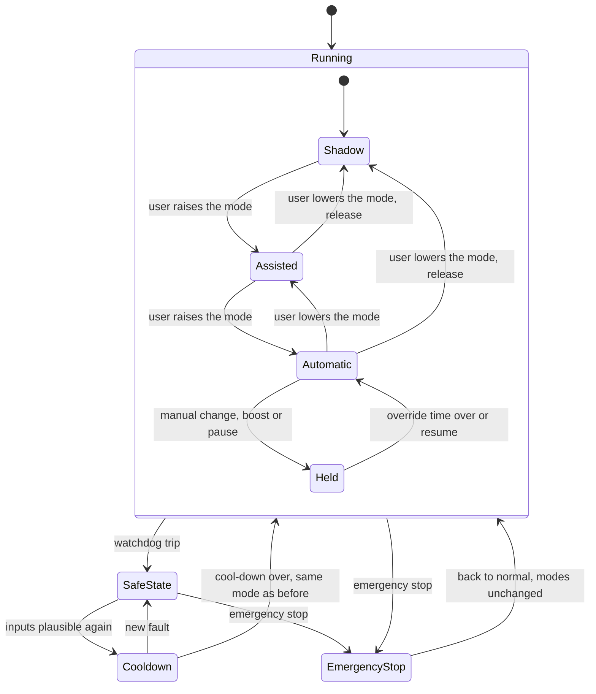
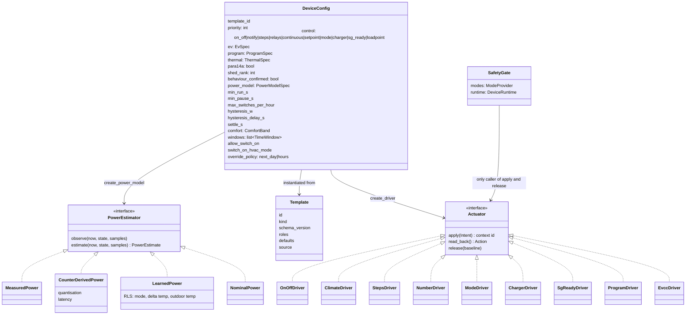
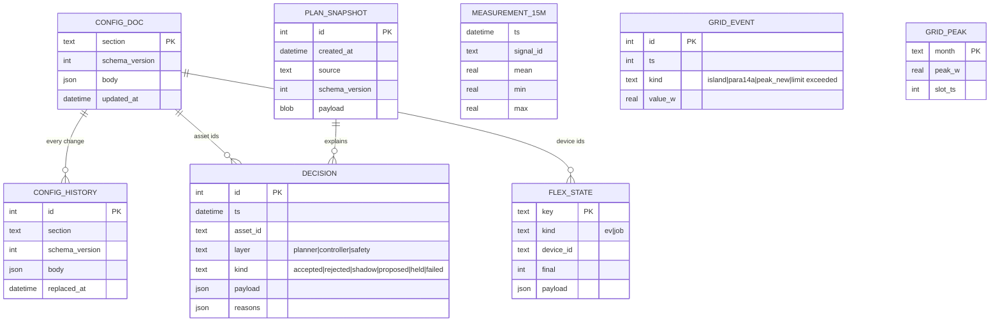
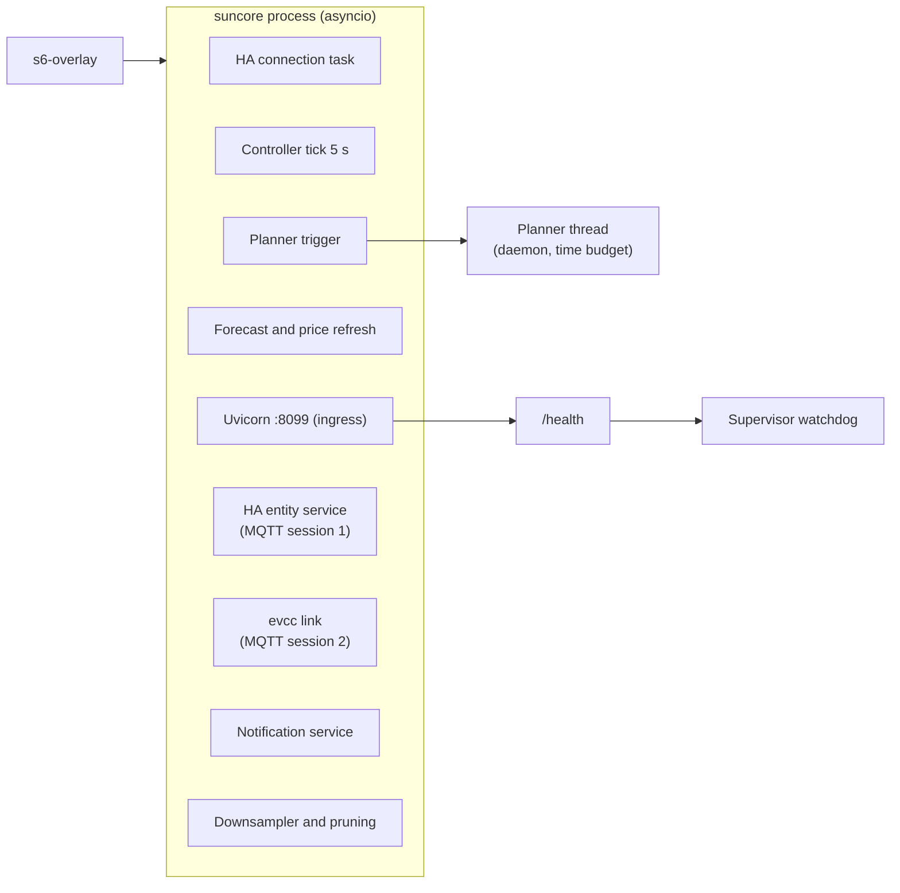

# SunCore architecture

Status: updated at the end of Phase 6 (every claim checked against the code on 2026-11-25).
Decisions referenced as ADR-NNNN live in [`adr/`](adr/). Requirements are in
[`BRIEF.md`](BRIEF.md).

## 1. System context

SunCore is one container, installed as a Home Assistant app (ADR-0010). It
reads everything through Home Assistant and writes through Home Assistant services
(including `modbus.write_register` for the Kostal registers). The only system it talks to
outside Home Assistant's own API is evcc, over MQTT, and only as an actor (ADR-0017).

SunCore makes no cloud requests of its own: forecasts and prices come from the integrations the
user runs in Home Assistant. Built-in internet fallbacks (Open-Meteo, Energy-Charts) are not part
of Phase 6 (plan §7).

## 2. Modules

Dependency rule: arrows point inward to `core/`; `core/` imports nothing
from the other packages. `planner/`, `controller/`, `safety/` and `analysis/` depend on
`core/` types only, never on `ha/`, `api/` or `storage/` – this is what makes them
unit-testable and `mypy --strict` clean (BRIEF §7). Phase 6 keeps it and adds three more
rules, all enforced by AST tests:

- `notify/` and `ha/mqtt` never write to a device: they import neither `safety`, `controller`,
  `devices`, `api` nor `app` (`ha/mqtt` imports only `core`, `i18n` and `ha`), never call
  `apply()` or `release()`, and reach the system only through an injected port (`CommandPort`,
  `ProposalPort`) that `app/` implements over the same service methods the web UI uses
  (`tests/ha/mqtt/test_boundary.py`, `tests/notify/test_boundary.py`).
- Only `notify/` (its sink) calls `HAConnection.notify`, and the connection refuses anything but
  `persistent_notification.create|dismiss` and `notify.*` before it reaches the wire
  (`tests/ha/test_websocket_notify.py`). The only Supervisor REST path is
  `GET /services/mqtt`, so the app configs ask for `services: [mqtt:want]` and **not** for
  `hassio_api` (`tests/ha/mqtt/test_boundary.py`).
- `core/grid.py` is the one resolver of the effective import limit, the effective export limit
  and the §14a budget; planner, controller and gate call only it (ADR-0018 decision 1), so the
  three layers cannot drift. The Phase 6 `core` modules (`grid`, `flex`, `thermal`, `sgready`,
  `inverter`, `haentities`) import no sibling package.

Package map (ADR-0001):

| Package | Responsibility | Depends on |
|---|---|---|
| `suncore/core` | Domain model: `Site`, `Asset`, `Signal`, `Capability`, `Plan`, `Intent`, `Decision`, `Reason`, units and signs; config sections (`mqtt`, `notifications`, `inverter`, grid with peak shaving, §14a, backup); `grid` resolvers; `flex` (EV modes and targets, program jobs); `thermal` (RC model, COP); `sgready`; `inverter` helpers | stdlib, pydantic |
| `suncore/ha` | `HAConnection` (Supervisor or Direct transport), entity subscription with staleness tracking, service calls with read-back, write rate limiter, registry queries, notify allowlist | core, aiohttp, templates |
| `suncore/ha/mqtt` | The HA entity surface (ADR-0016): broker lookup (Supervisor or manual), discovery payloads from a catalogue, state publisher with deadbands, event entity, command handler (parse, validate, rate limit, dispatch to a port), `no_broker` status and hint | core, ha, i18n, aiomqtt |
| `suncore/notify` | Notification engine (ADR-0016 decision 7): pure rules per category, rate limiter (dedupe, quiet hours, daily cap), sinks (persistent, `notify.send_message`, legacy `notify.<service>`), single-use action tokens for confirm and reject | core, ha, i18n |
| `suncore/i18n` | ICU message rendering for `Reason(key, args)` in Python (backend catalogue en/de, generated, golden-tested against the frontend renderer) | stdlib |
| `suncore/forecast` | PV, load (profiles, optional KNN), risk model, thermal learner for heat pumps; blending by measured skill; bias calibration | core, templates |
| `suncore/tariff` | Import/export price sources, price formula, region profiles, negative-price rules (Home Assistant reaches it through an injected action caller and entity reader wired in `suncore/app/adapters.py`) | core, templates |
| `suncore/planner` | Model builder, HiGHS behind `SolverBackend`, heuristic fallback, plan explanation; flexible loads (EV targets, program windows, thermal stores) and the monthly peak variable (`flex`, `flexmodel`, `flexheuristic`) | core, highspy, numpy |
| `suncore/controller` | Surplus, allocation, hysteresis machines, battery intents; `grid` (caps for island, §14a budget, shed order), `export` (export chain), `ev` (levels, modes, phase switching), `evcc` (intents), `programs` (job state machine) | core |
| `suncore/safety` | Gate, invariants (devices, battery B1-B9, grid G1-G6, inverter X1-X6, EV E1-E9, evcc L1-L5, heat pump H1-H5, programs P1-P6), watchdog, operating modes, overrides, fail-safe transitions; the only caller of `apply()` and `release()` | core |
| `suncore/templates` | Template schema v1 (device, tariff, forecast, region, battery, inverter), loader with user overrides, role matcher, read-only action allowlist check (ADR-0012) | core, yaml, pydantic |
| `suncore/devices` | Drivers (HA entity: onoff, climate, steps, number, mode, charger, sgready, program, water heater), the evcc driver (`LoadpointControl`), inverter and battery adapters, power models | core |
| `suncore/analysis` | Pure KPI, baseline and backtest functions over quarter-hour energy (ADR-0014) | core |
| `suncore/api` | FastAPI app, auth (ingress headers or token), REST, WebSocket live feed, OpenAPI; never imports `safety`, `ha`, `devices` | core, analysis, forecast, notify, planner, storage, tariff, templates |
| `suncore/storage` | SQLite repositories, migrations (`suncore.db` schema 6, `timeseries.db` schema 3), downsampling, export/import | core, safety (runtime records), aiosqlite |
| `suncore/sim` | Virtual house physics, EV, heat pump, program and inverter simulators, a fake evcc on a stub MQTT broker, scenario files, fake `HAConnection`, backtest runner, demo | all (test bed) |
| `suncore/app` | Composition root: settings, scheduler, `ControlStack`, `PlanningService`, `GridMonitor`, `ProgramJobBook`, `EvccLink`, `HaEntitySource` and the command port, notification composition, health endpoint | all |

## 3. Data flow

Sign and unit conventions (fixed in `core/units.py`, enforced by types):
power in W, energy in Wh, temperature in °C, money in the configured
currency per kWh; grid positive = import, battery positive = charging,
device power positive = consumption, PV positive = generation. Adapters
convert at the boundary (e.g. Kostal reports battery positive = discharging).

## 4. Planner, controller, safety in time

The planner (Phase 4) is in place: `suncore/planner` (`inputs.py` → `model.py` LP for HiGHS
behind a `SolverBackend` protocol → `run.py` with the heuristic fallback and `explain.py`
reasons) depends on `core` only. The scheduler (`suncore/app/planning.py`, `PlanningService`)
collects prices, forecasts and the risk targets, hands them over through `build_inputs`, runs
`run()` in a daemon worker thread (budget 8 s) every quarter hour and on events, and hands the
plan to the controller once per tick. A missing, expired or stale plan (older than 2 h) means the
controller consumes `Plan.default()`, which allows everything (the Phase 3 behaviour).
The control layer (Phase 3) is composed in one place, `suncore/app/control.py`
(`ControlStack`): entity cache, one driver and one power model per device, the controller
(`suncore/controller`), the safety gate with its watchdog (`suncore/safety`) and the connection
life cycle. The runtime, the demo and the simulator all use this same stack; only the connection
and the clock differ.

**Per-tick order** (`ControlStack.tick`, documented in `suncore/controller/loop.py`; the
simulator follows it too):

1. One injected `now` for the whole tick; nothing else reads a clock.
2. Inputs come from the entity cache. `check_site` feeds the site watchdog, `check_battery` and
   `check_inverter` the battery and inverter scopes; per device `check_device` (watchdog), then
   the power model `observe` and `estimate`. Then the tick's grid inputs are resolved once
   (`core/grid.py`), together with the EV modes and targets and the open program jobs from the
   runtime `flex_state`, and the inverter inputs.
3. `blocked` collects every device the controller must leave alone with the gate's reason:
   emergency stop, watchdog pause, orphaned runtime, release pending, manual hold.
4. `Controller.step`: smoothed surplus (median over `smoothing_s` with a spread as uncertainty),
   priority allocation, hysteresis machines, deficit back-off. It returns the intents (only on
   change, so the decision log does not fill every 5 s) and the `GateInputs` snapshot stamped with
   `now`; the gate treats a missing or old snapshot as unknown surplus and refuses to add load.
5. Every intent goes to `gate.submit` as a task (a settle wait never stalls the tick) and the
   decision is fed back with `controller.report`. `gate.poll()` then runs deferred releases, also
   on ticks without intents.

Outside the tick: `gate.observe` from the cache listener, `gate.recover()` after the first
successful connect (never before; observations are ignored until then),
`connection_lost()` / `connection_restored()` from the connection listener. While the connection
is lost the tick does nothing: nothing can be written or released, and the watchdog is already in
its safe state.

**The gate's order** for one intent: stale intent, emergency stop, effective mode, watchdog
pause, manual hold, invariants (grid import caused by SunCore, import limit, comfort band, min
run and pause, switches per hour, write rate, write only on change, battery reserve, heat limit,
and the Phase 6 families G, E, L, H, P and X of the Phase 6 paragraph below),
then by mode: shadow logs `shadow` (the invariants that would have fired are included), assisted
logs `proposed` (valid `proposal_ttl_s`; `confirm` re-submits as `Origin.USER` through the same
checks), automatic acquires the rate limiter, records the takeover baseline on the first write,
applies, settles, reads back and logs `accepted` or `failed`. The write path re-checks emergency
stop, mode, watchdog and hold right before `apply()` under a per-device lock. The free surplus is
claimed per `GateInputs` snapshot, so several intents of one tick cannot together exceed it.

**The battery** (Phase 4 WP10, ADR-0013) is the asset `battery` with its own path through the
same gate. The controller turns the band of a *fresh* plan interval into a `BatteryAction`
(limits, not set-points; `None` = the adapter's baseline found at takeover): `grid_charge_max_w`
-> `grid_charge_w` where the adapter can force charging, `discharge_lock` -> `max_discharge_w`
= 0 or a min-SoC floor at the live SoC (never below `effective_reserve_pct`), nothing planned ->
`ReleaseAction`. The gate judges it with the battery invariants B1-B9 (`safety/battery.py`):
floor never below the reserve or the user's own floor, grid charging only from a fresh planned
interval inside the grid-charge policy at the **live** price and within battery, adapter, band
and import-headroom bounds, a discharge lock only when planned, the import limit for every
action that can cause import, live ranges and capabilities, write only on change, mandatory
read-back. An adapter with a hardware fallback (Kostal §3.5) gets it armed and read back before
the first limit and is capped at assisted until `battery.fallback_measured`. An accepted state is
a **lease**: `gate.poll()` re-judges it every tick and restores the baseline when the mode, the
watchdog (site or battery scope, `gate.check_battery`: frozen battery power or SoC), stale inputs
or any invariant says so (also when no fresh plan interval covers the held state, or the adapter
refuses); the adapter's heartbeat re-writes only while it holds. A battery release is complete
only when the read-back shows the original baseline; until then the release is retried with
back-off (also during an emergency stop) and nothing else is written. Devices keep the
Phase 3 rule "no SunCore-caused import" unchanged, and the charging power of a forced grid charge
is never surplus for them.

**Phase 6: grid chain and flexible loads** (ADR-0016, ADR-0017, ADR-0018). Every new write is a
typed action that the gate judges; `NOT_YET_SUPPORTED_KINDS` is empty, each kind left it in the PR
that brought its invariants, simulator scenarios and `control-safety` sign-off. Shadow stays the
default for each new device and asset, and a device of a Phase 6 family runs at most assisted
until the user confirms its behaviour (`behaviour_confirmed`, the same cap as the Kostal
fallback).

- **Grid inputs once per tick.** `ControlStack._grid_inputs` calls
  `controller.grid.resolve_grid_inputs`, which uses only the resolvers of `core/grid.py`: the
  effective import limit (the smaller of the fuse and the peak limit, never above the fuse), the
  effective export limit, the §14a budget and the grid state (`connected`, `island`, `unknown`,
  `not_configured`). `GridMonitor` (`app/grid.py`) tracks the month's highest 15-minute mean
  import and writes `grid_event` and `grid_peak` rows. In island operation the controller ignores
  the plan (it assumes a grid) and uses `Plan.default()` plus the island caps.
- **Caps instead of new allocators.** `controller.grid.grid_caps` only ever lowers a device's
  level: island sheds everything off the keep list, an active §14a signal shares its budget among
  the flagged devices by priority, an unknown signal freezes them, and a cool-down
  (`safe_state_cooldown_s`) follows both. Above the import limit the back-off sheds in the order
  continuous loads, `shed_rank`, reverse priority. Rises still need real surplus.
- **Gate invariants.** G1 to G6 (`safety/grid.py`; import limit, reductions always pass, §14a,
  island, unknown inputs, cool-down) are called by the device path and the battery path alike.
  Further families, all pure functions over plain values: E1-E9 for a charger (`safety/flex.py`:
  current range, phase switching, bounded grid allowance, no raise when unplugged or off, the
  home battery never discharges into the car, mode capped until confirmed), L1-L5 for an evcc
  loadpoint (`safety/evcc.py`), H1-H5 for SG-Ready and the heat pump's set-point lift
  (`safety/heatpump.py`: never state 1, state 4 only with opt-in, dwell, comfort band, fail-safe
  to state 2), P1-P6 for programs (`safety/programs.py`: start only with a fresh power reading,
  never switch a running program off, the plug's safe state is on) and X1-X6 for the inverter
  limit (`safety/inverter.py`: bounds, no import caused, chain order, lease, capped at assisted
  until `limit_verified`). A `ReleaseAction` is never judged: "back to normal" works from any
  state.
- **Export chain.** `controller/export.py` orders the use of surplus: controlled devices first,
  then the hybrid inverter charges the battery (SunCore only lifts its own charge cap while the
  export exceeds the limit), and only then an `InverterLimitAction` (an export limit in W or an
  AC limit in %, Kostal register 533). The inverter is an asset of its own with a lease and a
  heartbeat like the battery; a held limit is restored to the user's own value on any release.
- **EV.** A charger is one more continuous load in the level allocator (`controller/ev.py`:
  paused level, one level per ampere from the 6 A floor) with the modes `off`, `now`, `min_pv`,
  `pv` and `target` read from `flex_state`. A floor (a rise without the surplus guard) is offered
  only inside the bounded import exception of ADR-0017 decision 4 and only while the house
  battery cannot discharge into the car. 1/3-phase switching is a state machine that pauses
  first. **evcc as actor** is different: `controller/evcc.py` (`EvccIntents`) says only what
  evcc may do (`off`, `smart`, `now`, maximum current) and cuts any wish down to what evcc shows
  now whenever an input is unknown. `app/evcc_link.py` is a second MQTT session to the same broker
  as the entity surface; evcc counts as alive only while `<prefix>/updated` is younger than 120 s.
  The driver (`devices/evcc.py`) is dumb and writes only mode, `maxCurrent` and `limitSoc`.
- **Heat pump.** SG-Ready steps and a hot-water set-point lift are levels of the same allocator.
  The planner models the store with the RC model and COP curve of `core/thermal.py`, which
  `forecast/thermal.py` learns from history.
- **Programs.** `core/flex.py` holds the job rules (`armed -> scheduled -> running -> done`;
  `cancelled` when the deadline passed). `controller/programs.py` is the state machine and
  `app/programs.py` (`ProgramJobBook`) persists the jobs in `flex_state` and turns events into
  notifications. The planner picks the start window; the latest start that meets the deadline
  applies without a plan.

**The HA surface and notifications** run beside the control layer, never on its tick, and write
to no device:

`HaEntityService` owns one MQTT session (birth message and last will, discovery from a
catalogue, deadbanded states, an event entity). It tells the user when there is no broker and
retries every minute. Commands are parsed, validated and rate limited, then handed to the port;
raising a mode or clearing the emergency stop is refused unless `mqtt.allow_mode_raise` is on.
`NotificationService` evaluates pure rules over an observation, limits the result (dedupe, quiet
hours, daily cap; safety events exempt) and sends it through the sinks; a confirm button carries
a single-use token and ends in the same `confirm_proposal` the panel uses, which re-checks the
device's effective mode and every invariant. The data flow of an evcc loadpoint, the entity
surface and the notifications is therefore: control state -> read-only publish; user input ->
services layer -> gate.

Deviation events: the planning service itself watches the live state of charge against the plan
(more than 10 %-points off) and the grid power against the planned net power (more than 1500 W
for 30 minutes, smoothed); either triggers an early re-plan. Event runs are debounced (at least
60 s between starts) and merged into one run.

## 5. Safety state machine (per device and global)

Three things are independent: the **operating mode** (global and per device, effective mode =
the lower of both, new devices and imports start in shadow), the **hold** of a manual override
and the **safe state** of the watchdog (per scope: the site or one device).

The diagram is per scope for `SafeState` and `Cooldown` (the site or one device) and global for
`EmergencyStop`. "Back to normal" changes no mode, it only lifts the stop: each device then acts in
its own effective mode again (shadow and assisted devices still do nothing on their own). The
emergency stop is persisted and survives a restart. A hold also applies to assisted devices in
the same way (the gate answers `held`).

**Safe state** means: the gate rejects intents for the scope, and devices under control are
released. A site fault (grid, PV, battery, house signals, HA connection) pauses every device, a
device's own fault only that device. The scope returns to normal after the faults have been clear
for `safe_state_cooldown_s` (120 s).

**Release** gives a device back: the driver restores the **baseline**, the state recorded at the
takeover (climate: set-point and HVAC mode). Paths:

| Trigger | Urgency | Notes |
|---|---|---|
| Emergency stop, shutdown, crash recovery, site trip, three failed writes | at once | bounded by `release_deadline_s` (10 s) where it blocks a stop |
| Mode lowered to shadow, device trip, restored connection, pause | deferred | writing stops at once; the write waits for the device's min run or pause time (`release_due_ts`, persisted, executed by `poll`) |
| Configuration change (`gate.handover(keep)`) | unchanged devices deferred, changed ones at once | the successor stack executes the deferral (`recover(after_handover=True)`); a failed release survives in `predecessor` |
| Removed or re-mapped device | with the old actuator | `predecessor` gate or reported as `safety.orphan_dropped` |
| Charger, evcc loadpoint | as above; a staged release waits for the phase pause or the end of §14a | the charger is left **paused**, the safe state; an evcc release restores mode, `maxCurrent` and `limitSoc` and waits for evcc's echo, refused while evcc is silent and retried with back-off |
| SG-Ready, set-point lift | as above | the baseline step if it is writable, else nothing (a lock someone else set stays); never state 1; the fail-safe return to state 2 ignores dwell, minimum run and the switch limit |
| Shiftable program (plug) | as above | the safe state is **on**: the release switches the plug on and never off, so a waiting machine starts early rather than never |
| Inverter limit | as above | complete only when the read-back shows the user's own limit; a held limit is a lease with a heartbeat |

**Observed-baseline rule.** A release gives back what the user left, not the state of the
takeover: when the override detection sees a manual change, the observed state becomes the
baseline, and every release first judges the observed state itself (`_adopt_user_state`), so a
change that was not judged yet (made while SunCore was down, or during an outage) is not
overwritten. Override detection is value-based: after the settle time a state that differs from
the last write is manual; the context id only counts as positive proof of "ours", because push
integrations echo our writes with fresh id-only contexts. A write whose read-back failed stays
pending for a while, so a late echo is a `late_confirmed`, not an override.

**Crash and restart.** The runtime (baseline, last write, switch history, hold, release
deadline, emergency stop) is persisted in `device_runtime` and `safety_state`. `recover()` loads
it after the first successful connect and releases whatever a crash left under control.

## 6. Device model

The operating mode is not part of `DeviceConfig`: the `operation` section is the only store, the
gate reads it through an injected `ModeProvider` (`ConfigModes`), and a device whose identity (id,
template, mapped entities) changed falls back to shadow. The `relays` control kind (1 to 3
switches, each step names the relays that are on) was added to schema v1 for the water heater
(ADR-0012 policy, additive).

`PowerEstimate` carries a value and an uncertainty; the controller widens the hysteresis with
uncertainty, which is how counter-only devices (the hourly Wh counter of the LG ThinQ climate)
and measured devices share one control path (BRIEF §4.5). A device's power cadence (a 5 minute
sensor, an hourly counter) is known to the watchdog, so a slow sensor is not stale before
`cadence * stale_cadence_factor`. The drivers are created by `safety.wiring.build_actuators`, so
the connection's writer never appears outside `ha`, `safety` and `sim` (boundary rule 3), and only
the gate calls `apply()` and `release()` (`tests/safety/test_boundary.py`).

## 7. Storage layout (ADR-0004)

Two SQLite files, each with its own migration line: `suncore.db` (schema 6) and
`timeseries.db` (schema 3). Migrations only add; a downgrade cannot open a newer file, so the
release notes say "export the configuration before updating".

`suncore.db` is backed up and holds `config_doc`, `config_history`, `decision`, `device_runtime`,
`safety_state`, `power_model_state`, `plan_snapshot`, `learned_param`, `backtest_run` and, since
schema 6, **`flex_state`**: the *runtime* state of flexible loads (an EV's mode and target, the
open program jobs). It is runtime state and not configuration, because it changes many times a
day; a row that does not parse is skipped (an EV then falls back to the conservative mode `pv`,
a job is simply gone and nothing is started for it), and finished jobs are pruned. (`learned` of
migration 0001 is unused.) User templates are files under `/data/templates`, not a table.

`timeseries.db` is excluded from the app backup and rebuilt from Home Assistant's statistics. It
holds `measurement`, `measurement_1m`, `measurement_15m`, `forecast`, `price`, `meta`,
`day_summary`, `accuracy_day` and, since schema 3, **`grid_event`** (island and §14a start and
end, new monthly peaks, limit breaches) and **`grid_peak`** (the highest 15-minute mean import
per local month, kept for good).

## 8. Process model inside the container

One Python process (ADR-0001): an asyncio event loop runs the HA connection, the controller tick,
the scheduler tasks (planner trigger, price and forecast refresh, history rebuild, downsampling
and pruning), the FastAPI server (Uvicorn in-process), the **HA entity service** (one MQTT
session), the **evcc link** (a second MQTT session, only when an evcc loadpoint is configured) and
the **notification service**. The three Phase 6 services each run in their own task, never on the
controller's tick, and a missing broker or a failing service never stops the controller. The
planner's solve runs in a **daemon thread** with a time budget (8 s by default,
`SUNCORE_PLANNER_BUDGET_S`): HiGHS releases the GIL (`tests/planner/test_gil.py`, measured on
amd64), so a slow MILP never delays the controller, and the rule-based plan covers a miss.
s6-overlay (from the HA base image) supervises the process; `/health` answers for the Supervisor
watchdog and reports the HA connection, the last controller tick age and the last plan age.

Pi 4 budgets (plan §1 item 7): a full-house plan (one EV, one heat pump, two programs) took
0.26 s on amd64; the aarch64 run and the resident memory with MQTT and notifications are
`UNVERIFIED` until measured.

## 9. Frontend structure (ADR-0002)

A hash router (`#/`, `#/plan`, `#/history`, `#/decisions`, `#/settings`, `#/setup[/<step>]`) that
does not depend on the ingress base path; the views are Now, Plan, History, Decisions, Settings
and the setup wizard (ten steps; step 3 *Grid connection* carries peak shaving, the export chain,
§14a and the backup entity, step 5 the inverter limit block, step 7 the device gallery with the
wallbox, evcc, heat pump and program templates). Settings has the sections *Home Assistant
entities* and *Notifications*. One WebSocket subscription delivers `Signals`, the current `Plan`,
the latest `Decisions` and health; REST for configuration and history. The EV, heat pump and
program cards and the grid badges poll `/devices/{id}/flex` every 10 s and `/grid/status` every
15 s (no extra WebSocket message type; the live feed stays the one channel). The SPA loads only
the active language's ICU catalogue; the bundle budget counts the largest one (228.6 kB of
250 kB, first paint 123.5 kB of 125 kB at the end of Phase 6). All asset paths are relative so
the ingress base path works. Theme tokens map to HA CSS variable names.

## 10. Cross-cutting

- **Explainability:** every `Plan` interval and every `Decision` carries
  `Reason` objects (`key`, `args`); the UI renders them through the ICU
  catalogue (ADR-0007). No free-text reasons in code.
- **Observability:** structured logs (structlog, no secrets), decision log
  in SQLite, anonymised diagnostics export (config with entity ids hashed,
  last 24 h of decisions, health).
- **Security:** ingress only by default; optional API port with token;
  Supervisor token never logged; dependencies pinned; CodeQL and Dependabot
  in CI; AppArmor profile.
- **Testing:** unit tests per package; property-based tests on Safety and
  the planner model; simulator scenarios as integration tests (the full control
  stack - cache, drivers, power models, controller, safety gate - against a fake
  Home Assistant with device physics, delayed pushes, faults and manual user
  events, in virtual time: `suncore/sim/runner.py`); Playwright
  E2E against the demo mode; CI smoke test starts the image and polls
  `/health`.
