# Design-Prüfstopp 1 (PR 7-D): Grundgerüst, Farben, Schrift

Dieser Stand ist der erste Schritt des Design-Durchgangs aus Phase 7 (Plan
[`phase-7.md`](../plans/phase-7.md) WP4, [ADR-0019](../adr/0019-ui-design-system.md)). Er ändert
das **Grundgerüst** – Farben und Abstände als Design-Tokens, die Navigation, die Kopfleiste, die
Hinweisbanner, gemeinsame Bausteine und das Diagramm-Theme. Die Ansichten selbst (Aufbau,
Reihenfolge, Karten) werden erst in 7-E, 7-F und 7-G neu gestaltet; sie übernehmen hier nur, was
sich über die Tokens und die gemeinsamen Klassen automatisch ändert.

Alle Bilder stammen aus dem Demo-Modus (Szenario `summer_day`, Start 09:30, englisch), Handy
390×844 und Desktop 1280×800, hell und dunkel, mit doppelter Pixeldichte. Ganze Seiten; auf dem
Handy sitzt die untere Navigationsleiste im Bild am Seitenende, im Browser bleibt sie am
Bildschirmrand stehen. Die neuen Demo-Geräte aus 7-C (E-Auto, Waschmaschine, Wärmepumpe) fehlen
noch, weil 7-C parallel entsteht.

## Was sich geändert hat und warum

| Bereich | Vorher | Nachher | Warum |
|---|---|---|---|
| Navigation | fünf Pillen-Links, auf dem Handy drei Zeilen Kopf | vier Ziele: **Jetzt, Plan, Analyse, Einstellungen**; Analyse hat Reiter Verlauf, Entscheidungen (und Was-wäre-wenn im Expertenmodus) | weniger Punkte, klare Gruppen; Verlauf und Entscheidungen gehören zusammen |
| Handy | Navigation oben, scrollt weg | Navigationsleiste unten mit Symbol und Text, wie in Handy-Apps üblich | mit dem Daumen erreichbar, Kopf bleibt einzeilig |
| Not-Aus | in der Kopfleiste, scrollt mit der Seite weg | Kopfleiste bleibt beim Scrollen stehen, Not-Aus immer sichtbar (Handy: Kurzlabel „Stop“, Vorleser sagen „Emergency stop“) | Sicherheit: in jeder Lage ein Tipp |
| Status | Expertenmodus, Modus und Verbindung als drei verschiedene Stile | ruhige Gruppe: Modus-Chip, Verbindungspunkt (Text nur bei Problemen), Expertenschalter als echter Schalter | weniger Lärm, Probleme fallen trotzdem auf |
| Demo-Hinweis | kräftiger orangefarbener Balken über die volle Breite | ruhiges Info-Banner im Inhaltsbereich; Not-Aus-Banner rot darüber (feste Reihenfolge nach Schwere) | Orange war die lauteste Fläche, obwohl nichts falsch ist |
| Farben | HA-Variablen direkt in jeder Komponente | zwei Schichten: HA-Theme als Eingabe, darüber semantische `--sc-*`-Tokens (Flächen, Text, Akzent, Status mit Tönung, Energie-Palette) | eine Stelle für das Aussehen; folgt weiterhin dem HA-Theme |
| Karten | 12 px Radius, harte Rahmen | 16 px Radius, feiner Rahmen, im Hellen ein weicher Schatten, im Dunklen eine Flächenstufe; mehr Innenabstand ab Tablet | ruhigere, einheitliche Karten |
| Knöpfe, Felder, Hinweise | gemischte Stile | Primär, Sekundär, Ghost, Gefahr in einem System; Hinweise als getönte Fläche mit farbiger Kante statt farbigem Text | bessere Lesbarkeit, einheitlicher Eindruck |
| Diagramme | Farben je Diagramm eigens gelesen | ein Diagramm-Theme aus den Tokens: gleiche Energie-Farben in Plan, Verlauf und Was-wäre-wenn, Tooltip als Karte, Achsenbeschriftung ohne Überlappung | ein Farbsystem für Fluss, Karten und Diagramme |
| Symbole | keine | eigene schlichte Liniensymbole (Sonne als Marke, Ziele, Not-Aus, Status) | Orientierung; keine fremde Lizenz, kein Icon-Font |

Barrierefreiheit: Kontrast der Standardfarben automatisch geprüft (Text mindestens 4,5:1,
Bedienelemente und Diagrammlinien 3:1, hell und dunkel); axe ohne Befund auf Jetzt, Plan, Verlauf,
Entscheidungen, Einstellungen und dem PV-Schritt bei 390 und 1280 px; alle Ziele mindestens 44 px
hoch; keine waagerechte Scrollleiste bei 390 px; Bewegungen entfallen bei „Bewegung reduzieren“.

## Vorher / Nachher

### Jetzt

| | Vorher | Nachher |
|---|---|---|
| Handy hell | 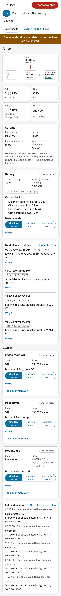 | 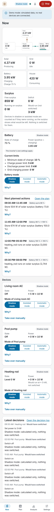 |
| Handy dunkel | 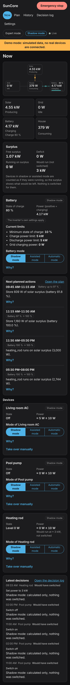 | 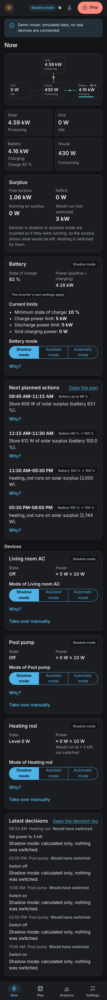 |
| Desktop hell | 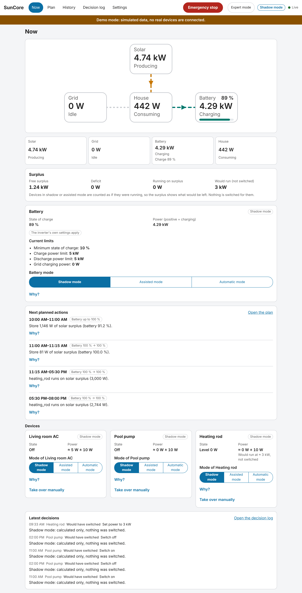 | 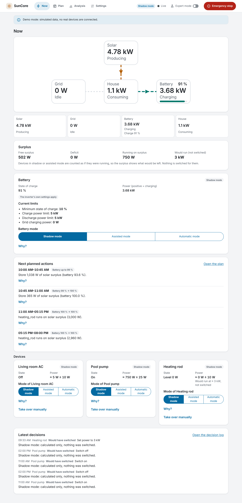 |
| Desktop dunkel | 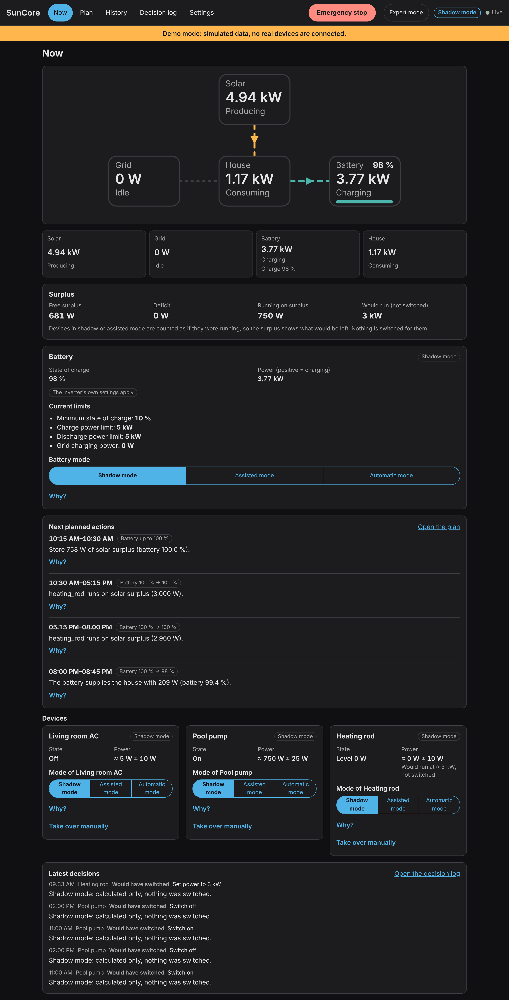 | 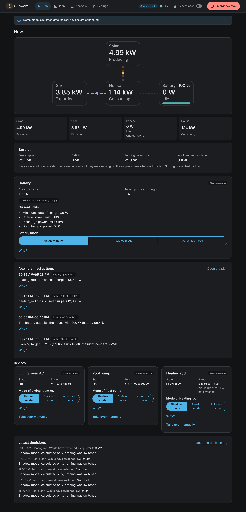 |

### Plan

| | Vorher | Nachher |
|---|---|---|
| Handy hell |  |  |
| Handy dunkel |  |  |
| Desktop hell | 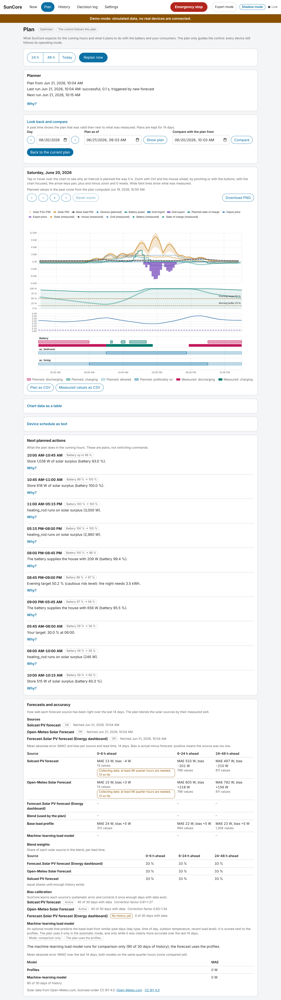 | 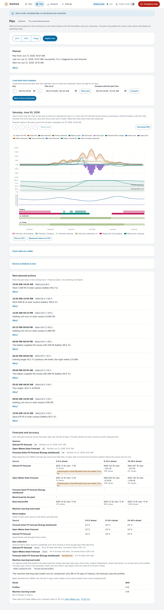 |
| Desktop dunkel | 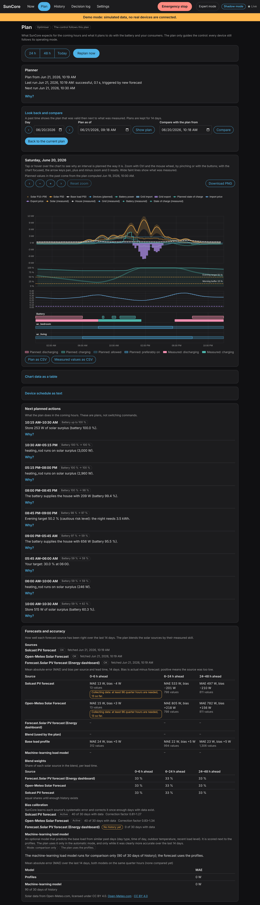 | 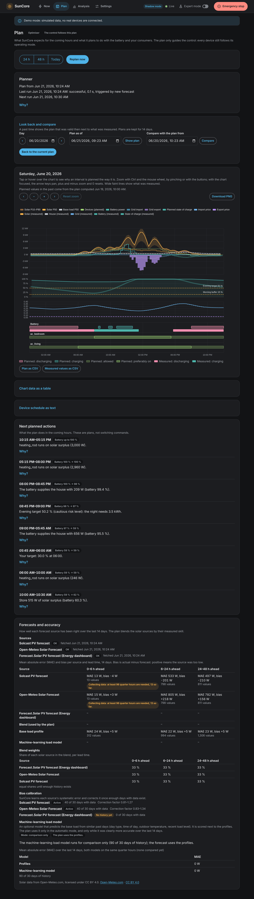 |

### Analyse (Verlauf)

| | Vorher | Nachher |
|---|---|---|
| Handy hell |  |  |
| Handy dunkel |  |  |
| Desktop hell | 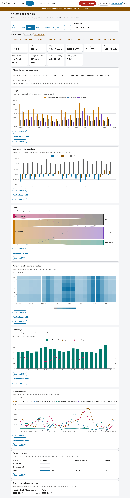 |  |
| Desktop dunkel | 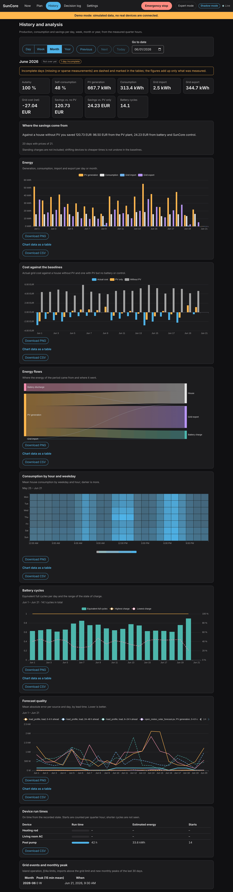 |  |

### Einstellungen

| | Vorher | Nachher |
|---|---|---|
| Handy hell | 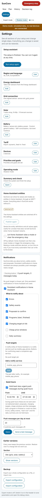 | 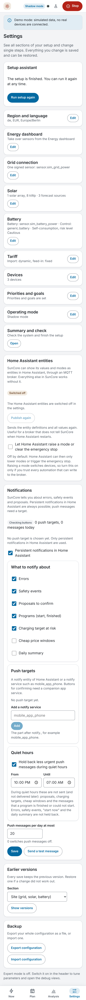 |
| Handy dunkel | 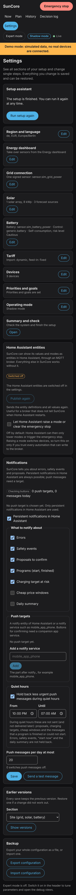 | 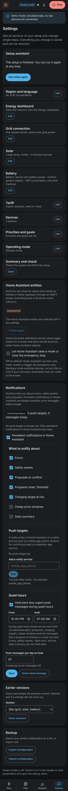 |
| Desktop hell | 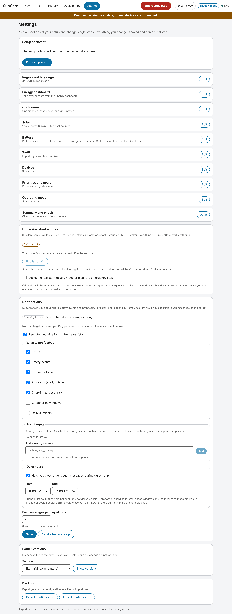 | 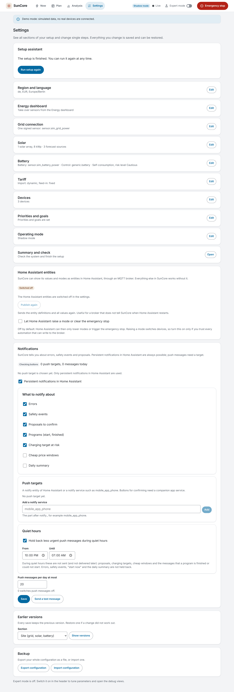 |
| Desktop dunkel | 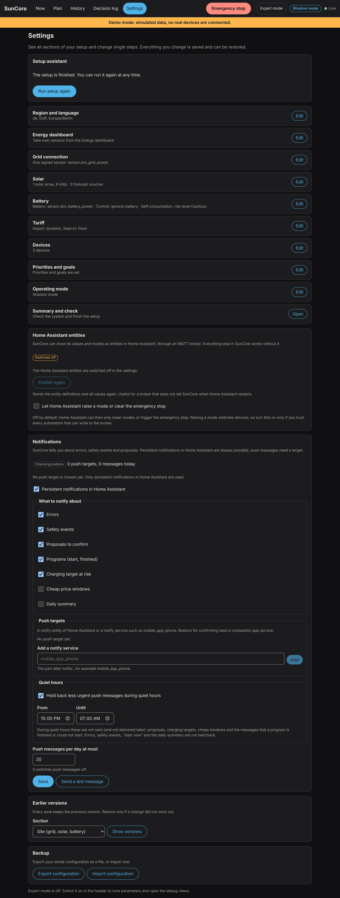 | 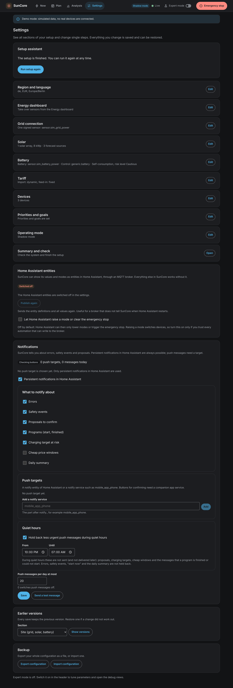 |

### Einrichtung, Schritt „Solar“

| | Vorher | Nachher |
|---|---|---|
| Handy hell |  |  |
| Handy dunkel |  |  |
| Desktop hell | 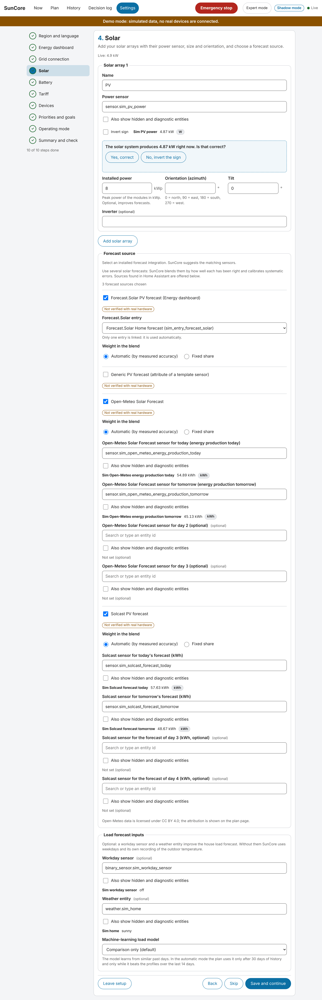 | 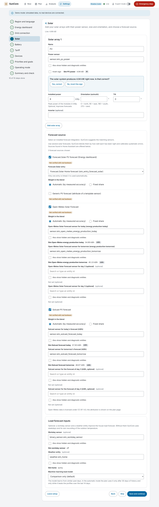 |
| Desktop dunkel | 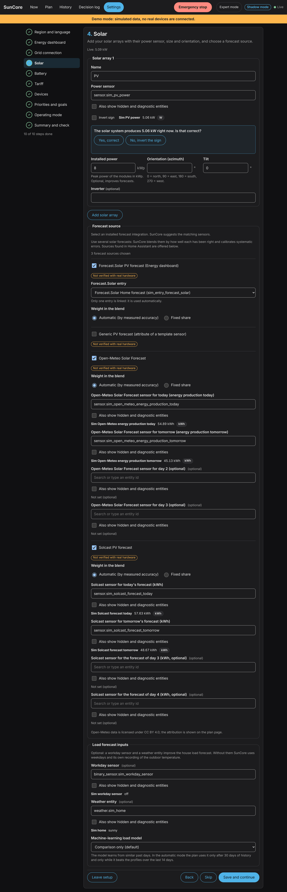 | 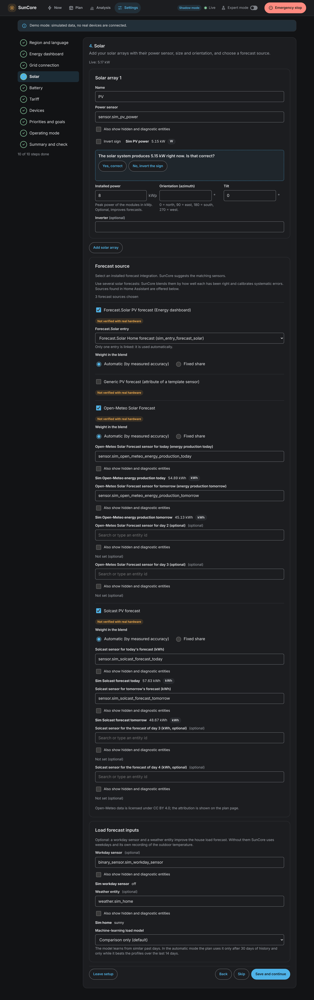 |

## Was bewusst noch nicht geändert ist (kommt in 7-E, 7-F, 7-G)

- **Jetzt (7-E):** doppelte Werte (Flussdiagramm und vier Kacheln darunter) werden zu einer Karte
  „Energie jetzt“ mit den Werten neben dem Fluss; Überschuss zieht in diese Karte; „Braucht dich“
  nur bei offenen Vorschlägen; „Als Nächstes“ auf drei Einträge gekürzt; Gerätekarten einheitlich
  und eingeklappt (Name, Zustand, Leistung, Modus, eine Hauptaktion), Details und „Warum?“ im
  aufgeklappten Teil; „Letzte Entscheidungen“ auf drei Einträge.
- **Plan und Analyse (7-F):** eine Kopfzeile mit 24/48-h-Umschalter, Neu-planen und Planer-Status;
  Legende unter dem Diagramm; Rückblick und Prognosegüte als einklappbare Karten; Verlauf mit
  `Stat`-Kacheln; Entscheidungsfilter auf dem Handy in einem Bottom-Sheet.
- **Einstellungen und Einrichtung (7-G):** Einstellungen als Übersicht mit Gruppen und je einer
  Unterseite (auf dem Desktop zweispaltig), Expertenmodus unter *Erweitert* statt in der
  Kopfleiste; Einrichtung mit vier Etappen statt zehn Schritten in der Seitenleiste, eine feste
  Fußleiste, erweiterte Felder eingeklappt; jeder Schritt und jede Unterseite lädt erst bei Bedarf
  (Ziel erste Anzeige ≤ 115 kB).
- Die Bestätigungsdialoge ziehen in 7-G auf den neuen `Sheet`-Baustein (auf dem Handy von unten).

## Fragen an den Maintainer

1. **Gesamteindruck:** Passen Ruhe, Abstände und Kartenstil so als Richtung für 7-E bis 7-G?
   Ohne Antwort geht es mit diesem Stand weiter.
2. **Kopfleiste auf dem Handy:** Marke als Symbol ohne Schriftzug, Not-Aus mit Kurzlabel „Stop“
   (deutsch „Not-Aus“). In Ordnung, oder soll der volle Text stehen (dann wird die Leiste
   zweizeilig)?
3. **Akzentfarbe:** Standard ist jetzt ein tieferes Blau (`#0369a1`) statt des bisherigen
   Petrol-Blaus; im HA-Theme gilt ohnehin dessen Primärfarbe. Passt das?
4. **Expertenschalter** bleibt bis 7-G in der Kopfleiste und zieht dann nach *Einstellungen →
   Erweitert*. Einverstanden?
