# Design-Durchgang, Schritt 7-E: die Ansicht „Jetzt“ und die Karten

„Jetzt“ ist die Seite, die beim Öffnen zuerst erscheint. Dieser Schritt baut sie neu auf: ein
Wert steht nur noch an einer Stelle, Erklärungen sind eingeklappt, und alle Karten haben
denselben Aufbau. Grundlage sind die Tokens und Bausteine aus 7-D
([Prüfstopp 1](review-7d.md), [ADR-0019](../adr/0019-ui-design-system.md), Plan
[`phase-7.md`](../plans/phase-7.md) WP5).

Alle Bilder stammen aus dem Demo-Modus (Szenario `summer_day`, Start 09:30, englisch) mit den
neuen flexiblen Demo-Geräten aus 7-C (`SUNCORE_DEMO_FLEX=1`: Wallbox, Waschmaschine,
Wärmepumpe). Größen: Handy 390×844 und Desktop 1280×800, hell und dunkel, doppelte Pixeldichte,
ganze Seiten. Die Vorher-Bilder aus 7-D zeigen die drei älteren Demo-Geräte; die drei neuen
Karten kommen in den Nachher-Bildern dazu, die Seite ist dadurch länger.

## Was sich geändert hat

| Bereich | Vorher (7-D) | Nachher (7-E) |
| --- | --- | --- |
| Energiefluss | Diagramm mit Werten in kleinen Kästen, darunter vier Kacheln mit **denselben** Werten | eine Karte „Energie jetzt“: Solar oben, Netz – Haus – Batterie darunter, je Symbol in der Energiefarbe, großer Wert und Zustand; Ladestand mit Balken an der Batterie; Linien laufen in Flussrichtung. Jeder Wert steht einmal. |
| Überschuss | eigene Karte, langer Erklärsatz immer sichtbar | Teil der Energie-Karte (Desktop rechts daneben, Handy darunter): freier Überschuss, Defizit, läuft mit Überschuss, würde laufen; Erklärung hinter „Was bedeutet ‚würde laufen‘?“ |
| Batterie | Werte, Grenzenliste, dreigeteilter Modus-Balken über die volle Breite, „Warum?“-Link | Ladestand groß mit Balken, Leistung und Zustand daneben; Modus als kompakter Umschalter (Schatten · Assistiert · Automatik); Grenzen und „Warum?“ als ruhige Schalter in der Fußzeile |
| Nächste Aktionen | vier Einträge, jeder mit eigenem „Warum?“-Link und viel Abstand | Zeitleiste mit drei Einträgen: Uhrzeit, kurze Beschreibung, Chip; die ganze Zeile klappt die Begründung auf. Auf dem Desktop neben der Batterie |
| Gerätekarten | unterschiedlich hoch; „Modus von X“ als Überschrift, „Warum?“ und „Manuell übernehmen“ als Links untereinander | einheitlich: Name und Modus-Chip, Zustand und Leistung, kompakter Modus-Umschalter; „Warum?“ und „Manuell übernehmen“ in einer ruhigen Fußzeile, die ihr Feld darunter aufklappt. Karten einer Reihe sind gleich hoch |
| Phase-6-Karten | Wallbox, Wärmepumpe, Programm mit eigenen Linien und eigenem Umschalter | gleiche Sprache: kleine Abschnittsüberschrift (LADEN, WÄRMEPUMPE, PROGRAMM), gleiche Wertepaare, Lademodus mit demselben Umschalter. Warnungen bleiben: Abbrechen eines Steckdosen-Programms und „Zurück zum Normalbetrieb“ warnen weiter, dass die Steckdose EINschaltet |
| Letzte Entscheidungen | fünf Zeilen, jede mit „Schattenmodus: nur berechnet, nichts geschaltet.“ | höchstens vier Zeilen (Uhrzeit, Gerät, Aktion, Chip); ein Hinweis, den alle Zeilen teilen, steht einmal oben; Link zum Entscheidungsprotokoll |
| Netz-Hinweise (Insel, §14a, Spitze) | Chips über dem Diagramm | unverändert über der Energie-Karte, nur wenn etwas vorliegt |
| Begründungen | Gerätekennung klein am Satzanfang („wallbox charges …“) | Anzeigename des Geräts und großer Anfangsbuchstabe („Garage wallbox charges …“), auch im Deutschen; gilt für alle Begründungen (Jetzt, Plan, Entscheidungsprotokoll) |
| Freier Überschuss | konnte negativ sein („-100 W“) | nie unter 0 W: ein negativer Wert heißt nur „kein Überschuss“ (Reserve nicht gedeckt), so rechnet auch die Sicherheitsprüfung; Bezug durch gesteuerte Geräte steht als Defizit daneben |
| Zustand einstellbarer Lasten | „Level 0 W“ (Zustand und Leistung vermischt) | Stufe 0 heißt „Aus“; andere Stufen wie bisher mit Einheit |

Reihenfolge von oben: Hinweise (nur bei Bedarf) – Energie jetzt – „Braucht dich“ (nur bei
offenen Vorschlägen) – Batterie und nächste Aktionen – Geräte – letzte Entscheidungen.

Die Zeitleiste der geplanten Aktionen ist ein gemeinsamer Baustein; die Liste auf der Plan-Seite
sieht deshalb schon jetzt genauso aus (der Rest der Plan-Seite folgt in 7-F).

### Was erreichbar bleibt

- Modus je Gerät und der Batterie: jede Option ist eine eigene Taste mit vollem Namen für
  Vorleser („Automatic mode“); Automatik fragt weiter nach, die Batterie fragt bei Assistiert und
  Automatik. Pfeiltasten wechseln den Modus bewusst nicht von selbst.
- „Manuell übernehmen“, „Jetzt fortsetzen“ und der Not-Aus (Kopfleiste) unverändert.
- „Warum?“ an Geräten, Batterie und jeder geplanten Aktion: eingeklappt, aber mit einem Tipp offen;
  der Inhalt bleibt im Dokument.
- `#/?device=<id>` scrollt weiter zur Karte und setzt den Fokus darauf.

### Barrierefreiheit und Technik

- Der Energiefluss ist jetzt Text: eine Liste „Current power values“ mit einem Eintrag je Knoten;
  Linien und Pfeile sind Dekoration. Die frühere Extra-Liste für Vorleser entfällt.
- axe ohne Befund (Playwright, Jetzt auf Desktop, Tablet und Handy); keine waagerechte
  Scrollleiste bei 375 und 390 px; Bewegung entfällt bei „Bewegung reduzieren“.
- Neue Bausteine: `ToggleGroup` (Umschalter mit `aria-pressed`), `CardFooter` (ruhige Fußzeile
  mit aufklappbaren Feldern), drei Symbole (Haus, Batterie, Netz); `Card` kann jetzt `article`
  sein und streckt die Fußzeile ans Ende (gleiche Höhen).
- Batteriekarte und „Nächste Aktionen“ behalten ihre eigene Höhe (keine leere Fläche unter dem
  Umschalter). In den Gerätekarten sitzt die Fußzeile immer am Kartenende, auch auf dem Tablet
  (zwei Spalten, geprüft bei 768 px).
- Bundle: erste Anzeige 118,9 → 120,5 kB (Budget 125), Standardpfad 243,7 → 245,8 kB
  (Budget 250), Experten-Extras 25,4 kB unverändert.

## Vorher / Nachher

### Jetzt

| | Vorher (7-D) | Nachher (7-E) |
| --- | --- | --- |
| Handy hell | 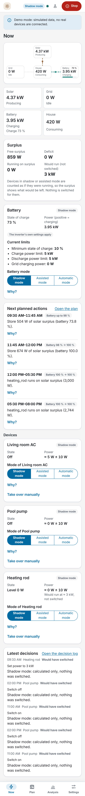 | 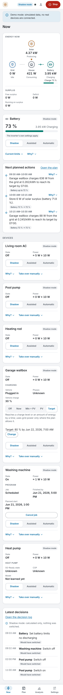 |
| Handy dunkel | 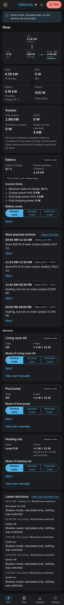 | 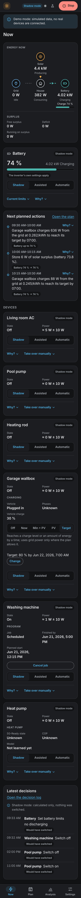 |
| Desktop hell | 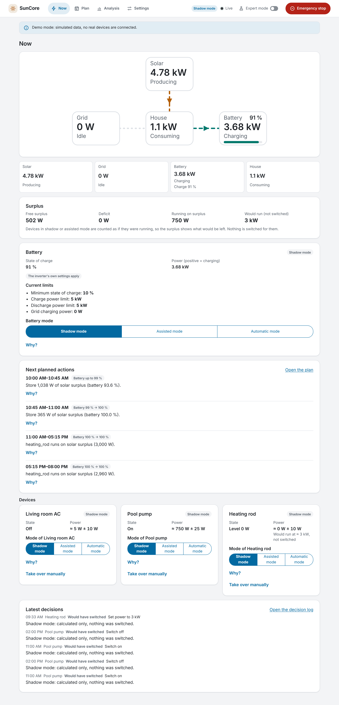 | 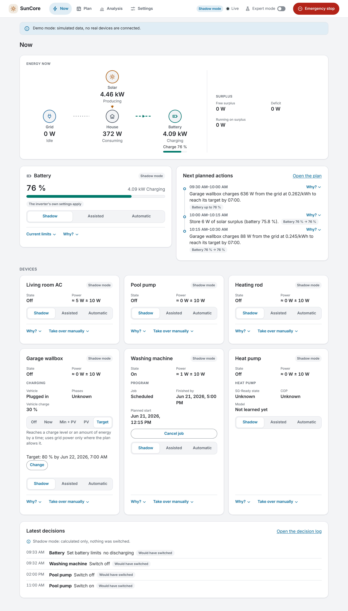 |
| Desktop dunkel | 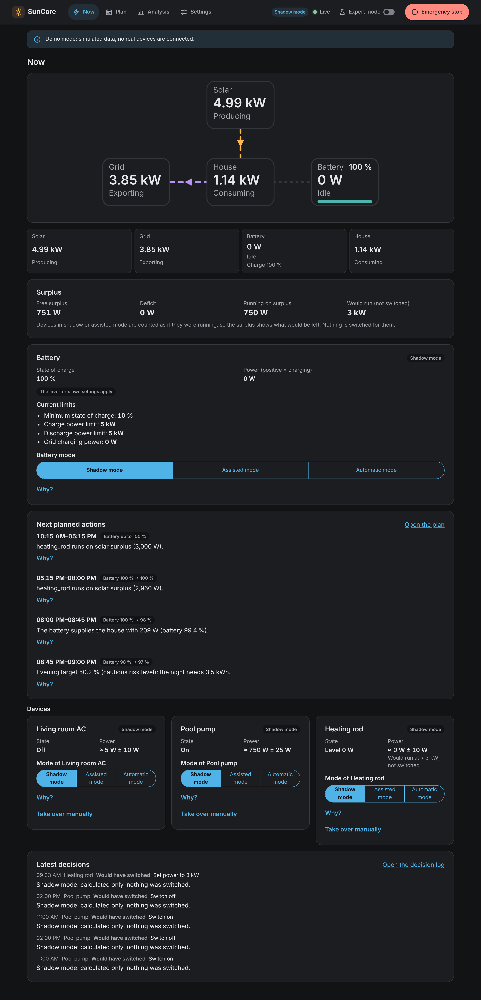 | 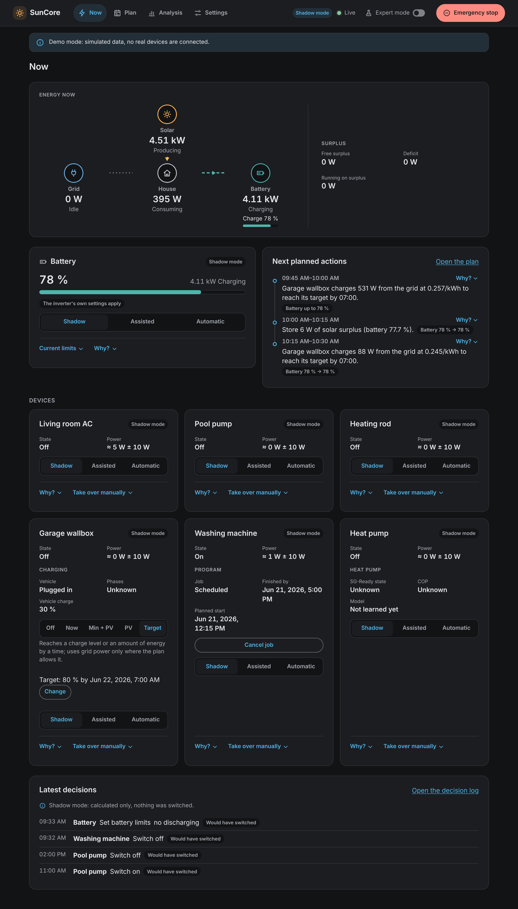 |

### Gerätekarten (Ausschnitt, nachher)

| | Hell | Dunkel |
| --- | --- | --- |
| Handy | 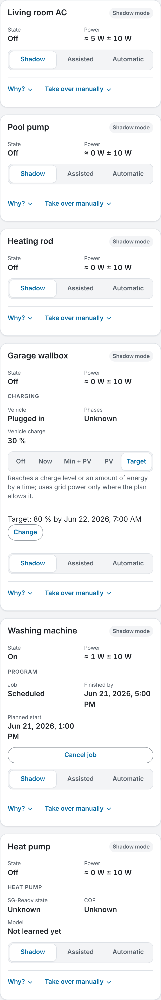 | 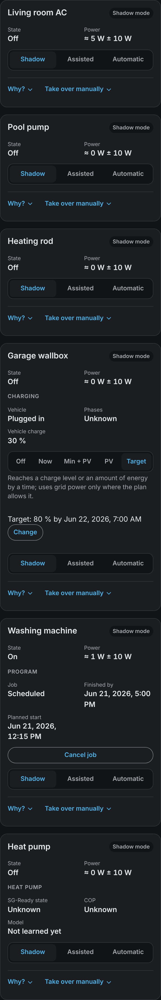 |
| Desktop | 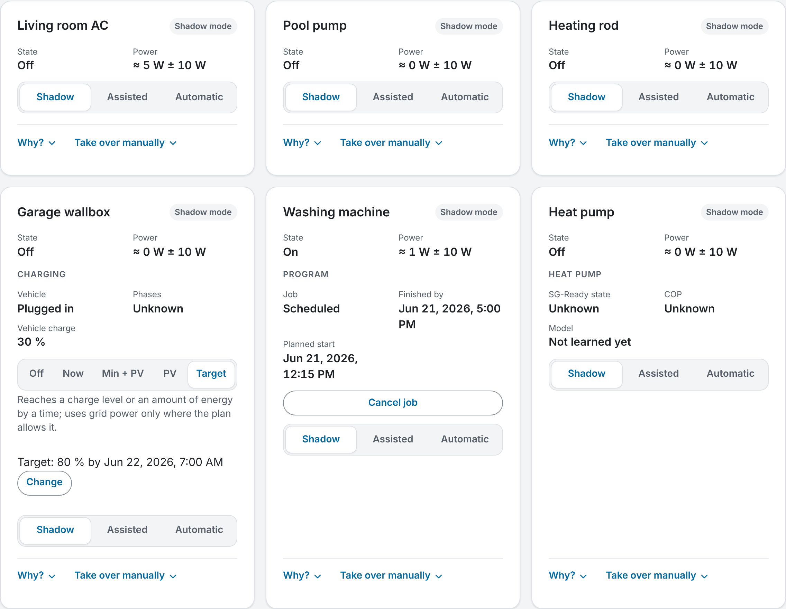 | 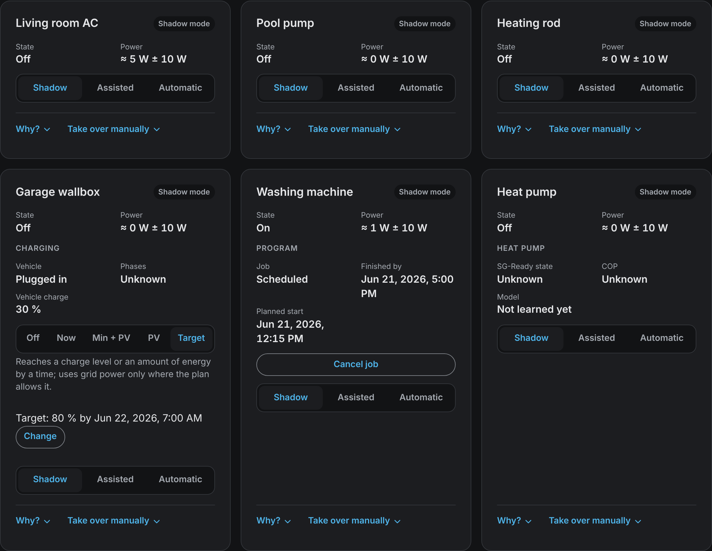 |

## Fragen an den Maintainer

1. **Batteriewerte doppelt?** Ladestand und Leistung stehen im Energiefluss und – groß, mit
   Balken – auf der Batteriekarte, wie gewünscht. Soll die Batteriekarte stattdessen nur Modus,
   Grenzen und „Warum?“ zeigen? Ohne Antwort bleibt es so.
2. **Kurzlabels im Modus-Umschalter** („Schatten · Assistiert · Automatik“, englisch „Shadow ·
   Assisted · Automatic“); der Chip oben rechts nennt weiter den vollen Namen. In Ordnung?
3. **Drei nächste Aktionen und vier Entscheidungen** auf „Jetzt“; der Rest im Plan bzw. im
   Protokoll. Passt die Menge?
