# Design-Durchgang, Schritt 7-F: Plan und Analyse

Nach „Jetzt“ (7-E) bekommen die Seiten *Plan* und *Analyse* (Verlauf, Entscheidungsprotokoll,
Was-wäre-wenn) dieselbe ruhige Sprache: eine Werkzeugleiste statt mehrerer Kästen, Details
eingeklappt, Karten mit gleichem Aufbau, Zahlen als `Stat`. Grundlage sind die Tokens und
Bausteine aus 7-D ([Prüfstopp 1](review-7d.md), [ADR-0019](../adr/0019-ui-design-system.md))
und die Karten aus [7-E](review-7e.md); Plan [`phase-7.md`](../plans/phase-7.md) WP5.

Alle Bilder stammen aus dem Demo-Modus (Szenario `summer_day`, Start 09:30, englisch,
`SUNCORE_DEMO_FLEX=1`). Größen: Handy 390×844 und Desktop 1280×800, hell und dunkel, doppelte
Pixeldichte, ganze Seiten. Vorher = Stand 7-E (`phase-7/e-now`), aufgenommen mit derselben
Testdatei (`e2e/review-shots.spec.ts`, neu: Plan live, Entscheidungsprotokoll, Was-wäre-wenn).

## Was sich geändert hat

### Plan

| Bereich | Vorher (7-E) | Nachher (7-F) |
| --- | --- | --- |
| Kopf | Titel, zwei graue Kästchen, langer Einleitungstext | Titel mit farbigen Chips (Optimierer, „Die Steuerung folgt diesem Plan“ grün; veraltet gelb), Einleitung darunter in Lesebreite |
| Steuerung und Planer | zwei Karten: Zeitraum + „Jetzt neu planen“, darunter „Planer“ mit drei Zeilen in zwei Spalten und „Warum?“ | eine Werkzeugleiste: Umschalter 24 h · 48 h · Heute (wie die Modus-Umschalter auf „Jetzt“), „Jetzt neu planen“ rechts; darunter eine ruhige Zeile „Plan von … · Letzter Lauf … · Nächster Lauf …“ und „Warum dieser Plan?“ eingeklappt |
| Zurückblicken | eigene Karte mit aufklappbarem Text-Link | einklappbare Karte, anfangs zu (das Diagramm kommt zuerst); offen nur bei einem Link auf einen vergangenen Tag, einen Zeitpunkt oder einen Vergleich; Tag vor/zurück als Pfeil-Symbole |
| Diagramm | Karte mit Titel, langem Bedienhinweis, Zoom-Leiste, Diagramm, CSV-Links; Tabelle und Geräteplan als zwei weitere Karten | eine Karte: Bedienhinweis hinter „Diagramm lesen und zoomen“, „Zurück zum aktuellen Plan“ oben rechts im Kartenkopf; Tabelle, Geräteplan und Vergleich als Aufklapper in derselben Karte; CSV-Links mit Symbol in der Fußzeile |
| Gerätezeilen im Diagramm | Kennungen wie „ac_bedroom“, „ac_living“ (die gespeicherten Demo-Pläne stammten vom Referenzhaus des Planers) | Anzeigenamen wie in den Begründungen („Living room AC“), auch in der Geräteplan-Tabelle und im Tooltip; die Demo speichert ihre Pläne jetzt mit ihrer eigenen Klimaanlage |
| Nächste Aktionen | volle Breite unter dem Diagramm | links neben den Prognosen (Desktop), gleiche Zeitleiste wie auf „Jetzt“ |
| Prognosen und ML-Lastmodell | eine lange Karte mit vier Tabellen, immer offen | zwei einklappbare Karten mit Status-Chip im Kopf („3 Quellen, alle aktuell“ bzw. „x Quellen prüfen“; „Profile aktiv“/„Modell aktiv“); Inhalt unverändert. Die Open-Meteo-Quellenangabe bleibt immer sichtbar unter den Karten (Lizenz) |

### Analyse – Verlauf

| Bereich | Vorher | Nachher |
| --- | --- | --- |
| Werkzeugleiste | Zeitraum als blauer Pillen-Balken, „Previous“/„Next“/„Today“ als drei Knöpfe | Umschalter Tag · Woche · Monat · Jahr, Pfeile zurück/vor um „Heute“, Datumsfeld |
| Kennzahlen | zehn gleich große Kacheln in zwei Reihen ohne Ordnung | drei Gruppen-Karten: **Energie** (Solar, Verbrauch, Netzbezug, Einspeisung mit Farbpunkt der Energiefarbe), **Eigenversorgung** (Autarkie, Eigenverbrauch, Batteriezyklen), **Kosten und Ersparnis** (Netzkosten, beide Ersparnisse) |
| „Woher die Ersparnis kommt“ | eigene Karte | Teil der Kosten-Karte, direkt unter den Zahlen, auf die sie sich bezieht |
| Diagrammkarten | Diagramm, darunter untereinander „PNG herunterladen“, „Diagrammdaten als Tabelle“, „CSV herunterladen“ | Diagramm, darunter **eine** Zeile: Tabelle zum Aufklappen links, PNG und CSV als ruhige Symbol-Links rechts (Handy: darunter) |
| Tabellen | eigene Stile je Karte | ein gemeinsamer Tabellenstil (`.data-table`): kleine graue Spaltenköpfe, Zahlen mit fester Ziffernbreite |
| „Am Plan zeigen“ (Tag) | Chip-Link | Link mit Plan-Symbol neben dem Zeitraum |

### Analyse – Entscheidungsprotokoll

| Bereich | Vorher | Nachher |
| --- | --- | --- |
| Filter | große offene Karte mit sieben Feldern, füllt auf dem Handy den ersten Bildschirm | einklappbare Karte „Filter“ mit Zähler „2 aktiv“; auf dem Handy anfangs zu (außer ein Link setzt Filter), ab Tablet offen |
| CSV-Export | bei den Filtern | oben in der Liste neben „1–18 von 18“ |
| Einträge | jeder Eintrag mit „Schattenmodus: nur berechnet, nichts geschaltet.“ und großem „Warum?“-Knopf | der gemeinsame Hinweis steht **einmal** oben (wie auf „Jetzt“); Ergebnis als farbiger Chip (verworfen/fehlgeschlagen rot, vorgeschlagen/gehalten gelb, ausgeführt grün); „Warum?“ als ruhiger Aufklapper rechts. Die Handy-Seite ist etwa halb so lang |

### Analyse – Was-wäre-wenn

Kopf wie die anderen Seiten, „Neuer Lauf“ als Abschnittsüberschrift, das Formular behält auf dem
Desktop eine Lesebreite (56 rem) statt Eingabefelder über 1100 px; Fortschritt mit Akzentrand.
Ergebnis- und Formular-Karten selbst sind unverändert (sie nutzen schon die Token-Stile).

### Was erreichbar bleibt

- Alle Funktionen und Test-IDs: Zeitraum 24/48 h/Heute (`range-*`, weiter `aria-pressed`),
  Neu planen, Zurückblicken, Vergleich, Zoom per Tastatur und Knöpfen, PNG und alle CSV-Exporte,
  Text-Alternativen (Tabelle, Geräteplan, Vergleich), alle Verlaufsdiagramme, Filter samt
  Teilen-Link, „Warum?“ mit Tastatur und Escape, Was-wäre-wenn im Expertenmodus.
- Eingeklappte Karten behalten ihren Inhalt im Dokument (`hidden`), Vorleser hören den
  Zustand (`aria-expanded`); der Bedienhinweis des Diagramms bleibt dessen Beschreibung
  (`aria-describedby`), auch wenn er eingeklappt ist.

### Barrierefreiheit und Technik

- axe ohne Befund in den Playwright-Tests (Plan hell/dunkel, Tag mit Vergleich, Verlauf
  hell/dunkel, Protokoll inkl. Handybreite, Was-wäre-wenn); keine waagerechte Scrollleiste.
- Karten und Aufklapper haben jetzt genau eine flexible Spalte: eine breite Tabelle scrollt in
  ihrer Karte, statt die Seite auf dem Handy zu verbreitern (im vollen E2E-Lauf gefunden).
- Einklappbare Karten zeigen den Pfeil jetzt **vor** dem Titel (wie „Warum?“-Aufklapper);
  der Status-Chip steht rechts daneben.
- Neue Symbole: zurück, vor, neu planen, herunterladen, Filter. Neue Schlüssel en/de für
  Gruppen, Zähler und Status-Chips (ICU-Plural).
- Bundle: die Bausteine aus `lib/ui` liegen jetzt in einem gemeinsamen Chunk `ui`. Seit Plan
  und Analyse sie auch nutzen, zerlegte Vite sie sonst in ein Dutzend Kleinst-Dateien (erste
  Anzeige 125,0 kB, Standardpfad 253,1 kB, beide über dem Budget). Erste Anzeige
  120,5 → 122,6 kB (Budget 125), Standardpfad 245,8 → 249,6 kB (Budget 250), Experten-Extras
  25,4 → 25,5 kB (Budget 30), ECharts unverändert.

## Vorher / Nachher

### Plan (live, 24 h)

| | Vorher (7-E) | Nachher (7-F) |
| --- | --- | --- |
| Handy hell |  | 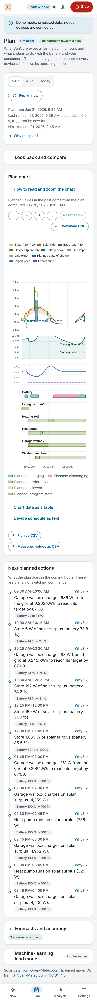 |
| Handy dunkel |  | 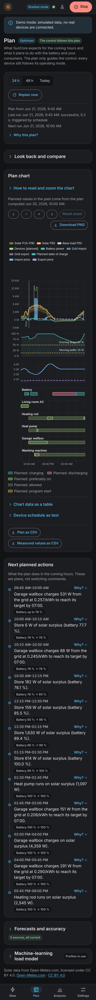 |
| Desktop hell | 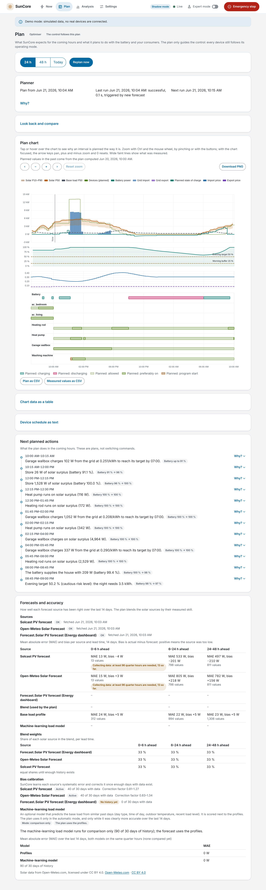 | 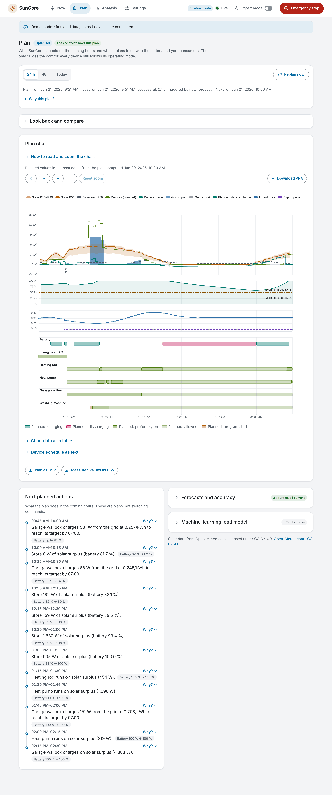 |
| Desktop dunkel | 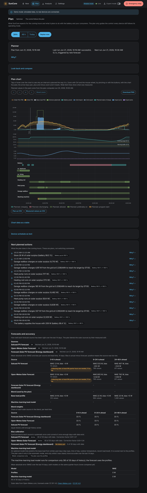 | 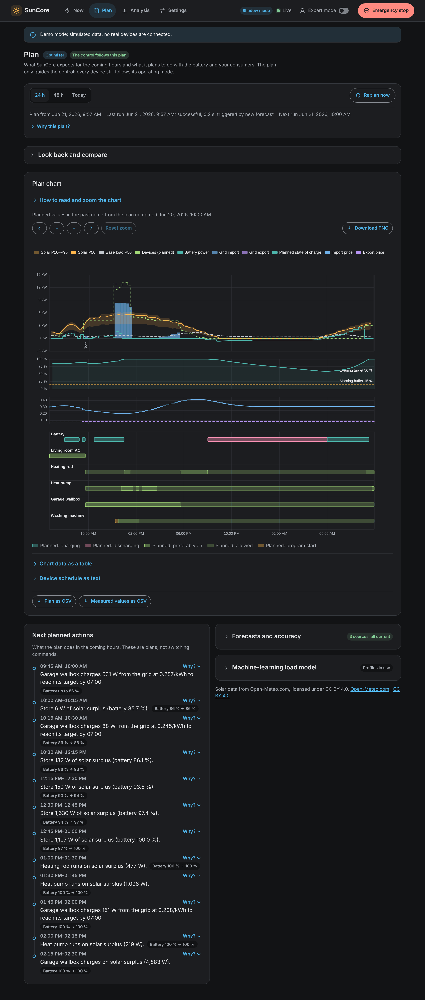 |

### Plan eines vergangenen Tags (20. Juni, mit Messwerten)

| | Vorher (7-E) | Nachher (7-F) |
| --- | --- | --- |
| Handy hell |  | 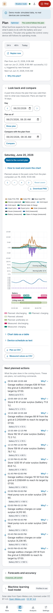 |
| Desktop dunkel | 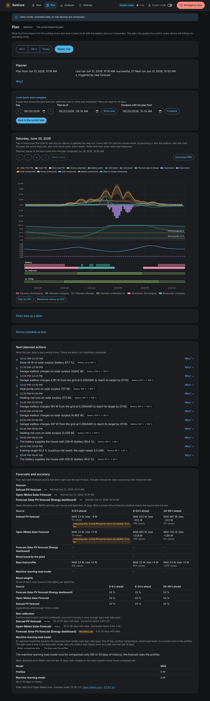 | 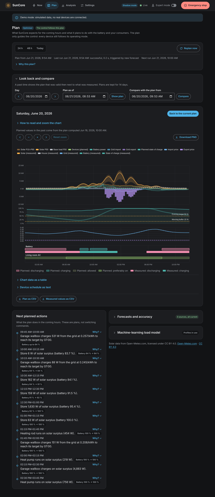 |

### Verlauf (Monat)

| | Vorher (7-E) | Nachher (7-F) |
| --- | --- | --- |
| Handy hell |  |  |
| Handy dunkel |  |  |
| Desktop hell |  | 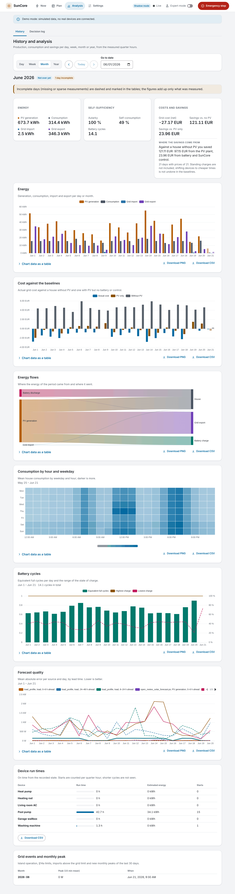 |
| Desktop dunkel |  | 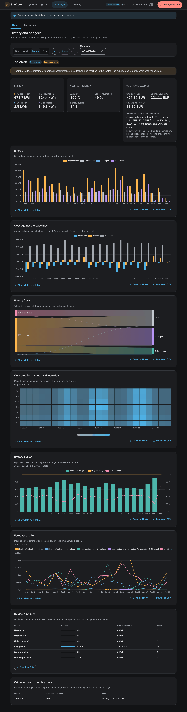 |

### Entscheidungsprotokoll

| | Vorher (7-E) | Nachher (7-F) |
| --- | --- | --- |
| Handy hell |  | 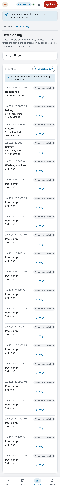 |
| Handy dunkel |  | 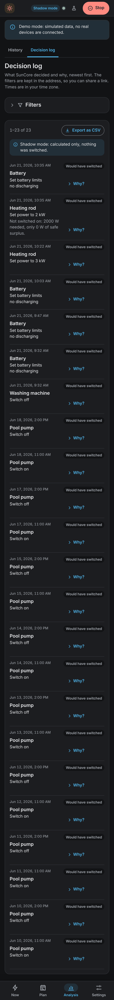 |
| Desktop hell | 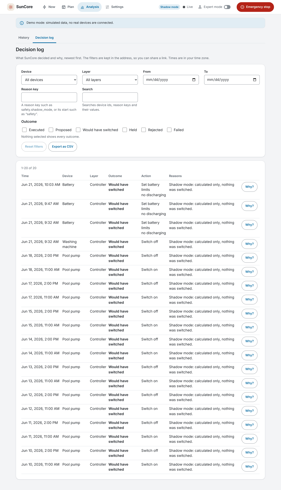 | 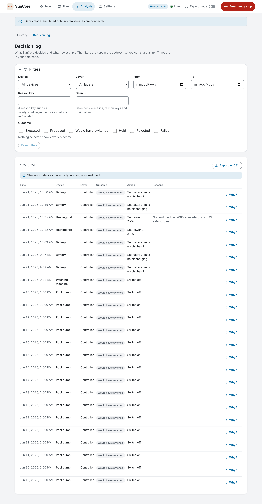 |
| Desktop dunkel | 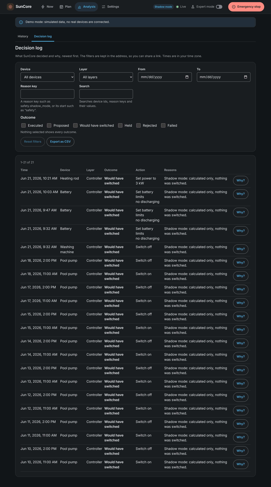 | 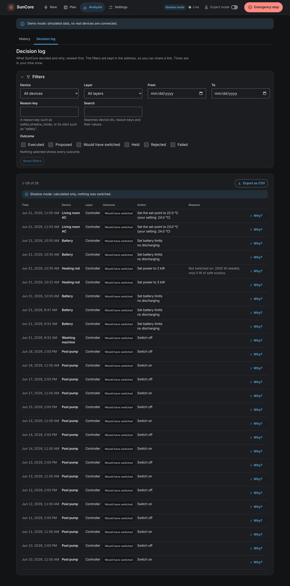 |

### Was-wäre-wenn (Expertenmodus)

| | Vorher (7-E) | Nachher (7-F) |
| --- | --- | --- |
| Handy hell | 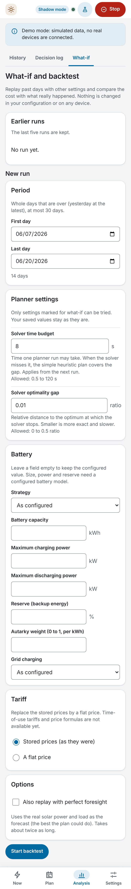 |  |
| Desktop dunkel | 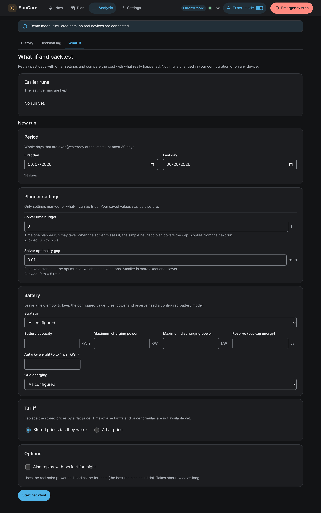 | 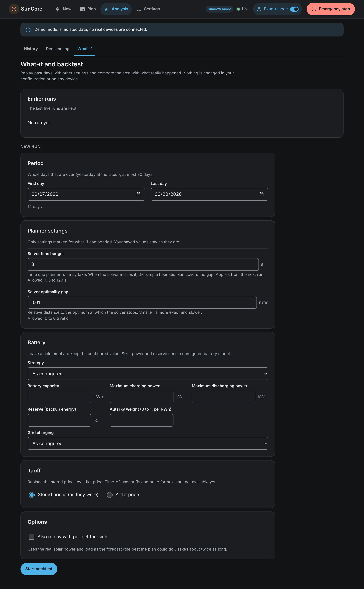 |

## Fragen an den Maintainer

1. **Prognosen eingeklappt?** „Prognosen und Genauigkeit“ und das ML-Lastmodell sind jetzt
   anfangs zu; der Status-Chip im Kopf sagt, ob alle Quellen aktuell sind. Sollen sie stattdessen
   offen starten (oder sich den Zustand je Browser merken)? Ohne Antwort bleibt es eingeklappt.
2. **Legende des Plan-Diagramms** bleibt oben (7-D hatte „unten“ für 7-F vorgesehen): das
   Diagramm hat vier gestapelte Bereiche, eine Legende unten stünde weit weg vom Hauptbereich und
   unter dem Geräteplan, der schon eine eigene Legende hat. Einverstanden?
3. **Filter auf dem Handy** starten eingeklappt (Zähler im Kopf zeigt aktive Filter). Der Plan
   nannte ein unteres Blatt (`Sheet`); das kommt mit 7-G. Reicht die einklappbare Karte, oder
   soll 7-G die Filter auf dem Handy in ein Blatt verschieben?
4. **Budget:** der Standardpfad liegt mit 249,6 kB knapp unter 250 kB. 7-G macht Wizard-Schritte
   und Einstellungsseiten zu eigenen Chunks und sollte wieder Luft schaffen; bis dahin ist jede
   weitere Ansicht in diesem Pfad eng. Soll ich vorher etwas zurücknehmen (z. B. die
   Ergebnis-Chips im Protokoll, ca. 0,4 kB)?
