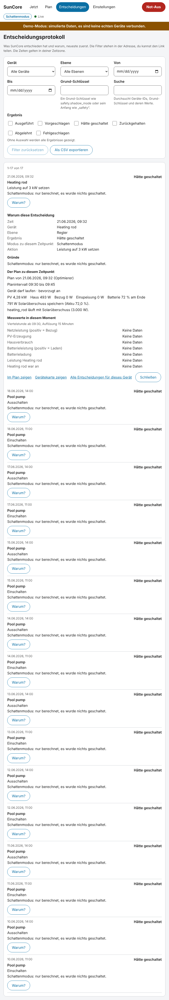

# Entscheidungen und "Warum?"

Jedes Mal, wenn SunCore ein Gerät schaltet, hält oder nicht schaltet, schreibt es eine
Entscheidung mit ihren Gründen. Die Ansicht **Entscheidungen** in der Kopfzeile listet sie auf,
und **Warum?** erklärt eine Entscheidung zusammen mit dem, was das System in dem Moment wusste.
Das funktioniert auch im Schattenmodus: Die Einträge sagen dann, was SunCore getan *hätte*.

## 1. Liste filtern

Die Liste ist eine Tabelle (Karten auf dem Handy) mit 50 Zeilen pro Seite. Filter:

- **Gerät** und **Ergebnis** (zum Beispiel angenommen, fehlgeschlagen, hätte geschaltet).
- **Ebene:** wer entschieden hat: Planer, Regler, du oder die Sicherheitsschicht.
- **Grund:** ein Grund-Schlüssel oder dessen Anfang.
- **Text:** durchsucht die Geräte-ID und die gespeicherte Entscheidung (Grund-Schlüssel und
  Werte), nicht den ausgegebenen Satz.
- Datum **von** und **bis**. Das Enddatum zählt mit.

Die Filter stehen in der Adresse (`#/decisions?device=...&from=...`). Kopiere den Link, um zur
gleichen Ansicht zurückzukehren. Nicht passende Werte in einem eingefügten Link werden verworfen.
Neue Einträge erscheinen nur auf Seite 1 live.

**CSV** lädt die gefilterte Liste herunter.

## 2. Warum?

Drücke **Warum?** in einer Zeile (Tastatur: Enter; Escape schließt das Panel und setzt den Fokus
auf die Zeile zurück). Das Panel zeigt:

- die Entscheidung und ihre Gründe in verständlicher Sprache,
- das Planintervall, in das sie fiel: das erlaubte Band und die erwarteten Flüsse,
- die Messwerte dieses Moments: Netz, PV, Hauslast, Akku, Ladestand sowie Leistung und Zustand
  des Geräts,
- die Entscheidungen unmittelbar davor und danach.

Die Messwerte sind die Rohwerte der damaligen Zeit, kein nachträglich berechneter Überschuss.

Vom Panel aus springst du zum **Plan zu dieser Zeit** (`#/plan?at=<Zeit>`, das Intervall ist
markiert), zur **Gerätekarte** in der Ansicht Jetzt und zum **Protokoll dieses Geräts**.

## 3. Die Antwort lesen

"Warum hat die Wärmepumpe um 12:10 nicht eingeschaltet?" Typische Antworten: Der Überschuss lag
zu kurz über der Schwelle (Hysterese), der Plan zog bei diesem Preis den Akku vor, die
Mindestpause war nicht um, oder die Sicherheitsschicht hat das Schreiben gesperrt. Jede davon ist
ein Grund mit Zahlen. Eine Entscheidung ohne Grund ist ein Fehler; bitte melde sie.

Der zu einer Entscheidung gehörende Plan-Schnappschuss wird 14 Tage aufbewahrt; danach sagt der
Planlink, dass kein Plan gespeichert ist.

## Siehe auch

[Plan-Diagramm](plan-chart.md) · [Überschusssteuerung](surplus-control.md) ·
[Planung und Akkusteuerung](planning-and-battery.md)
