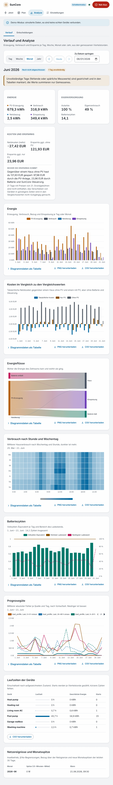

# Verlauf und Analyse

Die Ansicht **Verlauf** beantwortet "Was hat mein Haus gemacht, und was hat SunCore gespart?" für
einen Tag, eine Woche, einen Monat oder ein Jahr. Sie liest die gemessenen Viertelstunden, die
SunCore speichert, und funktioniert deshalb auch im Schattenmodus. Sie ändert nichts an deinen
Geräten.

## 1. Zeitraum wählen

Öffne **Analyse → Verlauf**. Wähle **Tag**, **Woche**, **Monat** oder **Jahr** und
wechsle mit **Zurück**, **Weiter** und **Heute** oder mit **Zu Datum springen**. Der Zeitraum
steht in der Adresse (`#/history?period=week&date=2026-06-10`), du kannst also ein Lesezeichen
setzen oder den Link teilen.

- Ein Zeitraum, der noch läuft, ist mit **Noch nicht abgeschlossen** markiert.
- Ein Tag mit weniger als 80 % gemessenen Viertelstunden ist **unvollständig**: Er ist in den
  Diagrammen gestrichelt, in den Tabellen markiert und fließt nicht in Durchschnitte ein.
- Nach einem Update rekonstruiert SunCore bis zu 365 Tage vergangener Energie aus den
  Langzeitstatistiken von Home Assistant. Diese Stunden sind mit **aus HA-Statistiken
  rekonstruiert** markiert (der Anteil steht dabei). Für sie gibt es keine gespeicherten Preise,
  also auch keine Kosten.
- Einen freien Datumsbereich gibt es noch nicht, nur die vier Zeiträume und den Datumssprung.

## 2. Die Kacheln

| Kachel | Bedeutung |
|---|---|
| Autarkie | Anteil deines Verbrauchs, der nicht aus dem Netz kam |
| Eigenverbrauch | Anteil deiner Solarenergie, den du selbst genutzt hast (Haus und Akku) |
| Netzkosten (netto) | Bezugskosten minus Einspeiseerlös, mit den damals gespeicherten Preisen |
| Ersparnis ggü. ohne PV | Kosten eines Hauses ohne PV und Akku minus deine tatsächlichen Kosten |
| Ersparnis ggü. nur PV | Kosten eines Hauses mit deiner PV, aber ohne Akku und ohne SunCore-Steuerung, minus deine tatsächlichen Kosten |
| Batteriezyklen | Äquivalente Vollzyklen, gerechnet über die **nutzbare** Kapazität |

Dazu PV-Erzeugung, Verbrauch, Bezug, Einspeisung sowie niedrigster und höchster Ladestand.

### Was die Ersparnis bedeutet

Es gibt nicht "die" Ersparnis. SunCore zeigt deshalb zwei Vergleichswerte und die Aufteilung
dazwischen:

- **Ohne PV** ist das, was die Anlage bringt: jede kWh deiner Last aus dem Netz.
- **Nur PV** ist ein Haus mit deiner Solaranlage, aber ohne Akku und ohne SunCore-Steuerung:
  gemessene Hauslast, Überschuss ins Netz. Der Unterschied zu deinen tatsächlichen Kosten ist,
  was **Akku und SunCore** beitragen. Der Kasten "Woher die Ersparnis kommt" nennt beide Teile in
  Zahlen.

Nicht enthalten: Grundgebühren und Einmalkosten zählen nicht zu den Kosten, Akku-Verschleiß
ebenfalls nicht, und das Verschieben von Geräten in günstigere Zeiten wird in den Vergleichswerten
**nicht** rückgängig gemacht (SunCore weiß nicht, wie die unverschobene Last aussähe). Kosten gibt
es nur für Tage, für die SunCore Preise gespeichert hat. SunCore schätzt nie vergangene Preise aus
dem heutigen Tarif, und eine Tarifänderung ändert keinen abgeschlossenen Tag.

## 3. Die Diagramme

Jedes Diagramm hat eine Datentabelle als Textalternative, einen **CSV**-Link und eine
**PNG**-Schaltfläche.

- **Energie:** Erzeugung, Verbrauch, Bezug und Einspeisung je Tag oder Monat.
- **Kosten gegenüber den Vergleichswerten:** tatsächliche Kosten neben den zwei Vergleichswerten.
- **Energieflüsse (Sankey):** woher die Energie kam und wohin sie ging. Die Regel ist fest: PV
  versorgt zuerst das Haus, dann den Akku, dann das Netz. Der Akku versorgt zuerst das Haus. Das
  Netz lädt den Akku nur um das, was PV nicht schafft.
- **Verbrauch nach Stunde und Wochentag:** eine Heatmap der mittleren Hauslast. Sie deckt
  mindestens die letzten 28 Tage ab.
- **Batteriezyklen:** äquivalente Vollzyklen je Tag und der Bereich des Ladestands.
- **Prognosegüte:** mittlerer absoluter Fehler und Abweichung je Quelle, nach Vorlaufzeit.
  Weniger ist besser. Die Abweichung ist Ist minus Prognose.
- **Laufzeiten der Geräte:** je gesteuertem Gerät, wie lange und wie oft es lief.

**Plan-Diagramm für diesen Tag** führt zur Planansicht eines vergangenen Tages (siehe
[Plan-Diagramm](plan-chart.md)); das geht, solange die Plan-Schnappschüsse aufbewahrt werden
(14 Tage).

## 4. Export

- **CSV:** UTF-8, Komma als Trenner, Punkt als Dezimaltrenner, ISO-8601-Zeit mit dem Offset
  deines Standorts, Einheiten in den Spaltennamen. Die Zahlen entsprechen denen der Diagramme.
  Eine Excel-Variante mit Semikolon und Dezimalkomma gibt es noch nicht.
- **PNG:** im Browser aus dem Diagramm gezeichnet, mit Titel und Zeitraum.

## 5. Wenn nichts zu sehen ist

- **Daten werden gesammelt** heißt: Für diesen Zeitraum gibt es noch keine Messwerte.
- **Der Verlauf ist nicht verfügbar** heißt: Die Zeitreihen-Datenbank konnte nicht geöffnet
  werden. Sieh ins Log der App.
- Tage aus der Zeit vor SunCore stammen nur dann aus den HA-Statistiken, wenn dein Home Assistant
  sie aufbewahrt hat. Wie weit das zurückreicht, ist `UNVERIFIED`.

## Siehe auch

[Entscheidungen und "Warum?"](decision-log.md) · [Plan-Diagramm](plan-chart.md) ·
[Was-wäre-wenn und Backtest](what-if-and-backtesting.md)
