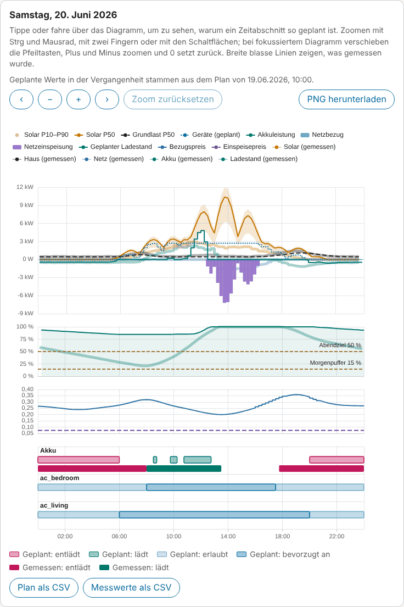

# Plan-Diagramm

Die Ansicht **Plan** zeigt, was SunCore für die nächsten 24 oder 48 Stunden vorhat, und seit
Phase 5 auch, wie das zu den Messwerten passt. Diese Seite beschreibt das Neue. Was der Planer
tut, steht in [Planung und Akkusteuerung](planning-and-battery.md).

## 1. Was du siehst

- **Geplant:** Preis, Solarleistung mit dem Band P10 bis P90, Hauslast, Ladestand, Akkuleistung,
  Netzbezug und Einspeisung.
- **Gemessen:** breite, blasse Linien unter den geplanten. Das Fenster beginnt drei Stunden vor
  jetzt, damit du den Plan an der Wirklichkeit messen kannst. Messwerte haben 15 Minuten
  Auflösung.
- Ein **Zeitplan je gesteuertem Gerät und für den Akku** (Gantt): geplante Balken sind
  umrandet, gemessene gefüllt. Ein Gerät gilt als gelaufen, wenn es mindestens die Hälfte des
  Intervalls an war. Der Akku zeigt Lade-, Entlade- und Sperrzeiten.
- **Tooltips** mit den Gründen des Intervalls.
- Eine Farblegende sowie unter den Diagrammen Tabellen und eine Textfassung des Zeitplans für
  Screenreader.

## 2. Zoomen und Verschieben

Die Felder teilen eine Zeitachse. Nutze die Schaltflächen oder die Tastatur im Diagramm:
Pfeiltasten verschieben, **+** und **-** zoomen, **0** setzt zurück. Der Zoom steht nicht in der
Adresse.

## 3. Zurückblicken und vergleichen

Das Panel **Zurückblicken und vergleichen** setzt Deep-Links:

- **Tag** zeigt einen vergangenen Tag (`#/plan?day=JJJJ-MM-TT`; der Verlauf verlinkt hierher).
- **Plan zum Zeitpunkt** zeigt den damals gültigen Plan (`#/plan?at=<Zeit>`; die Entscheidungen
  verlinken hierher, und das Intervall der Entscheidung ist markiert).
- **Vergleichen mit dem Plan von** zeichnet Ladestand und Akkuleistung des zweiten Plans
  gestrichelt und listet die abweichenden Intervalle.

Pläne werden **14 Tage** aufbewahrt. Für eine ältere Zeit sagt die Ansicht, dass kein Plan
gespeichert ist; die Messwerte erscheinen trotzdem. Für ein Fenster in der Vergangenheit stammen
die geplanten Werte aus einem Schnappschuss am Fensteranfang, nicht aus einem neuen Plan je
Stunde.

## 4. Export

**Plan als CSV**, **Messwerte als CSV** (die fünf Standort-Signale und höchstens drei Geräte) und
**Vergleich als CSV** sowie **PNG**.

## Siehe auch

[Verlauf und Analyse](history-and-analysis.md) · [Entscheidungen und "Warum?"](decision-log.md)
