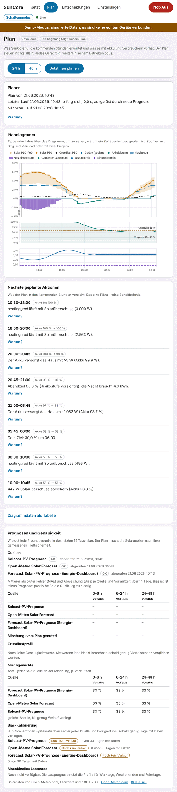
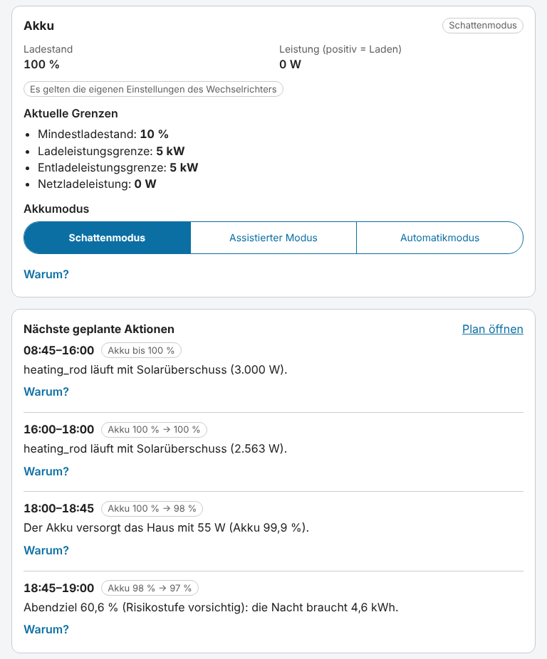
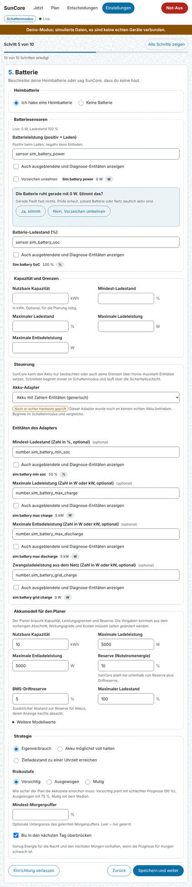

# Planung und Akkusteuerung

SunCore kann vorausschauen. Es liest die Solarprognosen und Preise der Integrationen, die du
ohnehin betreibst, lernt den Verbrauch deines Hauses, berechnet einen Plan für die nächsten
48 Stunden und setzt, wenn du es erlaubst, Grenzen an deinem Heimakku. Diese Seite erklärt, was
der Planer tut, was du einstellen kannst, wie der Akku **sicher** gesteuert wird und wie du
deinen ersten Akku vom Schattenmodus in den assistierten Modus nimmst.

Alles hier beginnt im **Schattenmodus**: Der Plan wird berechnet und angezeigt, und **in deinen
Akku oder Wechselrichter wird nichts geschrieben, bevor du es erlaubst**. Lies
[Bekannte Grenzen und UNVERIFIED](#10-bekannte-grenzen-und-unverified), bevor du dich darauf
verlässt: Planer und Akkusteuerung sind noch nie an echter Hardware gelaufen.

## 1. Was der Planer tut

Der Planer berechnet einen Fahrplan für die **nächsten 48 Stunden in Schritten von 15 Minuten**.
Er läuft **alle 15 Minuten** und noch einmal, **wenn sich etwas ändert**: neue Preise, eine neue
Prognose, eine geänderte Einstellung, ein manueller Eingriff an einem Gerät, eine große
Abweichung vom Plan (der Akku liegt mehr als 10 Prozentpunkte neben dem geplanten Ladestand,
oder die Netzleistung weicht 30 Minuten lang um mehr als 1,5 kW ab) oder wenn du **Jetzt neu
planen** drückst. Läufe, die weniger als eine Minute auseinanderliegen, werden zusammengelegt.

Für jedes 15-Minuten-Intervall enthält der Plan die erwartete Solarleistung, die Hauslast, die
Akkuleistung, Netzbezug und Einspeisung, den geplanten Ladestand des Akkus und die Preise,
**und die Gründe**. Er minimiert, was du zahlst (Bezugskosten minus Einspeiseerlös plus ein
kleiner Verschleißkostenanteil für den Akku), innerhalb der Grenzen, die du setzt. Die Kosten sind
nicht alles: Deine Ziele (Morgenpuffer, Abendziel, dein eigener Ziel-Ladestand) gehören zum
Modell, und ein kleiner Bonus für Autarkie hält den Plan bei flachen Preisen vernünftig (siehe
[Das Autarkie-Gewicht](#das-autarkie-gewicht)).

- **Optimierer oder regelbasiert.** Normalerweise findet ein Optimierer (HiGHS) den Plan. Er hat
  ein Zeitbudget (standardmäßig 8 Sekunden), und vorher wird als Sicherheitsnetz ein
  regelbasierter Plan berechnet. Wird der Optimierer nicht rechtzeitig fertig, kann er das Modell
  nicht lösen, ist nicht verfügbar oder liefert einen Plan, der die Zulässigkeitsprüfung nicht
  besteht, gilt der **regelbasierte Plan**, und die Planansicht sagt es (Marke **Regelbasiert**
  statt **Optimierer**, mit dem Grund). Der regelbasierte Plan ist einfacher: erst der Akku bis
  zum Morgenpuffer, danach Verbraucher mit Überschuss, solange das Abendziel erreichbar bleibt,
  Netzladen nur, um ein Ziel zu erreichen.
- **„Warum?“** Jedes Intervall trägt Gründe in verständlicher Sprache, zum Beispiel „Abendziel
  60,6 % (Risikostufe vorsichtig): Die Nacht braucht 4,6 kWh“ oder „Akku halten bei 0,287/kWh:
  Seine Energie ist um 19:00 mehr wert“. Du findest sie in der Planansicht (Tooltip, Liste
  **Nächste geplante Aktionen**) und in der Ansicht **Jetzt**.
- **Der Plan führt, der Regler entscheidet.** Der Echtzeit-Regler aus der
  [Überschusssteuerung](surplus-control.md) hat alle paar Sekunden das letzte Wort. Der Plan setzt
  Bänder (wie viel Leistung ein Gerät nutzen darf, „Akku zuerst bis X %“), und der Regler vergleicht
  sie mit dem, was wirklich passiert. Ein **veralteter Plan** (älter als 2 Stunden) oder gar kein
  Plan heißt: Der Regler verhält sich genau wie ohne Planer. Schatten, assistiert und Automatik
  gelten für die Wirkung des Plans wie bisher.

Die Ansicht **Plan** zeigt ein Diagramm der nächsten 24 oder 48 Stunden (Solar mit seinem
P10-bis-P90-Band, Hauslast, Akkuleistung, Netzbezug und Einspeisung, den geplanten Ladestand mit
Morgenpuffer und Abendziel als Linien sowie Bezugs- und Einspeisepreis), den Zustand des Planers
(letzter Lauf, Auslöser, nächster Lauf, Fehlschläge), die **Nächsten geplanten Aktionen** mit
**Warum?**, eine Tabellenfassung des Diagramms für Screenreader und das Feld **Prognosen und
Genauigkeit**. Der Plan ist ein Plan, kein Schaltbefehl: Jedes Gerät folgt weiterhin seinem
eigenen Betriebsmodus.

## 2. Prognosen

### Solar

SunCore ruft von sich aus keinen Wetterdienst auf. Es liest die Prognosen von Integrationen, die
du installiert hast, im Einrichtungsschritt 4 (**Photovoltaik**, Abschnitt **Prognosequellen**):

| Quelle | Hinweise |
|---|---|
| Solcast | Liest die Prognose-Attribute der Integration (P10, P50, P90) oder deren lesende Abfrage-Aktion. SunCore ruft nie die Solcast-API auf. |
| Forecast.Solar | Die Core-Integration, gelesen über das Energie-Dashboard. Bei mehreren Einträgen wählst du den für diese Anlage. |
| Open-Meteo Solar Forecast | Die HACS-Integration. |
| Generisch | Eine Vorlage, die Attribute einer Entität auf eine Prognosekurve abbildet. |

Du kannst **mehrere Quellen** gleichzeitig nutzen. Ihre Prognosen werden **nach gemessener
Treffsicherheit gemischt**: SunCore vergleicht jede Nacht jede Quelle mit dem, was deine Module
in den letzten 14 Tagen wirklich erzeugt haben, und gibt besseren Quellen mehr Gewicht (jede
Quelle behält einen Mindestanteil). Solange noch nicht genug Tage verglichen wurden, zählen alle
Quellen gleich. Du kannst auch je Quelle einen festen Anteil setzen (**Gewicht in der
Mischung**).

Darüber hinaus lernt SunCore den **systematischen Fehler** jeder Quelle (zum Beispiel „morgens
bei Bewölkung zu hoch“) je Tagesstunde, Jahreszeit und Wetterklasse und korrigiert ihn. Diese
**Kalibrierung wird nach 30 Tagen mit Daten aktiv**; davor werden die Prognosen so genutzt, wie
sie geliefert werden, und das Feld zeigt „0 von 30 Tagen mit Daten“. Stunden, in denen der
Wechselrichter oder die Einspeisegrenze die Leistung **abgeregelt** hat, werden erkannt und aus
dem Lernen herausgehalten, damit eine gedrosselte Anlage der Prognose nicht beibringt, zu
pessimistisch zu sein.

Das Feld **Prognosen und Genauigkeit** (unter dem Plandiagramm) zeigt je Quelle, wie frisch ihre
Daten sind, ihren Fehler (MAE) und ihre Abweichung (Bias) je Vorlaufzeit (0 bis 6, 6 bis 24 und
24 bis 48 Stunden voraus), die Mischgewichte und den Stand der Kalibrierung. Bias ist Ist minus
Prognose: Positiv heißt, die Quelle lag zu niedrig. Werte erscheinen nach der ersten Nacht mit
genug Daten (bis dahin **Daten werden gesammelt**).

**Open-Meteo:** Die Daten der Integration Open-Meteo Solar Forecast stehen unter **CC BY 4.0**.
SunCore zeigt die Namensnennung „Solardaten von Open-Meteo.com, lizenziert unter CC BY 4.0“ im
Feld, sobald eine Open-Meteo-Quelle eingerichtet ist. SunCore bringt in dieser Version keinen
eingebauten Open-Meteo- oder anderen Internet-Ersatz mit; ohne Prognosequelle rechnet der Plan
ganz ohne Solarstrom.

### Hauslast

Die Lastprognose lernt, was dein Haus **ohne die gesteuerten Geräte** verbraucht: Die Grundlast
ist der Hausverbrauch minus jedes Geräts, das SunCore steuern darf (diese werden getrennt
geplant). Sie baut für jede Viertelstunde ein Profil für **Werktage, Wochenenden und Feiertage**
auf, mit langsam verblassender Erinnerung (die letzten Wochen zählen mehr), und baut beim ersten
Start die letzten **28 Tage** aus den Langzeitstatistiken von Home Assistant nach, sodass sie
nicht bei null anfängt. Bis drei Tage bekannt sind, nutzt sie eine flache Schätzung mit breitem
Band; ganz ohne Verlauf rechnet der Plan mit flachen 500 W und plant keine Verbraucher (ein
Planhinweis sagt es).

Zwei optionale Eingaben in Schritt 4 (**Eingaben der Lastprognose**) verbessern sie:

- Ein **Arbeitstag-Sensor** (die Home-Assistant-Integration Workday). SunCore nutzt seinen Zustand
  für heute und fragt für andere Tage `workday.check_date`. Hat dein Sensor einen `days_offset`,
  berücksichtigt SunCore ihn: Home Assistant wertet den Sensor für das Datum plus Versatz aus,
  und SunCore gleicht das aus.
- Eine **Wetter-Entität**. Home Assistant führt keine Statistik über eine Wetter-Entität, deshalb
  zeichnet SunCore deren Außentemperatur selbst auf. Der Temperaturterm der Lastprognose wird
  nach 14 Tagen mit aufgezeichneter Temperatur aktiv.

Ein Lastmodell mit maschinellem Lernen ist **noch nicht verfügbar**; das Feld sagt es. Die Profile
funktionieren vom ersten Tag an.

## 3. Tarife

Schritt 6 (**Tarif**) sagt dem Planer, was Energie kostet. Der Bezugspreis kann sein:

- **Dynamisch** von Tibber, Nord Pool, ENTSO-E, EPEX Spot oder Octopus Energy über die
  Integration, die du ohnehin betreibst (wähle die Tarif-Vorlage; Nord Pool braucht die ID seines
  Konfigurationseintrags, die du unter **Entwicklerwerkzeuge → Aktionen** nachschlagen kannst),
  oder eine **generische Preisliste** oder nur ein **Preissensor**.
- **Fest** oder **fester Zeittarif (HT/NT)** mit Zeiträumen je Wochentag, Mitternachtsübergang
  und Monaten.

**Preisformel.** Viele Quellen liefern nur den **Börsenpreis** (den Marktpreis). Darauf kann der
Planer nicht optimieren, weil du Netzentgelt, Abgaben, Aufschlag und Mehrwertsteuer dazu zahlst.
Wähle unter **Was der Preis enthält** die Option **Nur Börsenpreis (Gebühren und Steuern kommen
dazu)**, schalte **Börsenpreis in meinen Endpreis umrechnen** ein und trage Faktor, Netzentgelt,
Abgaben, Aufschlag und MwSt ein (Endpreis = (Börsenpreis × Faktor + Netzentgelt + Abgaben +
Aufschlag) × (1 + MwSt)); optionale zeitvariable Netzentgelte (§14a EnWG Modul 3) lassen sich als
Zeitfenster ergänzen. Die Formel gilt **nur für Börsenpreise**: Der `price` von Tibber ist ein
Endpreis mit allem (wähle **Endpreis (alles enthalten)**), und ein fester Preis braucht keine
Formel. Eine Quelle, die reine Börsenpreise **ohne** Formel liefert, lehnt der Planer ab: Er
plant ohne Preisoptimierung (nur auf Autarkie) und sagt es („liefert reine Börsenpreise und es ist
keine Preisformel eingerichtet“), und die Systemprüfung warnt.

Die **Einspeisevergütung** ist **fest**, **gestaffelt nach Anlagengröße** (du trägst den Satz
jeder Stufe ein, zum Beispiel die zwei deutschen Sätze bis und über 10 kWp; die letzte Stufe muss
die ganze Anlage abdecken, das Regionsprofil enthält die amtliche Tabelle noch nicht) oder
**keine**. **Negativpreis-Regel:** In einer Region, in der bei negativen Preisen nicht vergütet
wird (Profil `de`), bewertet der Plan die Einspeisung in diesen Intervallen mit null und steckt
den Überschuss lieber in Akku und Verbraucher. Ein tatsächliches Abregeln des Wechselrichters wird
noch nicht gesteuert.

Die Day-ahead-Preise für morgen werden ab 13:00 Ortszeit erwartet; bis sie da sind, werden spätere
Stunden ohne Preis mit dem Median gefüllt und gekennzeichnet („mit dem Medianpreis geplant“), und
**Netzladen verlässt sich nie auf einen geschätzten oder unbekannten Preis**.

## 4. Ziele und Strategien

Das alles stellst du in Schritt 5 (**Batterie**: Abschnitte **Akkumodell für den Planer** und
**Strategie**) und Schritt 8 (**Prioritäten und Ziele**) ein.

### Risikostufe

Prognosen liegen manchmal daneben, und der Akku soll deshalb nicht leerlaufen. Die
**Risikostufe** sagt, wie sicher der Plan die Akkuziele erreichen muss:

| Risikostufe | Plant mit | Bedeutung |
|---|---|---|
| **Vorsichtig** (Standard) | einer schlechten Prognose (90 %) | Die Ziele werden in etwa **9 von 10 Fällen** erreicht. |
| **Ausgewogen** | 75 % | Die Ziele werden in etwa 3 von 4 Fällen erreicht. |
| **Mutig** | der mittleren Prognose (Median) | Die Ziele werden in etwa der Hälfte der Fälle erreicht. |

SunCore lernt, wie falsch die Prognosen tatsächlich sind, je Wetterklasse, aus dem Unterschied
zwischen der prognostizierten Nettoenergie (Solar minus Last) und dem, was passiert ist. Bis 30
Tage Verlauf vorliegen, nutzt es die P10/P90-Bänder der Quellen selbst (so gekennzeichnet). Der
gelernte Fehler bestimmt die Größe der Puffer: mehr Unsicherheit, größerer Puffer.

### Morgenpuffer, Abendziel, Überbrücken

- **Morgenpuffer** („Akku zuerst bis X %“). Bis der Akku X % erreicht hat, lädt der Solarüberschuss
  den Akku, bevor Verbraucher ihn bekommen. X wird aus der Prognose berechnet: höher, wenn der Tag
  unsicher ist, niedriger, wenn viel Solarenergie erwartet wird. Im Plandiagramm ist es die
  gestrichelte Linie **Morgenpuffer**. Der **Mindest-Morgenpuffer** (Schritt 5) ist deine eigene
  Untergrenze unter dem gelernten Wert; leer heißt nur gelernt. Oberhalb von X geht der Überschuss
  an Verbraucher, **solange der Plan sagt, dass das Abendziel noch erreichbar ist**. SunCore
  vergleicht X alle paar Sekunden mit dem **aktuellen** Ladestand, damit ein Tag, der vom Plan
  abweicht, richtig behandelt wird.
- **Abendziel** (gestrichelte Linie **Abendziel**). Der Ladestand, den der Akku zu Beginn des
  abendlichen Defizits haben soll, damit er das Haus durch die Nacht trägt: der Verbrauch der Nacht
  plus, bei eingeschaltetem **Bis in den nächsten Tag überbrücken**, die fehlende Energie eines
  schwachen Folgetags (der 48-Stunden-Horizont zeigt sie), auf der gewählten Risikostufe, höchstens
  bis zu deinem maximalen Ladestand. Er liegt nie unter deinem eigenen Ziel.
- **Dein Ziel.** Das Ziel **Batterie zu einer Uhrzeit auf einen Ziel-Ladestand bringen**
  (Schritt 8) ist eine **Untergrenze**: Der Plan hält den Akku zu dieser Zeit mindestens auf diesem
  Ladestand, und der Echtzeit-Regler hält den Akku vorn, solange er darunter liegt. Der Plan kann
  mehr verlangen, nie weniger.

Harte Grenzen (Reserve, maximaler Ladestand, dein Ziel, der Mindest-Morgenpuffer) setzt immer du,
und sie gewinnen immer gegen das Gelernte.

### Strategien

| Strategie (Schritt 5) | Was sie tut |
|---|---|
| **Eigenverbrauch** (Standard) | Gelernte Puffer wie oben; der Akku deckt die Nacht und überbrückt einen schwachen Folgetag, wo es sich lohnt. |
| **Akku möglichst voll halten** (`prefer_full`) | „Akku zuerst“ bis zum maximalen Ladestand, immer. Verbraucher bekommen nur Überschuss, den der Akku nicht aufnehmen kann. |
| **Zielladestand zu einer Uhrzeit erreichen** (`target_by_time`) | Nutzt das Ziel aus Schritt 8 (Ziel-Ladestand und Uhrzeit) als festes Ziel, zusätzlich zu den Puffern. |

### Das Autarkie-Gewicht

Schritt 8 hat das Expertenfeld **Autarkie-Gewicht je kWh**, Standard **0,01** (1 Cent je kWh in
deiner Währung). Stell es dir als winzigen Bonus für jede kWh vor, die du aus den eigenen Modulen
nutzt, statt sie zu kaufen: Der Plan bewertet sie mit 1 ct/kWh mehr als dem Preis. Es entscheidet
nur zwischen Möglichkeiten, deren Kosten sich um **weniger als 1 ct/kWh** unterscheiden, kostet
also höchstens 1 ct je kWh; es verhindert, dass der Optimierer bei flachem Tarif beliebig unter
gleich teuren Plänen wählt. **0** bedeutet reine Kosten.

### Netzladen

**Standardmäßig aus.** In Schritt 8, **Laden aus dem Netz**, wirkt **Laden des Akkus aus dem Netz
erlauben** nur zusammen mit mindestens einer Regel:

- einer **Preisgrenze** („nur bei einem Bezugspreis bis höchstens … laden“) und/oder
- einem **Wochenplan** (Zeitfenster, in denen Laden erlaubt ist; **Mit dem Nachtfenster
  22:00–06:00 füllen** gibt dir einen Anfang). Sind beide gesetzt, müssen beide erfüllt sein.

Bei einem **dynamischen Tarif** kommt eine dritte Regel dazu, der **Preisabstand**: SunCore lädt
nur, wenn ein späterer Preis hoch genug über dem Ladepreis liegt (plus Verschleißkosten und einem
Aufschlag von etwa 3 ct je kWh), um die Verluste zu bezahlen. **Ohne bekannten Preis lädt SunCore
nie aus dem Netz**, und es braucht deine **Anschlussgrenze für Bezug** (Schritt 3), damit es den
Anschluss nie überschreiten kann. Geladen wird nur in Intervallen, die der Plan erlaubt, und der
aktuelle Preis wird bei der Ausführung noch einmal geprüft.

Ob dein Wechselrichter tatsächlich zum Laden aufgefordert werden kann, ist eine Frage des Adapters,
siehe [Abschnitt 7](#7-adapter). **Kostal Plenticore lässt sich von SunCore nicht zum Laden aus dem
Netz zwingen:** Der Plan zeigt es als „würde laden“, und es wird nichts geschrieben.

## 5. Steuerung: Schatten, assistiert, Automatik

Der Akku hat in der Ansicht **Jetzt** eine eigene **Akku**-Karte und einen eigenen Modus, wie ein
Gerät:

| Modus | Was SunCore mit dem Akku tut |
|---|---|
| **Schattenmodus** (Standard) | Berechnet und zeigt, was es setzen **würde** („SunCore würde setzen“). Schreibt nichts. |
| **Assistierter Modus** | Schlägt Grenzen unter **Vorschläge warten auf dich** vor; **Bestätigen** führt einen aus, und er durchläuft trotzdem die Sicherheitsprüfungen. |
| **Automatikmodus** | Schreibt Grenzen selbst, innerhalb aller Grenzen. |

Der Akku handelt im **niedrigeren** von Gesamtmodus und eigenem Modus, genau wie ein Gerät. Das
**Umstellen des Akkus auf assistiert oder Automatik** verlangt eine Bestätigung, die die
**Identität** des Akkus trägt (den Adapter, seine zugeordneten Entitäten und die Ladestand- und
Leistungssensoren der Anlage). Änderst du den Adapter oder diese Entitäten oder importierst eine
Konfiguration, **fällt der Akku in den Schattenmodus zurück**, und ein gespeichertes
Einstellungsdokument kann den Modus nicht von allein anheben.

**Was SunCore schreibt: nur Grenzen.** Nie einen Leistungs-Sollwert. SunCore sagt dem
Wechselrichter, wie viel der Akku laden oder entladen **darf** oder bei welchem Ladestand er
aufhören muss (ein Mindest-Ladestand), und die eigene Eigenverbrauchsregelung des Wechselrichters
erledigt den Rest. Laden aus Solar braucht gar keinen Schreibvorgang. Braucht der Plan keine
Grenze, **gibt** SunCore den Akku **zurück**: Es stellt wieder her, was der Wechselrichter vorher
hatte (seine „Basis“), und der Wechselrichter arbeitet wieder selbstständig. SunCore schreibt nie
Werte über diese Basis hinaus, kann also nur **einschränken**, nie freigeben.

**Die wirksame Reserve** schützt die Energie, auf die du dich verlässt. Sie ist der **höhere** Wert
aus dem Mindest-Ladestand deines Wechselrichters (Schritt 5, **Mindest-Ladestand**) und der
**Reserve plus BMS-Driftreserve** (**Akkumodell für den Planer**; die Driftreserve, standardmäßig
5 %, ist für Akkus, deren Anzeige nachts absackt). Der Plan geht nie darunter, und die
Sicherheitsschicht verweigert einen Mindest-Ladestand darunter. SunCore hält **keine dauerhafte
Untergrenze** am Wechselrichter: Es schreibt einen Mindest-Ladestand nur für geplante Intervalle, in
denen der Plan Energie für später aufheben will, und deine eigene, niedrigere Untergrenze außerhalb
eines solchen Intervalls bleibt, wie sie ist.

**Prüfungen.** Jeder Schreibvorgang wird vom Gerät zurückgelesen (beide Kostal-Wege können ohne
Fehlermeldung scheitern), erfolgt nur bei Änderung und ist in der Rate begrenzt. Drei fehlgeschlagene
Schreibvorgänge in Folge pausieren die Akkusteuerung. Ein eingefrorener Akkuwert, ein unbekannter
Ladestand, ein veralteter Plan oder jede Störung pausiert die Steuerung und **gibt** den Akku
**zurück**. Eine Rückgabe ist erst vollständig, wenn das Zurücklesen die ursprünglichen Werte zeigt;
bis dahin versucht SunCore es erneut und schreibt nichts anderes.

**Wenn du selbst etwas änderst.** Eine Grenze, die du von Hand setzt (in der App des
Wechselrichters oder in Home Assistant), wird am Wert erkannt und **respektiert**: SunCore lässt los,
ohne zu schreiben, und hält sich bis **04:00 Uhr am nächsten Tag** zurück. Ein dokumentierter
Sonderfall: Ein Wert, den du wählst und den SunCore **selbst in derselben Regelphase schon versucht
oder geschrieben** hatte, sieht aus wie SunCores eigener Wert und wird bei der Rückgabe auf die
Basis zurückgesetzt. Das ist die sichere Richtung (die eigenen Einstellungen des Wechselrichters),
heißt aber, dass deine manuelle Wahl in diesem einen Fall verloren geht; wiederhole sie nach der
Rückgabe. Alles andere, was du geändert hast, bleibt.

**Not-Aus.** Die rote Taste in der Kopfzeile gibt den Akku wie jedes Gerät innerhalb von 10
Sekunden zurück, und es wird nichts geschrieben, bis du den Stopp beendest. Auch ein normales
**Stoppen**, ein Neustart oder ein Update der App gibt den Akku zurück, bevor die Verbindung
schließt. Nach einem Absturz ist die Aufzeichnung, was SunCore gehalten hat, gespeichert, und beim
nächsten Start wird der Akku zurückgegeben, sobald Home Assistant verbunden ist.

**Assistiert, bis der Timer gemessen ist.** Manche Adapter können von selbst auf die eigenen
Grenzen des Wechselrichters zurückfallen, wenn SunCore verstummt (Kostal Modbus kann das über einen
Timer im Wechselrichter). Bis du diesen Timer an deiner Anlage **gemessen** hast (siehe
[Abschnitt 7](#den-rückfall-timer-messen)), ist ein solcher Akku **auf den assistierten Modus
begrenzt**: Die Karte sagt es, und Automatik wirkt wie assistiert.

## 6. Ablauf: dein erster Akku in den assistierten Modus

Mach das an einem Tag mit Sonne (die Rückfall-Messung in
Abschnitt 7 braucht stattdessen den Abend), mit einem Akku weit über seiner Reserve und
während du zu Hause bist.

1. **Vorbereiten.** Beende den Einrichtungs-Assistenten. Trage in Schritt 5 die Kapazität, die
   maximale Lade- und Entladeleistung und die Reserve ein (**Akkumodell für den Planer**), wähle
   **Strategie** und **Risikostufe** (die Vorgaben passen) und einen **Akku-Adapter** (siehe
   [Abschnitt 7](#7-adapter)). Trage in Schritt 3 deine **Anschlussgrenze für Bezug** ein. Exportiere
   unter **Einstellungen** eine Sicherung.
2. **Im Schatten bleiben.** Sieh dir die Ansicht **Plan** einen oder zwei Tage an. Wirkt das
   Diagramm plausibel? Lies die Gründe unter **Nächste geplante Aktionen**. Liegt das Abendziel
   nahe an dem, was die Nacht wirklich braucht? Steht im Plan „Regelbasiert“ oder gibt es Warnungen
   (siehe [Fehlersuche](#9-fehlersuche))? In der Ansicht **Jetzt** zeigt die Akku-Karte **Aktuelle
   Grenzen** (was der Wechselrichter jetzt hat) und, wenn es passt, **SunCore würde setzen**.
3. **Prognosen prüfen.** Sieh dir nach der ersten Nacht **Prognosen und Genauigkeit** an. Eine
   Quelle mit riesigem Bias oder sehr alten Daten solltest du zuerst in Ordnung bringen.
4. **Akku auf assistiert stellen.** Wähle auf der Akku-Karte **Assistierter Modus**, lies den Dialog
   und bestätige. Auch der Gesamtmodus muss **Assistiert** oder **Automatik** sein (Schritt 9 oder
   **Einstellungen → Betriebsmodus**), sonst bleibt der Akku im niedrigeren. Die Geräte behalten
   ihre eigenen Modi.
5. **Auf einen Vorschlag warten.** Vorschläge erscheinen, wenn der Plan eine Grenze will, zum
   Beispiel eine Entladesperre („Akkuentladung zurückgehalten“ in **Nächste geplante Aktionen**).
   Das kann Stunden oder Tage dauern: Bei flachem Tarif und vollem Akku braucht der Plan vielleicht
   nie einen. Ein Vorschlag gilt 2 Minuten. **Bestätige** nur, wenn der Grund einleuchtet,
   sonst **Verwerfen**.
6. **Den ersten Schreibvorgang beobachten.** Nach **Bestätigen** zeigt die Karte **SunCore hält
   diese Grenzen**. Sieh auf das Display des Wechselrichters oder die Home-Assistant-Entität: Der Wert
   muss stimmen (SunCore prüft das selbst und meldet eine Abweichung). Kostal REST braucht bis zu 35
   Sekunden.
7. **Deine Ausgänge kennen.** **Schattenmodus** auf der Karte gibt den Akku zurück. **Not-Aus** in
   der Kopfzeile gibt ihn sofort zurück. Setzt du selbst eine Grenze, lässt SunCore bis 04:00 Uhr los.
8. **Erst dann über Automatik nachdenken**, nach mehreren Tagen sinnvoller Vorschläge. Adapter ohne
   Hardware-Rückfall (generisch, Kostal REST) sind nicht begrenzt, aber eine Grenze bleibt im
   Wechselrichter, bis SunCore sie zurückgibt oder neu startet: Bleib lange im assistierten Modus
   und betrachte das als bewusste Entscheidung.

## 7. Adapter

Wähle in Schritt 5 unter **Steuerung** den **Akku-Adapter**. Vorgabe ist **Nur beobachten (SunCore
schreibt nie)**: Der Akku gehört zum Plan, aber du stellst ihn selbst ein. Die Akku-Karte listet,
was der Adapter **einstellen kann**.

### Generisch: Home-Assistant-Entitäten

**Akku mit Zahlen-Entitäten (generisch).** Ordnet bis zu vier optionale `number`-Entitäten deiner
Akku-Integration zu: Mindest-Ladestand (%), maximale Ladeleistung, maximale Entladeleistung (W oder
kW) und eine Zwangsladeleistung aus dem Netz. SunCore setzt, was du zuordnest; leere Rollen
werden nicht genutzt. Es stellt auch wieder her, was die Zahlen vorher hatten. Der Adapter wurde
noch nie an einem echten Akku betrieben (**Nicht an echter Hardware geprüft**); beginne im Schatten
und vergleiche. Das ist der Adapter, wenn deine Integration über eine Zahl ein Laden aus dem Netz
erzwingen kann.

### Kostal Plenticore über die Home-Assistant-Integration

Adapter **KOSTAL PLENTICORE (Home-Assistant-Integration, Mindest-Ladestand)**. Er kann **nur den
Mindest-Ladestand** setzen (`Battery:MinSoc`): SunCore nutzt ihn als **Entladesperre** für geplante
Intervalle und gibt ihn danach zurück. Er kann **die Leistung nicht begrenzen und nicht aus dem Netz
laden** (die REST-Schnittstelle hat keinen solchen Sollwert): Ein geplantes Netzladen wird nur
**angezeigt** („würde aus dem Netz laden, aber der Adapter kann kein Laden erzwingen“), nie
ausgeführt. Weil die Zahl des Wechselrichters in 5-%-Schritten läuft, rundet SunCore **auf**. Ein
fehlgeschlagener Schreibvorgang bleibt in dieser Integration stumm, deshalb liest SunCore den Wert
nach etwa 35 Sekunden zurück und glaubt nur, was es sieht. Ohne Hardware-Rückfall bleibt die Sperre,
bis SunCore sie zurückgibt: SunCore sperrt nur für geplante Intervalle, nie unbegrenzt.

**Die Entität `Battery:MinSoc` ist in Home Assistant standardmäßig deaktiviert.** Aktiviere sie:

1. Öffne **Einstellungen → Geräte & Dienste** und die Integration **Kostal Plenticore**, dann dein
   Wechselrichter-Gerät.
2. Zeige die deaktivierten Entitäten an (ein Hinweis wie „+N Entitäten nicht angezeigt“ lässt sie
   aufklappen, oder nutze den Filter für deaktivierte Entitäten) und öffne die Zahl **Battery min
   SoC**.
3. Öffne ihre **Einstellungen** (Zahnrad), schalte **Aktiviert** ein und speichere. Home Assistant
   lädt die Integration nach etwa 30 Sekunden neu; die Entität zeigt dann einen Wert zwischen 5 und
   100 %.
4. Vergleiche den Wert mit dem Mindest-Ladestand auf dem Display deines Wechselrichters.
5. Wähle in SunCore Schritt 5 unter **Steuerung** den Kostal-Adapter und ordne die Rolle **Zahl
   „Battery min SoC“ des Wechselrichters** zu. Listet die Auswahl sie noch nicht, hake **Auch
   ausgeblendete und Diagnose-Entitäten anzeigen** an. Die optionale Auswahl **Battery charging /
   usage mode** wird nur gelesen.
6. Prüfe die Vorzeichen im Feld **Vorzeichen prüfen** von Schritt 5 (das Akkuvorzeichen der
   Kostal-REST-Integration ist `UNVERIFIED`), lass den Akku im **Schattenmodus** und beobachte die
   ersten Vorschläge im assistierten Modus.

(Die Menünamen stammen aus der Erinnerung an Home Assistant und wurden für diese Anleitung nicht
durchgeklickt; sie unterscheiden sich je nach Version.)

### Kostal Plenticore über Modbus (Grenzen nach §3.5)

Adapter **KOSTAL PLENTICORE G3 Akku-Grenzen über Modbus (§3.5)**. Er kann die **maximale Lade- und
Entladeleistung** setzen und hat einen **Hardware-Rückfall**: SunCore schreibt die Grenzen alle 20
Sekunden neu; hört es auf, kehrt der Wechselrichter nach einem Timer (standardmäßig 60 Sekunden) zu
seinen Rückfallgrenzen zurück. Auch er kann kein Laden aus dem Netz erzwingen. Er braucht:

- **Vom Installateur aktiviertes externes Batteriemanagement über Modbus** (Register 1080 muss `2`
  melden; sonst weigert sich SunCore zu schreiben). Wie es aktiviert wird, ist hier nicht
  dokumentiert.
- Einen **`modbus`-Hub** in Home Assistant (ob er sich in der Oberfläche anlegen lässt, ist
  `UNVERIFIED`; nimm YAML an) mit der Unit-ID des Wechselrichters (Kostal-Standard 71) und je einen
  Sensor pro Register: 1080, 1280, 1282, 1284, 1286, 1288, 1076, 1078 und Register 5. Jeder wird in
  Schritt 5 der Rolle mit dem Namen seines Registers zugeordnet.
- Die **Wortreihenfolge von Register 5** (**Little Endian** oder **Big Endian**), eingetragen unter
  **Modbus-Verbindung**. SunCore rät sie nie.

Dieser Adapter **läuft bisher nur im Simulator**, weil beim Wechselrichter des Maintainers das
externe Batteriemanagement noch nicht aktiviert ist. Er ist **auf assistiert begrenzt**, bis
`fallback_measured` gesetzt ist.

#### Den Rückfall-Timer messen

Mach das **einmal**, während du zu Hause bist. Es beweist, dass der Wechselrichter wirklich auf
seine eigenen Grenzen zurückfällt, wenn SunCore verstummt, und genau deshalb ist Automatik
überhaupt erlaubt.

**Sicherer Test, kurz:** Alle Geräte im Schattenmodus, den Akku im assistierten Modus, abends
(Hauslast über der Solarleistung) eine Entladesperre bestätigen, SunCore abrupt beenden, sodass
es nichts zurückgeben kann, und beobachten, wann der Akku wieder entlädt. Erwartet: 40 bis 60
Sekunden nach dem Beenden (der eingestellte Timer minus die Zeit seit SunCores letztem
Neuschreiben), plus die Verzögerung deines Leistungssensors.

Bevor du anfängst:

- Der Akku liegt weit über seiner Reserve (zum Beispiel 30 Punkte), die Hauslast ist niedrig und
  es startet keine große Last (keine Wallbox, kein Wärmepumpen-Boost, kein Kochen). Die
  Solarleistung liegt **unter** der Hauslast, der Akku entlädt also schon vor dem Test (Abend oder
  trüber Tag). Die Sperre, die SunCore vorschlägt, ist eine **volle Entladesperre** (0 W): Das Haus
  bezieht seine ganze Last für ein paar Minuten aus dem Netz und, falls der Wechselrichter nicht
  zurückfällt, bis du ihn wiederherstellst. Es ist keine Not-Aus-Lage.
- Stelle **jede Gerätekarte auf Schattenmodus** (der Gesamtmodus bleibt Assistiert). Ein
  beendetes SunCore kann nichts zurückgeben: Ein Gerät, das es eingeschaltet hatte, bliebe bei
  gesperrtem Akku an, und keine Bezugsgrenze wird mehr überwacht.
- Lass den Modbus-Timer auf der Vorgabe (`fallback_timeout_s` 60 s, `heartbeat_s` 20 s). Der
  Sensor von Register 1080 zeigt `2`, und du kennst die eigenen Grenzen des Akkus (1076, 1078).
  Die Rückfall-Register werden in Schritt 2 geprüft.
- Du siehst **Akkuleistung** und **Netzleistung** mit Zeitstempeln (ein Verlaufsdiagramm).
- Du kommst an die Shell des Home-Assistant-Hosts (zum Beispiel mit der App „Advanced SSH & Web
  Terminal“ bei ausgeschaltetem Schutzmodus) **oder** kannst die App anderweitig abrupt beenden.
  Schalte den Schutzmodus nach dem Test wieder ein.
- **Schalte den Watchdog der App AUS** (Seite **Info** der App), bevor du testest. Bei
  eingeschaltetem Watchdog startet der Supervisor einen beendeten Container sofort neu, SunCore
  gibt den Akku zurück und schreibt die Grenzen innerhalb der 60 Sekunden selbst, und der Test
  zeigt einen Rückfall, der nie stattgefunden hat (falsch positiv). Schalte den Watchdog danach
  wieder ein. (Verhalten aus dem Supervisor-Quelltext `supervisor/apps/app.py` gelesen am
  2026-10-28; auf HA OS `UNVERIFIED`.)
- **Abbruchkriterien:** ein Modbus-Fehler im Protokoll, Register 1080 nicht `2`, ein Sensor, der
  nicht zeigt, was SunCore geschrieben hat, ein Ladestand, der sich der Reserve nähert, Netzbezug
  nahe deiner Anschlussgrenze, die Solarleistung deckt die Last, SunCore läuft wieder, bevor du
  den Rückfall beobachtet hast (siehe Schritt 4), oder irgendetwas, das du nicht verstehst. Dann
  nicht weitermachen: Starte die App (sie gibt den Akku nach dem Verbinden zurück), stelle die
  Akku-Karte auf **Schattenmodus** und sieh ins Protokoll. Kehrt die Grenze nicht von allein
  zurück: Starte SunCore und prüfe, ob der Sensor von Register 1282 die eigene Entladegrenze des
  Akkus zeigt und der Akku wieder entlädt. Klappt auch das nicht, lass deinen Installateur (oder
  den Installateurzugang zur Weboberfläche des Wechselrichters) das externe Batteriemanagement
  über Modbus ausschalten. Halte bis dahin große Lasten aus: Eine hängende Entladesperre kostet
  Netzbezug, schadet dem Akku aber nicht. Lass `fallback_measured` auf false.

Schritte:

1. Stelle den Akku auf **Assistierter Modus** (siehe
   [Abschnitt 6](#6-ablauf-dein-erster-akku-in-den-assistierten-modus)).
2. Warte auf einen Vorschlag, der eine **Entladegrenze** enthält (der Plan zeigt „Akkuentladung
   zurückgehalten“). **Bestätige** ihn einmal. Die Karte zeigt **SunCore hält diese Grenzen**, und
   der Sensor von Register 1282 zeigt den Wert. Prüfe jetzt die Rückfall-Register, die SunCore vor
   diesem Schreiben gesetzt hat: 1288 zeigt 60, und 1284 und 1286 zeigen die eigenen Grenzen des
   Akkus oder höhere. Wenn nicht, brich ab.
3. Prüfe die Wirkung: Bei einer Entladegrenze von 0 W geht die Akkuleistung auf etwa 0 W, und das
   Haus bezieht aus dem Netz. Warte mindestens 20 Sekunden (ein Heartbeat), damit der Wert sichtbar
   gehalten wird. Entlud der Akku vorher nicht (die Solarleistung deckt die Last), kann der Test
   den Rückfall nicht zeigen: Lass den Vorschlag auslaufen und versuche es an einem anderen Abend.
4. Notiere die Uhrzeit (sekundengenau). Solange die Karte noch **SunCore hält diese Grenzen**
   zeigt, beende den Container mit `docker kill <Name>` ohne Option `--signal` (das sendet
   SIGKILL). Den Namen findest du mit `docker ps` (er endet auf `suncore`; der genaue Name ist
   `UNVERIFIED`). Nutze nie `docker stop`, `docker restart`, `docker kill --signal=TERM`,
   `ha apps stop` oder die Stopp-Schaltfläche: Sie lassen SunCore sauber herunterfahren und den
   Akku zurückgeben, was nichts beweist. Prüfe auf der App-Seite und mit `docker ps`, dass die App
   **gestoppt bleibt**. Suche später, nach dem Start, im **Entscheidungsprotokoll** den Eintrag
   „Neustart nach unsauberem Stopp“ (`safety.crash_recovery`): Seine Zeit muss **nach** dem
   beobachteten Rückfall liegen, sonst hat SunCore die Grenzen selbst geschrieben, und die Messung
   ist ungültig.
5. Beobachte Akkuleistung und Netzleistung. Fällt der Wechselrichter zurück, beginnt der Akku, ins
   Haus zu entladen, und der Netzbezug sinkt. Notiere die Zeit, zu der das passiert. Die Zeit vom
   Beenden bis zu diesem Moment ist dein Ergebnis. Sie ist der Timer minus die Zeit seit SunCores
   letztem Neuschreiben (0 bis 20 s), plus deine Sensorverzögerung. Nutze dafür nicht die Sensoren
   1280/1282: Sie zeigen nach dem Rückfall möglicherweise weiter SunCores letzten Wert
   (`UNVERIFIED`).
6. **Erwartet:** Der Akku entlädt wieder zwischen etwa 40 und 60 Sekunden nach dem Beenden, plus
   einem Sensorschritt (angenommen 15 Sekunden). Deutlich schneller als 35 Sekunden heißt, dass
   etwas anderes als der Timer des Wechselrichters die Grenzen zurückgegeben hat (SunCore wurde
   nicht abrupt beendet, oder etwas anderes hat sie geschrieben): Der Lauf ist ungültig. Hat der
   Akku nach dem Dreifachen des eingestellten Timers (3 Minuten) nicht begonnen zu entladen,
   **brich ab**: Starte SunCore und nimm den Wechselrichter wie oben beschrieben von Hand zurück.
7. Starte die App wieder. Sie findet die Aufzeichnung, was sie gehalten hat, und gibt den Akku
   zurück (schreibt die eigenen Grenzen), sobald Home Assistant verbunden ist. Schalte den
   Watchdog der App wieder ein und stelle die Gerätekarten auf ihre früheren Modi zurück.
8. Wiederhole es zur Sicherheit einmal. Ist der Wechselrichter in beiden Läufen wie erwartet
   zurückgefallen: **Exportiere** die Konfiguration unter **Einstellungen**, setze in der Datei im
   Abschnitt `battery` `"fallback_measured": true` (`sections → battery → body`) und
   **importiere** sie wieder. Die Akku-Karte zeigt dann die Begrenzung auf assistiert nicht mehr
   (die Einstellung hat im Panel noch keinen Schalter). `fallback_measured` ist deine eigene
   Aussage; SunCore prüft sie nicht. Sie hebt nur die Begrenzung auf: Sie schaltet nichts auf
   Automatik und ändert weder Timer noch Heartbeat. Sie gilt nur für den Timer, mit dem du
   gemessen hast, an diesem Wechselrichter und dieser Firmware. Änderst du `fallback_timeout_s`
   oder `heartbeat_s`, aktualisierst du die Firmware, tauschst den Wechselrichter oder verkabelst
   den Modbus-Hub neu, setze sie wieder auf false und miss erneut. Ein Import setzt Gesamtmodus
   und Akku wie immer auf Schatten zurück: Stelle sie wieder um, einen Schritt nach dem anderen.

Ist in einem Lauf der Rückfall ausgeblieben, später als 60 Sekunden plus einem Sensorschritt
eingetreten oder der Lauf ungültig, lass `fallback_measured` auf false (die Begrenzung bleibt) und
eröffne ein Issue mit deinen Messwerten.

## 8. Was du sonst noch siehst

- **Einstellungen** listet **Akku (Steuerung und Planung)** (Adapter, Strategie, Risikostufe) und
  **PV-Prognose** (die Zahl der Quellen). Beide lassen sich wie jeder Abschnitt öffnen,
  wiederherstellen und exportieren.
- **Einrichtungsschritt 10** zeigt den **Ersten Plan**: erwartete Solarenergie, Verbrauch, Bezug und
  Einspeisung der nächsten Stunden sowie tiefsten, höchsten und letzten Ladestand des Akkus.
  **Vorschau aktualisieren** berechnet ihn neu.
- Das **Entscheidungsprotokoll** listet auch Akku-Entscheidungen mit Gründen.
- Der Planer braucht den Ladestand des Akkus. Ohne ihn („Warte auf den Ladestand der Batterie, bevor
  geplant wird“) gibt es keinen Plan.

## 9. Fehlersuche

- **„Es gibt noch keinen Plan: SunCore regelt nur nach den Überschussregeln.“** Der Planer ist noch
  nicht gelaufen. Er wartet auf Preise und Prognosen und startet spätestens 5 Minuten nach der
  ersten Verbindung; der Hinweis in der Planansicht nennt, was fehlt (zum Beispiel „Warte auf den
  Ladestand der Batterie“ oder „Noch nichts zu planen: Die Anlage ist nicht eingerichtet oder Home
  Assistant ist nicht verbunden“). Drücke **Jetzt neu planen**, wenn du es behoben hast.
- **„Der Plan ist älter als … h“ / veraltet.** Nach 2 Stunden ohne neuen Plan nutzt SunCore ihn nicht
  mehr und regelt nur nach den Überschussregeln (das Verhalten von Phase 3). Sieh im Block **Planer**
  nach Fehlschlägen und ins Protokoll; der letzte gute Plan bleibt sichtbar, als veraltet markiert.
- **Der Plan ist „Regelbasiert“.** Der Optimierer hat nicht geliefert; der Grund an der Marke sagt
  warum (Zeitbudget, Löser nicht verfügbar, …). Der regelbasierte Plan ist sicher, aber weniger
  klug.
- **„Keine Strompreise: Planung nur auf Autarkie, ohne Preisoptimierung“** oder **„… liefert reine
  Börsenpreise und es ist keine Preisformel eingerichtet“** (dieselbe Warnung erscheint in der
  Systemprüfung von Schritt 10). Der Plan läuft in einem flachen Modus ohne Preisoptimierung.
  Prüfe die Preisquelle (Status unter **Tarif**) oder ergänze in Schritt 6 die Preisformel.
- **„Der Ladestand des Akkus ist unbekannt: Der Akku bleibt aus dem Plan“**, **„Keine
  Solarprognose“**, **„Noch keine Lastprognose“.** Behebe die Entität oder ergänze eine
  Prognosequelle (Schritt 4); der Plan nennt jede fehlende Eingabe.
- **Ein Ziel „ist nicht erreichbar“.** Der Plan sagt „Das Abendziel von 70 % um 18:00 ist nicht
  erreichbar: Der Plan erwartet 55 %“: Der Tag bietet auf deiner Risikostufe zu wenig Energie, oder
  deine Grenzen (maximale Ladeleistung, Anschlussgrenze) sind zu eng.
- **Die Akku-Karte sagt „Pausiert: …“.** Die Akkusteuerung ist aus einem Grund pausiert (eingefrorener
  Wert, veraltete Eingaben, eine unvollständige Rückgabe, drei fehlgeschlagene Schreibvorgänge). Der
  Grund nennt es; sie läuft weiter, sobald die Werte wieder plausibel sind.
- **„Der Akku-Adapter kann kein Laden erzwingen: nur angezeigt“.** Bei Kostal Plenticore zu
  erwarten: Netzladen wird geplant und angezeigt, ist aber nicht ausführbar.
- **Keine Genauigkeitswerte.** Sie werden jede Nacht berechnet; warte auf die erste Nacht mit Daten.
- **Mehr** im Abschnitt zur Fehlersuche der [App-Beschreibung](../../../addon/suncore/DOCS.md)
  (englisch) und in der [Überschusssteuerung](surplus-control.md).

## 10. Bekannte Grenzen und UNVERIFIED

- **Vom Projekt bisher nie an echter Hardware betrieben.** Planer, Prognosen, Tarife und der
  Akkupfad sind im Simulator und mit Testdaten nach dem Quellcode der Integrationen geprüft.
  Formulierungen und Menüpfade in dieser Anleitung wurden nicht in einem echten Home Assistant
  durchgeklickt.
- **Kostal Modbus** läuft nur im Simulator: Wie das externe Batteriemanagement aktiviert wird, der
  Rückfall-Timer des Wechselrichters und die Bytereihenfolge von Register 5 und des Timer-Registers 1288
  sind unbestätigt. Das Verfahren oben soll den Timer messen.
- **Kostal REST:** Das Vorzeichen von Akku- und Netzleistung, wie schnell der Mindest-Ladestand
  zurückgelesen wird (35 Sekunden angenommen) und ob Werte außerhalb des Bereichs begrenzt werden,
  sind unbestätigt.
- **Netzladen ist bei Kostal Plenticore nicht ausführbar** (keiner der beiden Wege hat einen
  Lade-Sollwert). Es wird nur geplant und angezeigt. Ein generischer Adapter mit einer
  Zwangslade-Zahl kann es, wenn deine Integration eine anbietet.
- **Generischer Adapter:** nur im Simulator erprobt.
- **Gewichte und Regeln des Planers** (Strafen für verfehlte Ziele, der Wert der am Horizontende
  übrigen Energie, das Gerätebudget) sind begründet, nicht angepasst. An einem Tag mit weit weniger
  Sonne als prognostiziert (unter etwa der Hälfte der geplanten Solarenergie) kann das Abendziel um
  einige Prozentpunkte verfehlt werden, weil die Verbraucher zuerst ihren Anteil bekamen. Rechenzeiten
  auf einem Raspberry Pi (aarch64) sind nicht gemessen; auf einem PC sind es einige Millisekunden.
- **Kalibrierungs- und Risikokonstanten** (Klarhimmel-Klassen, Schrumpfung, Grenzen 0,5–1,5,
  Standardbänder je Wetterklasse) sind begründet, nicht an echten Daten angepasst; sie brauchen
  deine 30 Tage.
- **Tarife:** Wie die MwSt. auf negative Börsenpreise wirkt, ist angenommen; die Negativpreis-Regel
  nutzt bei All-in-Quellen wie Tibber den Endpreis als Ersatz; die Veröffentlichungszeit der Preise für
  morgen (13:00) ist angenommen; die Konfigurations-ID von Nord Pool musst du von Hand eintragen; die
  amtliche deutsche Einspeisestufen-Tabelle ist nicht eingebaut.
- **Nicht modelliert:** das thermische Verhalten von Klimageräten und Warmwasserbereitern im Plan
  (sie bekommen nur den Überschuss), Einspeisebegrenzung über den Wechselrichter (Abregelung wird
  angezeigt, nicht gesteuert), Lastspitzenkappung, Wallbox, Wärmepumpe, verschiebbare Programme.
- **Kein Verlauf, kein Was-wäre-wenn.** Die Planansicht ist minimal; das volle Diagramm, Verlauf und
  Analyse folgen in Phase 5.
- **Nach einem Neustart** wird der erste Plan neu berechnet (gespeicherte Pläne werden nicht
  zurückgelesen).
- **Zeitreihen** (`timeseries.db`) gehören nicht zur App-Sicherung; SunCore baut 28 Tage
  Viertelstundenverlauf aus den Statistiken von Home Assistant neu auf. Die gelernten Korrekturen
  brauchen neue Tage.
- **Downgrade:** Diese Version speichert ihre Daten im Datenbankschema 4, das frühere Versionen nicht
  öffnen können. Exportiere die Konfiguration vor dem Update.
- **Im Vergleich zu EMHASS und Predbat:** Beide sind deutlich ausgereiftere Optimierer mit jahrelanger
  Praxis; SunCores Planer ist neu und an Hardware unerprobt. SunCore ergänzt eine App mit Prognosen,
  Plan, Akkusteuerung, Sicherheitsschicht, Schattenmodus und einer Begründung für jede
  Entscheidung, eingerichtet über einen Assistenten. Für Ladepunkte bleibt evcc die bessere Wahl.

Siehe auch: [Schnellstart](quick-start.md), [Überschusssteuerung](surplus-control.md),
[Gerätevorlage beitragen](device-templates.md), [Kompatibilitätsliste](../compatibility.md).
