# Schnellstart

SunCore ist **Pre-Alpha** (Phase 2). Diese Version hilft dir mit einem
Einrichtungs-Assistenten, deine Anlage zu beschreiben, und zeigt deinen
Energiefluss live an. Sie läuft im **Schattenmodus**: Es wird nichts
geschaltet und kein Sollwert geschrieben. Die vollständige App-Beschreibung
(englisch) steht in [`addon/suncore/DOCS.md`](../../../addon/suncore/DOCS.md).

## 1. Installieren

1. Öffne in Home Assistant **Einstellungen → Apps → App-Store**.
2. Menü (drei Punkte) → **Repositories** → füge
   `https://github.com/pxljake/suncore` hinzu.
3. Installiere **SunCore (beta)**, solange es kein stabiles Release gibt,
   starte die App und aktiviere **In der Seitenleiste anzeigen**.

Die Menünamen unterscheiden sich je nach Home-Assistant-Version; ältere
Versionen zeigen **Add-ons** und **Add-on-Store** statt **Apps** und
**App-Store**.

Du willst dich erst umsehen? Schalte auf dem Reiter **Konfiguration** der
App die Option `demo_mode` ein und starte neu. Ein simuliertes, fertig
eingerichtetes Haus speist das Panel; von deiner Installation wird nichts
gelesen.

## 2. Panel öffnen: der Assistent startet

Öffne **SunCore** in der Seitenleiste (nur für Administratoren). Beim
ersten Start öffnet sich der Einrichtungs-Assistent von selbst. Er hat zehn
Schritte, zeigt deinen Fortschritt, speichert jeden Schritt und lässt sich
jederzeit mit **Einrichtung verlassen** beenden; du machst dort weiter, wo
du aufgehört hast (**Einrichtung fortsetzen** in den Einstellungen). Hast du
die Phase-1-Version genutzt, landest du einmalig im Assistenten, mit deinen
alten Sensoren schon eingetragen.

Während der Einrichtung wird nichts geschaltet. Zu jedem gewählten Sensor
siehst du den aktuellen Wert und kannst ihn sofort prüfen.
Vorzeichenkonvention überall: **Netz positiv = Bezug**, **Batterie positiv
= Laden**, Solar positiv = Erzeugung.

## 3. Die zehn Schritte

### Region und Sprache

Wähle das **Regionsprofil** (es legt Währung, Zeitzone und Regeln wie die
Einspeisevergütung fest) und die **Sprache**. Nimm das neutrale Profil,
falls dein Land nicht aufgeführt ist.

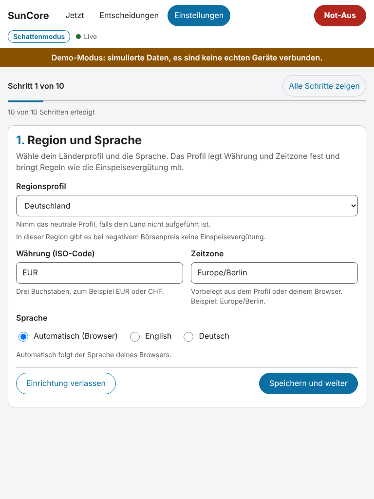

### Energie-Dashboard

Hast du das Energie-Dashboard von Home Assistant eingerichtet, liest
SunCore es und schlägt Sensoren für Netz, PV und Batterie vor. Hake die
gewünschten Vorschläge an und wähle **N Vorschläge übernehmen und weiter** (N ist die Zahl der
angehakten; bei einem heißt es "Vorschlag").
Ohne deine Auswahl wird nichts übernommen, und du kannst alles in den
nächsten Schritten ändern. Oft enthält das Dashboard nur Energiezähler
(kWh) und keine Leistungssensoren; dann sagt SunCore das, und du wählst den
Leistungssensor selbst. Nicht eingerichtet? Überspring den Schritt.

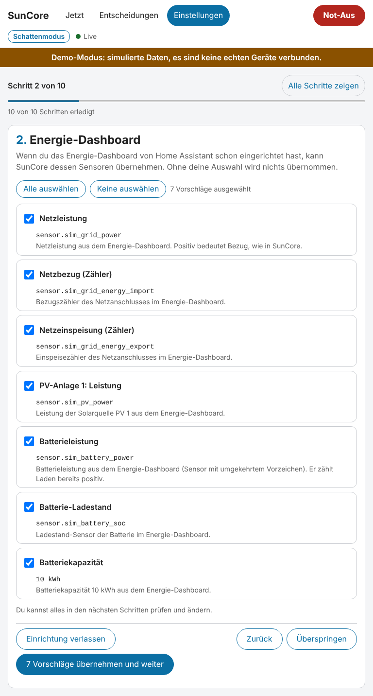

### Netzanschluss

Wähle **Ein Sensor mit Vorzeichen** oder **Getrennte Bezugs- und
Einspeise-Sensoren**. Optional: ein Sensor für den Hausverbrauch (sonst
wird er aus Netz, PV und Batterie berechnet), Grenzen für Bezug und
Einspeisung und das Signal des Netzbetreibers nach § 14a EnWG
(Deutschland).

Der Bereich **Vorzeichen prüfen** fragt zum Beispiel, ob der Netzanschluss gerade
Bezug oder Einspeisung zeigt, und ob das stimmt. Antworte **Ja, stimmt**
oder **Nein, Vorzeichen umkehren**. Fließt gerade fast nichts, prüfe später
noch einmal, wenn deutlich etwas fließt.

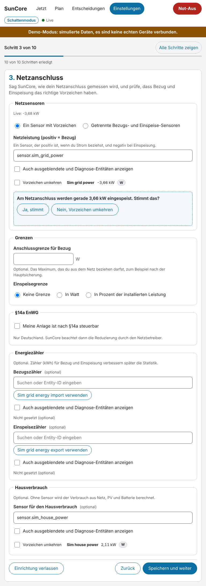

### Photovoltaik

Füge jede PV-Anlage mit ihrem **Leistungssensor**, der installierten
Leistung in kWp sowie Neigung und Ausrichtung hinzu (Azimut: 0 = Nord,
180 = Süd). Optional wählst du eine **Prognosequelle**, etwa Solcast, wenn
die Integration installiert ist.

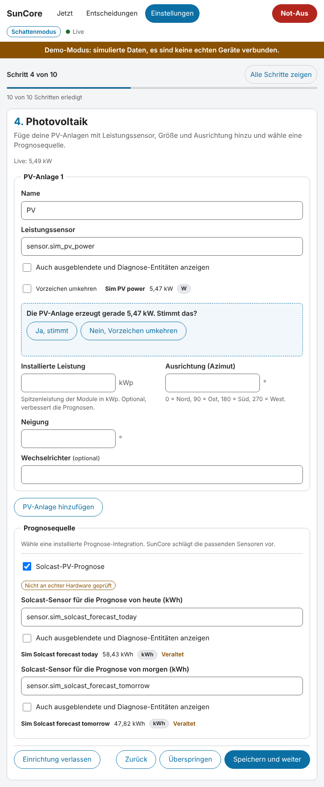

### Batterie

Wähle den Sensor für die Batterieleistung (positiv = Laden) und den für den
Ladestand, oder **Keine Batterie**. Kapazität sowie Mindest- und maximaler
Ladestand sind optional. SunCore beobachtet die Batterie vorerst nur.

### Tarif

Gib den **Bezugspreis** (**Fester Preis** oder **Dynamischer Preis**) und
die **Einspeisevergütung** ein (fest, gestaffelt nach Anlagengröße oder
keine). Ein dynamischer Preis braucht einen Preissensor oder eine
Tarif-Vorlage wie Tibber. Die Preise werden für spätere Versionen
gespeichert; der Planer nutzt sie noch nicht.

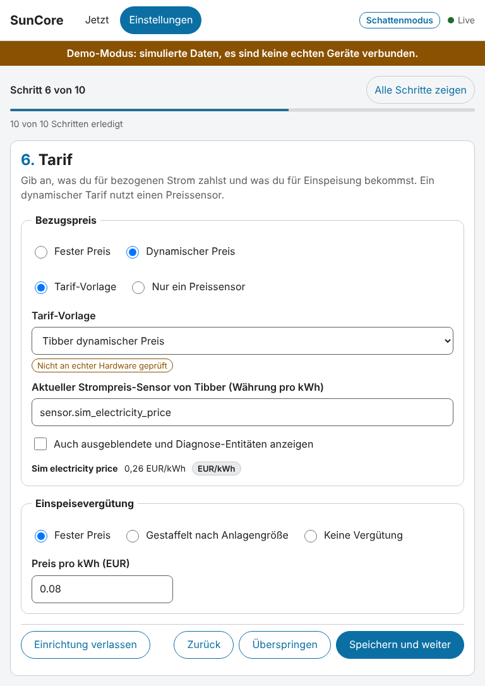

### Verbraucher

Füge die Geräte hinzu, die SunCore später steuern darf. Durchsuche die
Galerie, wähle eine Vorlage (zum Beispiel ein LG-ThinQ-Klimagerät, einen
Schalter oder eine einstellbare Last), ordne ihre Entitäten zu, prüfe
Leistungsmodell und Schutzzeiten und speichere. Der Assistent sortiert
deine Entitäten und sagt dir, warum ein Kandidat passt. Neue Geräte starten
immer im Schattenmodus.

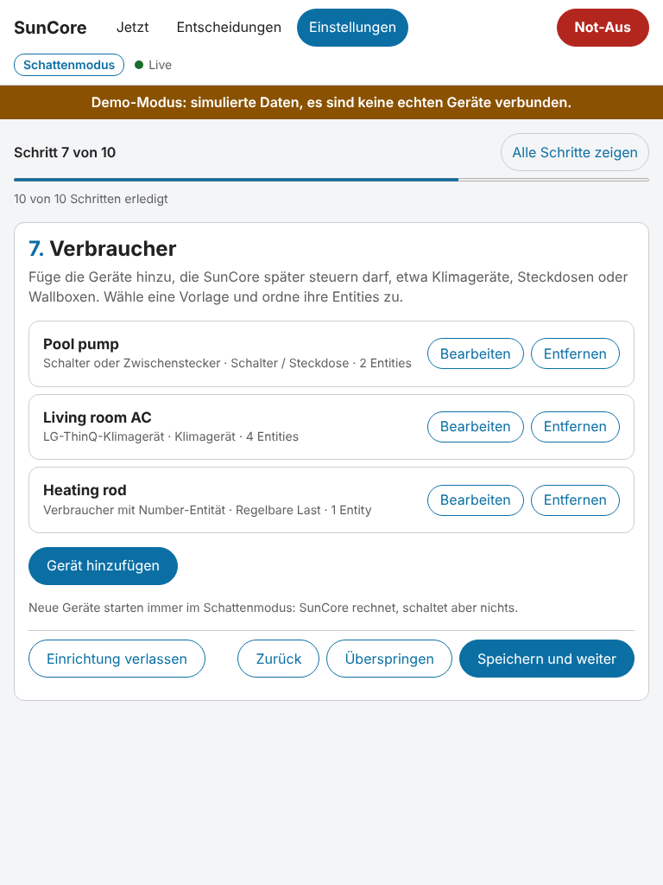

Fehlt dein Gerät? Siehe
[Gerätevorlage beitragen](device-templates.md) und die generierte
[Kompatibilitätsliste](../compatibility.md) (englisch).

### Prioritäten und Ziele

Ziehe die Geräte am Griff oder nutze die Pfeil-Schaltflächen oder die Pfeiltasten, um festzulegen, wer
den Überschuss zuerst bekommt. Position 1 wird zuerst bedient. Ziele
(Ziel-Ladestand der Batterie zu einer Uhrzeit, Klimagerät vor der
Einspeisung, nur nachts aus dem Netz laden) werden jetzt gespeichert und in
späteren Versionen genutzt.

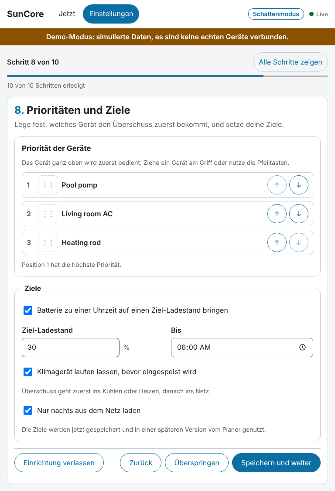

### Betriebsmodus

Wähle **Schattenmodus**, **Assistierter Modus** oder **Automatikmodus**. In
dieser Version ist nur der Schattenmodus aktiv; die anderen Auswahlen
werden gespeichert und sind mit „ab einer späteren Version aktiv“
gekennzeichnet.

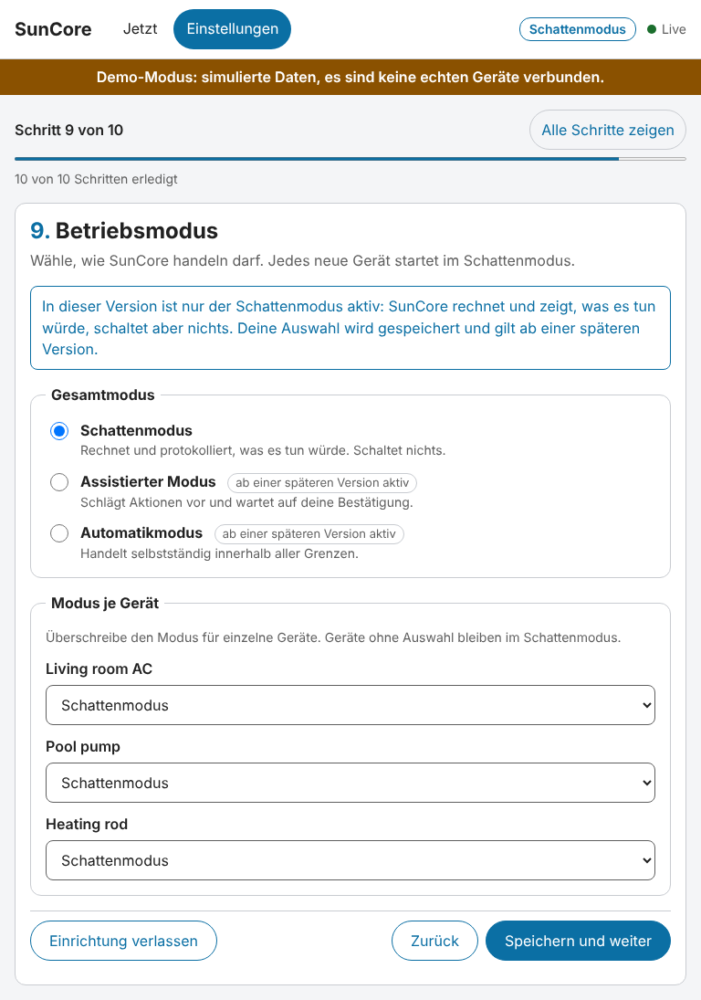

### Zusammenfassung und Check

Der **Systemcheck** prüft Einheiten, Vorzeichen, die Leistungsbilanz und ob
die Sensoren aktuelle Werte liefern. Behebe alles, was mit einem Kreuz
markiert ist (Schritt über die Liste öffnen), wähle **Erneut prüfen** und
dann **Einrichtung abschließen**. Warnungen blockieren nicht.

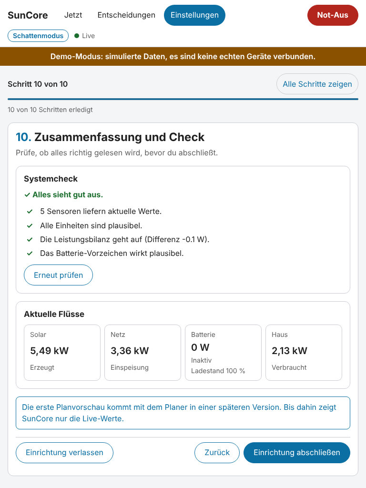

Das Panel folgt auch dem dunklen Design deines Geräts:

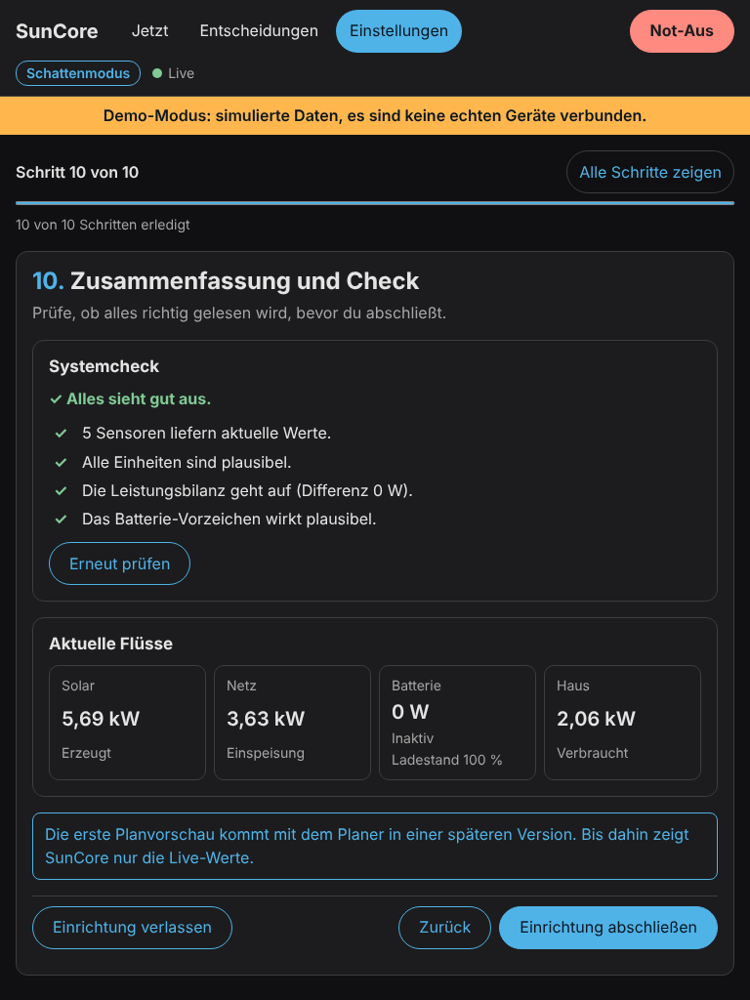

## 4. Was Schattenmodus bedeutet

SunCore berechnet, was es tun würde, und protokolliert es, schaltet aber
nichts und schreibt keinen Sollwert, egal was du im Schritt Betriebsmodus
wählst. Das ist in dieser Version eine feste Regel der Sicherheitsschicht
und keine Einstellung, die du aus Versehen verlieren kannst. Die Steuerung
kommt in einer späteren Phase, Gerät für Gerät und erst, nachdem du ein
Gerät ausdrücklich freigibst.

## 5. Die Ansicht Jetzt

Nach **Einrichtung abschließen** zeigt die Ansicht **Jetzt** Solar, Netz,
Batterie und Haus mit animierten Flüssen.

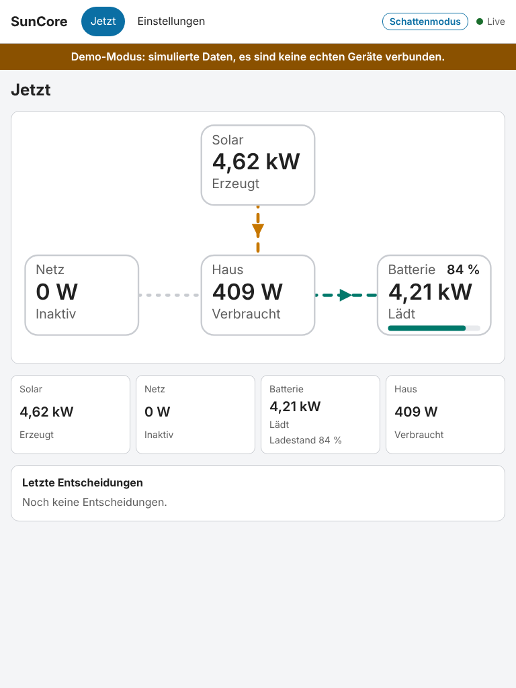

## 6. Später ändern

Öffne **Einstellungen**. Dort stehen alle Bereiche deiner Einrichtung
(**Region**, **Anlage (Netz, PV, Batterie)**, **Tarif**, **PV-Prognose**,
**Verbraucher**, **Ziele**, **Betriebsmodus**) mit einer Kurzfassung und
einem Link **Öffnen** zum passenden Schritt.

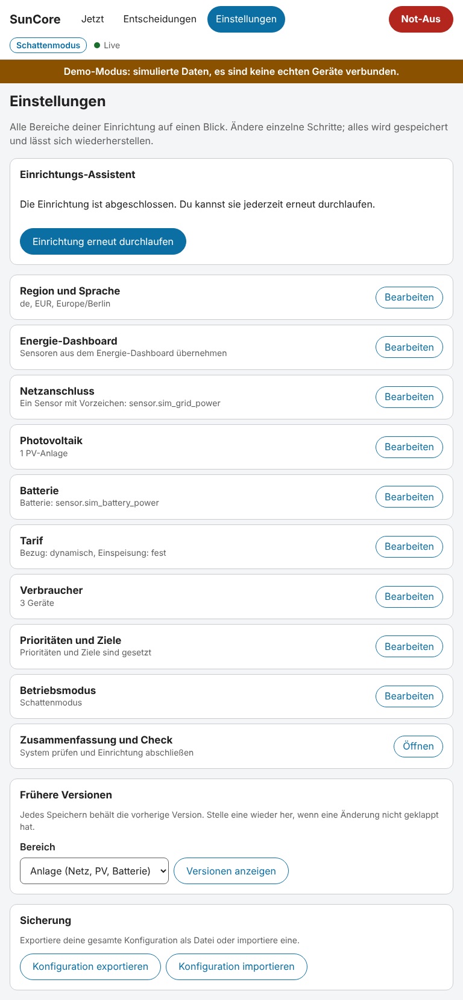

- **Einrichtung erneut durchlaufen** startet den Assistenten mit deinen
  aktuellen Werten neu.
- **Frühere Versionen**: Jedes Speichern behält die vorige Version. Mit
  **Versionen anzeigen** und **Wiederherstellen** machst du eine Änderung
  rückgängig.
- **Sicherung**: **Konfiguration exportieren** speichert alles als Datei,
  **Konfiguration importieren** lädt eine. Nutze das vor Experimenten und
  beim Umzug auf eine neue Installation.
- Ungespeicherte Änderungen sind geschützt: Beim Verlassen einer Seite wird
  vorher nachgefragt.

## Fehlersuche

- **Der Vorzeichen-Check sagt, die Bilanz geht nicht auf.** Ein Sensor, eine
  Einheit oder ein Vorzeichen ist falsch. Der Systemcheck nennt den Teil
  (etwa, dass das Umkehren des Netz-Vorzeichens die Bilanz schließen
  würde); geh zurück zu diesem Schritt und antworte **Nein, Vorzeichen
  umkehren**.
- **Ein Sensor wird wegen seiner Einheit abgelehnt.** Leistungssensoren
  müssen W oder kW liefern, Energiezähler Wh oder kWh, Ladestände %.
  SunCore rät nie Einheiten; wähle eine andere Entität oder korrigiere die
  Integration.
- **„wurde seit einiger Zeit nicht aktualisiert“ oder „ist nicht verfügbar“.** Die
  Quell-Integration liefert nichts mehr. Prüfe sie in Home Assistant;
  SunCore markiert den Wert, statt ihn zu verwenden.
- **Keine Vorschläge oder Sortierung, oder ein Hinweis, dass die Registry
  nicht verfügbar ist.** Für die Erkennung liest SunCore die Entitäts-,
  Geräte- und Bereichs-Registry von Home Assistant. Ist sie nicht
  verfügbar, fällt SunCore auf eine einfache Liste der Zustände mit
  schlichteren Regeln zurück: Deine Entitäten findest du weiterhin mit dem
  Suchfeld, nur die Sortierung ist ungenauer. Bleibt es dabei, aktualisiere
  Home Assistant und melde deine Version.
- **Der Schritt Energie-Dashboard ist leer.** Entweder ist es in Home
  Assistant nicht eingerichtet oder enthält nur Energiezähler. Überspring
  den Schritt und wähle Leistungssensoren selbst.
- **Ein Gerät fehlt in der Galerie.** Siehe
  [Gerätevorlage beitragen](device-templates.md) oder nimm eine generische
  Vorlage (Schalter, Klima, einstellbare Last).
- Mehr im Abschnitt Troubleshooting der
  [App-Beschreibung](../../../addon/suncore/DOCS.md) (englisch).

## Was SunCore noch nicht kann

Bedenke das, bevor du dich darauf verlässt. Diese Version hat keine
Prognosen und keinen Planer (deine Tarif- und Prognose-Angaben werden nur
gespeichert), steuert kein Gerät (nur Schattenmodus), hat keine
Verlaufsdiagramme, keine Batteriesteuerung und keine Home-Assistant-
Entitäten. Verglichen mit evcc (Ladepunkte und Heizstäbe), EMHASS und
Predbat (Batterieoptimierung) beobachtet SunCore derzeit nur. Die
[Roadmap](../../roadmap.md) zeigt, wann welcher Teil kommt.
