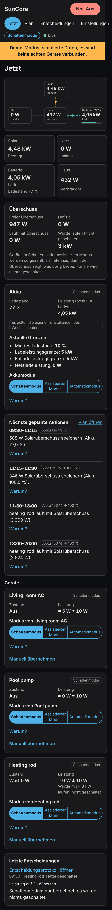

# Schnellstart

SunCore ist **Pre-Alpha** (Phase 1). Diese Version zeigt deinen Energiefluss
live an. Sie läuft im Schattenmodus: Es wird nichts geschaltet und kein
Sollwert geschrieben. Die vollständige App-Beschreibung (englisch) steht in
[`addon/suncore/DOCS.md`](../../../addon/suncore/DOCS.md).

## 1. Installieren

1. Öffne in Home Assistant **Einstellungen → Apps → App-Store**.
2. Menü (drei Punkte) → **Repositories** → füge
   `https://github.com/pxljake/suncore` hinzu.
3. Installiere **SunCore (beta)**, solange es kein stabiles Release gibt,
   starte die App und aktiviere **In der Seitenleiste anzeigen**.

## 2. Demo ausprobieren (optional)

Schalte auf dem Reiter **Konfiguration** der App die Option `demo_mode` ein
und starte neu. Ein simulierter Sonnentag speist das Panel; von deiner
Installation wird nichts gelesen.

## 3. Panel öffnen

Öffne **SunCore** in der Seitenleiste (nur für Administratoren). Die Ansicht
**Jetzt** zeigt Solar, Netz, Batterie und Haus mit animierten Flüssen.

Auf dem Smartphone wird die Ansicht untereinander angeordnet und folgt dem
dunklen Design deines Geräts:

## 4. Sensoren auswählen

Öffne **Einstellungen** und wähle Netz-, Solar-, Batterie- und (optional)
Haussensoren. Unter jedem Feld wird der aktuelle Wert angezeigt.

Vorzeichenkonvention: **Netz positiv = Bezug**, **Batterie positiv =
Laden**, PV positiv = Erzeugung. Nutzt ein Sensor die umgekehrte
Konvention, aktiviere für ihn **Vorzeichen umkehren**. Klicke auf
**Speichern**.

## Was noch fehlt

Prognosen, Planer, Gerätesteuerung und der Einrichtungsassistent folgen in
späteren Phasen; siehe die [Roadmap](../../roadmap.md). Probleme? Siehe den
Abschnitt Troubleshooting in der App-Beschreibung oben.
