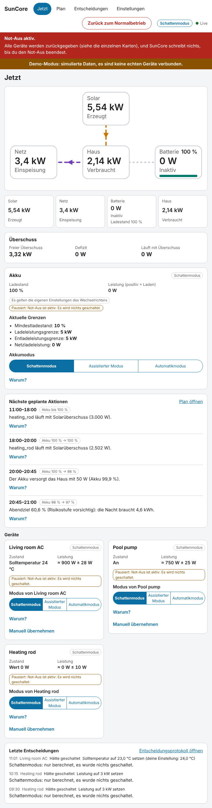
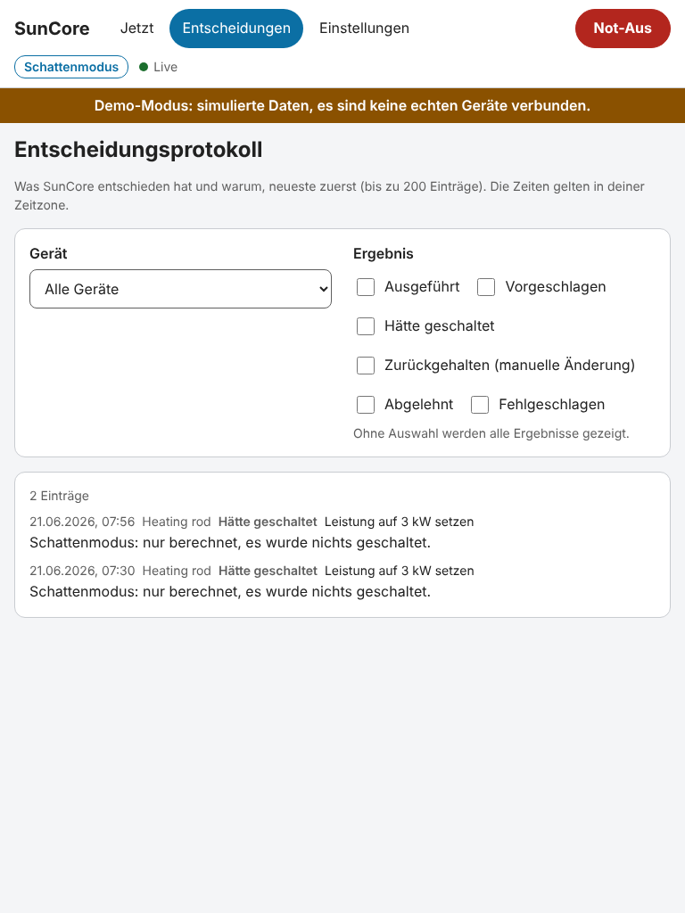

# Überschusssteuerung

SunCore kann deinen echten Solarüberschuss alle paar Sekunden auf Klimageräte, Warmwasserbereiter
und schaltbare oder regelbare Verbraucher verteilen. Diese Seite erklärt, wie es entscheidet,
was es bei Problemen tut und wie du dein erstes Gerät **sicher** in die Automatik nimmst. Sie
beschreibt die Version, in der die Steuerung existiert, aber **nichts geschrieben wird, bevor du
es erlaubst**: Der Schattenmodus ist der Standard für das ganze System und für jedes neue Gerät.

Lies [Bekannte Grenzen und UNVERIFIED](#bekannte-grenzen-und-unverified), bevor du dich darauf
verlässt.

## 1. So funktioniert die Überschusssteuerung

Alle 5 Sekunden (App-Option `controller_interval_s`) macht der Regler dieselben vier Dinge.

1. **Freier Überschuss.** Er addiert, was deinen gesteuerten Geräten zur Verfügung steht: die
   Leistung, die gerade ins Netz fließt, plus die Ladeleistung der Batterie, **wenn deine Ziele
   das erlauben** (siehe [Batterie und Ziele](#batterie-und-ziele)), plus das, was die
   gesteuerten Geräte gerade aufnehmen. 100 W bleiben unverteilt (Messrauschen, kleine
   Verbraucher), und was die Geräte schon belegen, wird abgezogen. Der Rest ist der **freie
   Überschuss**, den du in der Karte **Überschuss** der Ansicht **Jetzt** siehst, neben
   **Defizit** und **Läuft mit Überschuss**. Im Schatten- oder assistierten Modus zählt ein Gerät
   so, als liefe es (der Regler nimmt seine geplante Stufe an); deshalb zeigt die Karte zusätzlich
   **Würde laufen (nicht geschaltet)**: Diese Leistung wird **nicht** wirklich bezogen, und der
   freie Überschuss zeigt, was übrig bliebe. Vergleiche die Karte **Überschuss** mit Home
   Assistant anhand von **Läuft mit Überschuss**; eine Gerätekarte sagt im selben Fall
   **Würde mit … laufen, nicht geschaltet**.
2. **Glättung gegen Wolkenflackern.** Der verfügbare Wert ist der Median der letzten
   60 Sekunden, eine einzelne Wolkenkante bewegt ihn also nicht. Die Streuung der Werte in
   diesem Fenster zählt als Unsicherheit: Flackert die Sonne, wird das Band breiter, und
   SunCore **fügt** Last nur **hinzu**, wenn der freie Überschuss abzüglich dieser Unsicherheit
   noch den Bedarf des Geräts plus Hysterese deckt. Ein bereits laufendes Gerät wird am Median
   gemessen; eine kurze Wolke allein schaltet es nie ab.
3. **Prioritäten.** Die Geräte werden in der Reihenfolge bedient, die du im Einrichtungsschritt
   *Prioritäten und Ziele* festgelegt hast (Position 1 zuerst). Jedes Gerät bekommt, was es
   nutzen kann; der Rest geht weiter. Eine niedrigere Priorität nimmt nie Überschuss weg, auf den
   eine höhere noch wartet.
4. **Hysterese und Schutzzeiten.** Ein Gerät wird erst eingeschaltet (oder eine Stufe höher
   gestellt), wenn der Überschuss seine Leistung plus die **Hysterese** (Standard 100 W) deckt
   und diese Bedingung für die **Hysterese-Verzögerung** (Standard 60 s) angehalten hat. Es geht
   herunter, wenn der Überschuss für dieselbe Verzögerung unter minus Hysterese fällt. Dazu hat
   jedes Gerät **Mindestlaufzeit** und **Mindestpause**, eine **Höchstzahl an Schaltvorgängen
   pro Stunde** (Standard 6), eine **Einschwingzeit** nach jedem Schreiben und ein
   Schreib-Limit (höchstens ein Schreibvorgang je Gerät alle 5 s). Die Vorlage für das
   LG-ThinQ-Klimagerät bringt 10 Minuten Mindestlaufzeit und 5 Minuten Mindestpause mit; das
   sind verdichterschonende Entwurfswerte, keine Herstellerangaben. Hysterese, Verzögerung,
   Schaltvorgänge pro Stunde und Einschwingzeit kommen aus der Vorlage (oder den
   App-Standards); der Geräte-Editor bietet Mindestlaufzeit und Mindestpause, Experteneinstellungen
   für den Rest folgen in einer späteren Version.

Der Regler **schlägt nur vor**, was zu tun ist. Eine getrennte Sicherheitsschicht prüft jeden
einzelnen Schreibvorgang noch einmal mit denselben Zahlen, kann ihn mit einer Begründung
ablehnen und ist der einzige Teil, der ein Gerät anfassen darf.

### Kein Netzbezug durch SunCore

Das ist die zentrale Regel. Gesteuerte Geräte dürfen nur **echten Überschuss** nutzen.

- SunCore fügt nie Last hinzu, wenn der sichere Überschuss sie nicht deckt, und wartet, solange
  das Haus Strom aus dem Netz bezieht.
- Nimmt ein laufendes Gerät plötzlich mehr auf als erwartet (ein hochfahrender Verdichter, eine
  große Temperaturdifferenz), puffert deine Batterie das kurze Defizit. Dauern Netzbezug oder
  Batterieentladung, die **von den gesteuerten Geräten verursacht** werden, länger als
  30 Sekunden (halb so lange, wenn die Leistung eines Geräts nur grob geschätzt ist) oder hat
  die Batterie etwa 50 Wh abgedeckt, **fährt SunCore Schritt für Schritt zurück**: zuerst das
  Gerät mit der niedrigsten Priorität, immer eine Stufe (ein Klima-Sollwert geht zu deinem
  eigenen Wert zurück, Stufen und regelbare Lasten gehen auf eine niedrigere Stufe, ein Schalter
  geht erst nach seiner Mindestlaufzeit aus, sonst kommt das nächste Gerät dran). Vor dem
  nächsten Schritt wartet es die Einschwingzeit ab.
- **Batterie-Reserve und Bezugsgrenze fahren sofort zurück, ohne Puffer.** Steht die Batterie auf
  oder unter ihrem Mindestladestand, wird sie nie zur Deckung von Geräten genutzt. Bezieht das
  Haus mehr als die eingetragene Anschlussgrenze, fährt SunCore sofort zurück.

Bezug, der nichts mit SunCore zu tun hat (ein Wasserkocher, ein Backofen), ist nicht „durch
SunCore verursacht“: Der Regler fügt dann keine Last hinzu, schaltet aber deswegen keine anderen
Geräte ab, solange nicht die gesteuerten Geräte der Grund sind.

### Batterie und Ziele

Ohne Plan entscheidet dieser Regler nur, ob die **Ladeleistung** der Batterie für Geräte als
Überschuss zählt:

- Mit dem Ziel *Batterie zu einer Uhrzeit auf einen Ziel-Ladestand bringen* und einem Ladestand
  unter dem Ziel: Die Batterie lädt zuerst, Geräte bekommen nichts von der Ladeleistung. Ohne
  Plan wird die Uhrzeit nicht ausgewertet, das Ziel gilt den ganzen Tag. **Dein Ziel ist eine
  Untergrenze**: Auch mit Plan bleibt die Batterie vorn, solange sie unter deinem Ziel liegt.
- Mit *Klimagerät laufen lassen, bevor eingespeist wird* oder bei erreichtem Ziel steht die
  Ladeleistung den Geräten zur Verfügung.
- Mit **gar keinem Ziel**: Die Batterie hat Vorrang, und Geräte bekommen nur, was sonst
  eingespeist würde. Das ist ein vorsichtiger Standard und `UNVERIFIED` gegenüber dem, was du
  tatsächlich willst; setze eines der beiden Ziele, wenn Geräte den Strom nutzen sollen, der
  sonst die Batterie laden würde.

**Mit Plan** (siehe [Planung und Akkusteuerung](planning-and-battery.md)) setzt jetzt der Planer
die Bänder, denen der Regler folgt. **Die Batterie kommt zuerst bis zum Morgenpuffer** („Akku
zuerst bis X %“), den der Plan aus der Prognose und deiner Risikostufe berechnet; der Regler
vergleicht X alle paar Sekunden mit dem **aktuellen** Ladestand. Oberhalb von X geht der
Überschuss an die Geräte, **solange der Plan sagt, dass das Abendziel noch erreichbar ist**, und
der Plan drosselt ein Gerät auf eine maximale Leistung oder sperrt es, wenn das Ziel knapp
wird. Ein Plan **schränkt** Geräte gegenüber dem Regler ohne Plan nur ein. Ein veralteter Plan
(älter als 2 Stunden) oder keiner heißt: das Verhalten oben. Die Batterie selbst wird getrennt
gesteuert, über ihren eigenen Modus auf der Akku-Karte; siehe
[Steuerung](planning-and-battery.md#5-steuerung-schatten-assistiert-automatik).

## 2. Betriebsmodi

Es gibt drei Modi, je Gerät und für das ganze System (den **Gesamtmodus**).

| Modus | Was SunCore tut |
|---|---|
| **Schatten** (Standard) | Rechnet und protokolliert, was es getan **hätte**. Schreibt nie etwas. |
| **Assistiert** | Schlägt Aktionen im Panel vor und wartet auf deine Bestätigung. |
| **Automatik** | Handelt selbstständig innerhalb aller Grenzen. |

Ein Gerät handelt im **niedrigeren** von Gesamtmodus und eigenem Modus. Automatik braucht also
**beides**: den Gesamtmodus auf Automatik (Einrichtungsschritt *Betriebsmodus* oder
**Einstellungen → Betriebsmodus**) **und** das Gerät auf seiner Karte in der Ansicht **Jetzt** auf
Automatik gestellt. Jedes neue Gerät startet im Schattenmodus. Der Einrichtungsschritt setzt nur
den Gesamtmodus; die Modi der Geräte änderst du in der Ansicht **Jetzt**.

- **Assistierte Vorschläge** erscheinen unter **Vorschläge warten auf dich**. **Bestätigen**
  führt die Aktion jetzt aus (sie muss trotzdem die Sicherheitsprüfungen bestehen und kann mit
  einer Begründung abgelehnt werden), **Verwerfen** wirft sie weg. Ein Vorschlag gilt
  2 Minuten und verfällt dann.
- **Ein Gerät auf Automatik stellen** verlangt eine Bestätigung. Die Anfrage trägt die
  **Identität** des Geräts (ID, Vorlage und zugeordnete Entitäten). Hat sich das Gerät
  inzwischen geändert, erhältst du „Dieses Gerät hat sich inzwischen geändert. Lade neu und
  prüfe es“. Ein Gerät, dessen Entitäten oder Vorlage du änderst, fällt auf den Schattenmodus
  zurück, ein Import setzt den Gesamtmodus immer auf Schatten, und ein gespeichertes
  Einstellungsdokument kann von sich aus keinen Modus anheben.
- **Den Gesamtmodus auf Schatten senken** gilt sofort: SunCore hört auf zu schreiben und gibt die
  gesteuerten Geräte zurück (siehe [Zurückgeben](#5-zurückgeben-und-not-aus)).

## 3. Geräte

### Klima (Klimagerät)

SunCore schaltet das Gerät standardmäßig nicht ein und aus. Es **verschiebt den Sollwert**
innerhalb deines Komfortbereichs: beim Heizen nach oben (höchstens um die maximale Verschiebung
der Vorlage, bei der LG-Vorlage 2 °C), beim Kühlen nach unten, in Schritten von 1 °C (oder dem
eigenen Schritt des Geräts), und zurück auf **deinen** Sollwert, wenn der Überschuss weg ist. Der
Sollwert verlässt nie den **Komfortbereich**, den du im Geräte-Editor festlegst. Verschoben
werden nur die Modi *Heizen* und *Kühlen*; in jedem anderen Modus oder wenn dein eigener Sollwert
außerhalb des Komfortbereichs liegt, lässt SunCore das Gerät in Ruhe und sagt das.

- **Einschalten** ist ein Opt-in je Gerät: *Einschalten* im Geräte-Editor, zusammen mit dem
  HVAC-Modus, mit dem eingeschaltet wird. Ohne das bleibt ein ausgeschaltetes Gerät aus („Das
  Gerät ist aus, und SunCore darf es nicht einschalten“).
- **LG ThinQ hat keinen Leistungssensor.** Die Integration `lg_thinq` liefert nur einen
  Energiezähler, der ganze Wattstunden pro **Stunde** zählt. SunCore leitet die Leistung aus
  diesem Zähler ab und lernt mit der Zeit die tatsächliche Leistung des Geräts (ausgehend von der
  Nennleistung, die du eingegeben hast). Diese Schätzung ist unsicher, deshalb wird die Hysterese
  um die Unsicherheit verbreitert: Der Regler braucht mehr Überschuss, bevor er verschiebt, und
  reagiert **langsamer und vorsichtiger** als mit einem gemessenen Wert. Eine Steckdose mit
  Messung oder die HACS-Integration `smartthinq_sensors` (Sensor „Energy current“) liefert eine
  gemessene Leistung und ist die bessere Wahl, wenn du eine hast.
- **Ein Wert, der sich nicht ändert, ist nicht veraltet.** Viele Integrationen melden nur neue
  Werte (eine ausgeschaltete Anlage bleibt einen Tag lang bei 5 W, der Akku eine Stunde bei
  84 %). SunCore behält solche Werte, solange die Entität verfügbar ist. Erst wenn sich das Gerät
  geändert hat (eingeschaltet, neuer Modus oder Sollwert), wartet es darauf, dass der Sensor
  nachzieht: Trage für diesen Sensor von `smartthinq_sensors` **Aktualisierungsintervall des
  Leistungssensors** = 300 ein, dann passt die Wartezeit zu seinen 5 Minuten. Gemessene Werte
  sind trotzdem langsamer als bei einer Steckdose, die alle paar Sekunden meldet.

### Warmwasserbereiter

`UNVERIFIED`: Die Vorlagen für Warmwasserbereiter sind nur im Simulator getestet; der Maintainer
hat keinen Warmwasserbereiter, also lief nie etwas gegen echte Hardware.

Es gibt zwei Vorlagen: ein Gerät mit Leistungsstufen in einer **Select**-Entität
(`generic.water_heater_steps`) und eines mit **ein bis drei Relais**
(`generic.water_heater_relays`). SunCore wechselt zwischen den Stufen wie bei jeder gestuften
Last. Die Stufennamen und ihre Leistung in der Vorlage sind Platzhalter: Trage ein, was dein
Gerät anbietet und aufnimmt.

Die **Höchsttemperatur** des Komfortbereichs wird über den Speichersensor erzwungen
(Rolle `temperature`, in °C): Bei oder über dem Maximum fügt SunCore keine Wärme mehr hinzu, die
Sicherheitsschicht weigert sich, mehr zu schreiben, und eine **unbekannte, veraltete oder nicht
in °C gemeldete Messung gilt als voll**. Ohne Speichersensor wird das Maximum **nicht**
erzwungen; dann muss der Thermostat des Geräts die Temperatur begrenzen.

### Schaltbare und regelbare Lasten

Ein Schalter (Poolpumpe, Steckdose) geht mit der Hysterese und den oben genannten Schutzzeiten
an und aus. Eine regelbare Last (ein Heizstab über eine Number-Entität) folgt dem Überschuss in
ihrem eingestellten Bereich mit einer Totzone.

## 4. Wenn du selbst etwas änderst

SunCore respektiert manuelle Änderungen. Es erkennt sie am **Wert**: Befindet sich ein Gerät
nach der Einschwingzeit in einem anderen Zustand als dem, den SunCore geschrieben hat, hat es
jemand anderes geändert. (Verspätete Antworten, etwa aus der LG-Cloud, werden als SunCores
eigene Schreibvorgänge erkannt.)

- Ein Gerät, das du **ausschaltest** (Fernbedienung, LG-App), **bleibt aus**.
- Eine **Temperatur**, die du änderst, wird der **neue Basiswert**: SunCore verschiebt ab dann
  von deinem Wert aus.
- Danach lässt SunCore das Gerät in Ruhe. Die Karte zeigt **Gehalten bis ...**. Es übernimmt
  wieder **am nächsten Tag um 04:00 Uhr Ortszeit** (Standard) oder nach einer Anzahl Stunden (1
  bis 48). Das wählst du je Gerät unter **Manuelle Änderungen** im Geräte-Editor.
- **Jetzt fortsetzen** auf der Karte beendet das Halten sofort.
- Was die Rückgabe später wiederherstellt, ist **das, was du hinterlassen hast**, nicht der
  Zustand der ersten Übernahme.

**Manuell übernehmen** auf der Karte öffnet die ausdrücklichen Eingriffe:

- **Halten**: SunCore lässt das Gerät für eine Anzahl Minuten (1 bis 1440) in Ruhe und übernimmt
  danach wieder. Während des Haltens steuert SunCore nichts.
- **Pausieren**: dasselbe bis zu einer Zeit, die du wählst, oder bis du fortsetzt. Eine Pause
  gibt außerdem ein Gerät zurück, das SunCore gerade steuert (nach seiner Mindestlaufzeit bzw.
  Mindestpause).
- **Fortsetzen**: beendet ein Halten oder eine Pause.

## 5. Zurückgeben und Not-Aus

SunCore merkt sich je Gerät den Zustand **vor der Übernahme** (bei einem Klimagerät Sollwert und
HVAC-Modus). **Zurückgeben** stellt diesen Zustand wieder her. Es passiert beim Not-Aus, wenn
SunCore beendet wird, wenn du ein Gerät oder den Gesamtmodus auf Schatten senkst, bei einem
Watchdog-Auslöser, nach einem Verbindungsverlust und wenn ein Gerät entfernt oder neu zugeordnet
wird.

Die Schaltfläche **Not-Aus** steht in der Kopfzeile jeder Ansicht, ein Klick, keine Rückfrage:

- Jedes gesteuerte Gerät wird innerhalb von 10 Sekunden zurückgegeben, und SunCore **schreibt
  nichts**, bis du den Not-Aus beendest.
- Der Not-Aus ist **gespeichert**: Er übersteht einen Neustart der App oder ein Update.
- **Zurück zum Normalbetrieb** (mit Rückfrage) beendet ihn. Deine Modi bleiben unverändert: Ein
  Gerät im Schatten- oder assistierten Modus tut weiterhin nichts von allein, und Geräte im
  Automatikmodus werden wieder übernommen, sobald Überschuss da ist.

Eine nicht dringende Rückgabe (Absenken auf Schatten, Gerätestörung, wiederhergestellte
Verbindung, Konfigurationsänderung) **wartet auf die Mindestlaufzeit bzw. Mindestpause des
Geräts**, damit ein Verdichter nicht takten muss. SunCore hört sofort auf zu schreiben; die Karte
zeigt **Wird bis ... zurückgegeben**. Not-Aus und Beenden warten nicht.

## 6. Ausfallsicherheit

| Situation | Was passiert |
|---|---|
| App wird beendet, neu gestartet oder aktualisiert | Alle Geräte werden innerhalb von 10 s zurückgegeben, bevor die Verbindung zu Home Assistant schließt. |
| Absturz oder Stromausfall | Der Vermerk, was SunCore steuerte, ist gespeichert. Beim nächsten Start werden diese Geräte zurückgegeben, sobald Home Assistant verbunden ist. Bis dahin bleibt das Gerät, wie es war. |
| Verbindung zu Home Assistant verloren | SunCore kann nicht schreiben: Die Steuerung pausiert, es wird nichts entschieden. Ist die Verbindung zurück, werden die Geräte zurückgegeben (nach ihrer Schutzzeit), und der Regler startet vom dann aktuellen Zustand neu, einschließlich Änderungen, die du inzwischen gemacht hast. |
| Eingangsstörung (veraltet, nicht verfügbar, falsche Einheit, unplausibler Sprung, eingefrorene PV bei Tageslicht, Leistungsbilanz geht nicht auf) | Eine Störung bei Netz, PV oder Batterie pausiert **alle** Geräte und gibt sie zurück; eine Störung der eigenen Sensoren eines Geräts pausiert nur dieses Gerät. Die Steuerung läuft weiter, nachdem die Werte eine Abkühlzeit lang (2 Minuten) plausibel waren. |
| Drei Schreibvorgänge in Folge schlagen fehl | Das Gerät wird pausiert. |
| Du änderst die Konfiguration | Der Regler startet neu. Unveränderte Geräte werden nach ihrer Schutzzeit zurückgegeben, geänderte sofort, und sie fallen auf Schatten zurück. |

## 7. „Warum?“ und das Entscheidungsprotokoll

Jede Gerätekarte hat **Warum?** mit den letzten Gründen in Klartext, etwa „Warten auf die
Mindestlaufzeit, noch 240 s“ oder „Nicht eingeschaltet: 1200 W nötig, nur 800 W sicherer
Überschuss“, und die **Letzte Entscheidung**. Die Gründe stehen in deiner Sprache.

Das **Entscheidungsprotokoll** (Ansicht **Entscheidungen**) listet, was SunCore entschieden hat,
neueste zuerst (bis zu 200 Einträge, Zeiten in deiner Zeitzone), und lässt sich nach Gerät und
Ergebnis filtern: **Ausgeführt**, **Vorgeschlagen**, **Hätte geschaltet** (Schatten),
**Zurückgehalten (manuelle Änderung)**, **Abgelehnt** und **Fehlgeschlagen**. Ein Eintrag
entsteht nur, wenn sich **etwas ändert**, nicht alle 5 Sekunden. Das Protokoll behält 30 Tage und
höchstens 200 000 Einträge.

## 8. Dein erstes Gerät auf Automatik

Mach das mit **einem** Gerät, das du beobachten kannst, etwa dem Klimagerät oder einer
Poolpumpe, an einem Tag mit Sonne. Das Fenster von ein paar Tagen ist der Sinn: Du entscheidest
anhand von Belegen, nicht aus Hoffnung.

1. **Vorbereiten.** Schließe den Einrichtungs-Assistenten ab und lies den Systemcheck. Trage bei
   einem Klimagerät den Komfortbereich und die Nennleistung ein und entscheide, ob SunCore es
   einschalten darf. Vergleiche die Karte **Überschuss** mit dem, was du in Home Assistant
   siehst. Exportiere unter **Einstellungen** eine Sicherung.
2. **Im Schattenmodus bleiben** (Standard). SunCore protokolliert jetzt Einträge **Hätte
   geschaltet**. Öffne abends das **Entscheidungsprotokoll**, filtere nach dem Gerät und lies die
   Gründe. **Würde laufen (nicht geschaltet)** auf der Karte **Überschuss** und die Zeile „Würde
   … laufen“ auf der Gerätekarte sind Annahmen von SunCore, keine Messwerte: Es wird nichts
   geschaltet.
3. **Einen Tag beobachten, besser zwei oder drei.** Frage dich: Entstehen die Einträge, wenn
   wirklich Überschuss da war? Gibt es alle paar Minuten Einträge (zu nervös: erhöhe im
   Geräte-Editor Mindestlaufzeit und Mindestpause) oder nie (die Ziele halten die Batterie an
   erster Stelle, siehe [Batterie und Ziele](#batterie-und-ziele))? Wirkt die geschätzte
   Leistung des Geräts auf der Karte plausibel? Steht nirgends „Gehalten“, was du nicht
   verursacht hast?
4. **Optional: assistierter Modus.** Stelle den Gesamtmodus und das eine Gerät auf **Assistierter
   Modus**. SunCore schlägt jetzt vor, und du bestätigst mit **Bestätigen**. Jede bestätigte
   Aktion wird trotzdem von der Sicherheitsschicht geprüft.
5. **Automatik für ein Gerät.** Stelle den **Gesamtmodus** auf *Automatikmodus*, dann **nur
   dieses Gerät** auf seiner Karte auf *Automatikmodus* und bestätige den Dialog. Alle anderen
   Geräte bleiben im Schattenmodus. Bleib in den ersten Stunden dabei und beobachte die Ansicht
   **Jetzt** und das Protokoll: Die Einträge heißen jetzt **Ausgeführt**.
6. **Kenne deine Ausgänge.** **Not-Aus** (Kopfzeile), **Schattenmodus** auf der Karte (gibt das
   Gerät nach seiner Schutzzeit zurück), **Manuell übernehmen → Pausieren**, oder bediene das
   Gerät einfach selbst, dann lässt SunCore die Finger davon.
7. **Berichte.** Öffne ein Issue mit dem, was du gesehen hast (Entscheidungsprotokoll, App-Log
   mit `log_level: debug`). Besonders nützlich: wie sich die Schätzung des Klimageräts nur mit
   Zähler verhalten hat und wie spät das Cloud-Echo kam.

## Bekannte Grenzen und UNVERIFIED

- **Vom Projekt bisher nie an echter Hardware betrieben.** Das Verhalten ist im Simulator
  geprüft (Wolkenflackern, Mindestlaufzeit, Klima nur mit Zähler und mit langsamem Sensor,
  Wechselrichter-Hänger, Verbindungsverlust, manuelle Änderung, Warmwasserbereiter,
  Netzgrenze, Neustart, ein 7-Tage-Lauf). Die ersten echten Schreibvorgänge passieren mit deinem
  ersten Automatik-Gerät.
- **Warmwasserbereiter**: nur Simulator, `UNVERIFIED` (siehe oben). Die Schreibwege für
  `lg_thinq`-Klima (ein `TypeError` bei `set_temperature` ohne Schrittweite, die Verzögerung der
  Rückmeldung nach einem Befehl, `climate.turn_on` für Modi, die nicht in `hvac_modes` stehen)
  stammen aus dem Lesen des Integrations-Quelltexts, nicht aus einem echten Schreibvorgang.
- **Regler-Abstimmung** (Defizit-Verzögerung und -Budget, Streuung der Glättung, der zusätzliche
  Überschuss, den ein Klimagerät nur mit Zähler vor dem Verschieben braucht, „Batterie zuerst“ ohne
  Ziel) ist eine erste Schätzung und soll nach deinem Schattenlauf abgestimmt werden.
- **Nur der Netzzähler muss sich laufend melden.** Schweigt er 2 Minuten, pausiert SunCore.
  Andere Sensoren gelten als aktuell, solange sie verfügbar sind. Ein hängender Wechselrichter
  fällt auf, wenn seine Entitäten nicht verfügbar werden, über PV-Werte, die bei Tageslicht
  einfrieren (mindestens 200 W für 15 Minuten), oder mit Haussensor über eine Leistungsbilanz,
  die nicht aufgeht. Ein Akku-Wert, der einfriert und verfügbar bleibt, wird nicht direkt
  erkannt; echter Netzbezug lässt SunCore trotzdem zurücknehmen. Ob ein hängender Plenticore
  „nicht verfügbar“ oder eingefrorene Werte zeigt, ist `UNVERIFIED`. Die Standard-Sensortakte
  (Leistungssensor 60 s, Energiezähler 300 s, sofern nicht gesetzt) sind Annahmen.
- **Der Plan ist neu.** Prognosen, Tarife, Planer und Akkusteuerung gibt es jetzt
  ([Planung und Akkusteuerung](planning-and-battery.md)), aber auch sie sind noch nie an echter
  Hardware gelaufen. SunCore verschiebt keine Geräte-Last in günstigere Stunden, heizt nicht nach dem
  Wetter vor und modelliert kein thermisches Verhalten von Geräten. Ohne Plan entscheiden die Ziele
  *Batterie-Ziel* und *Klimagerät vor Einspeisung* nur, ob die Ladeleistung der Batterie als
  Überschuss zählt, und die Uhrzeit des Ziels wird nicht ausgewertet.
- **Zeitfenster und Ruhezeiten** beachtet der Regler, sie lassen sich im Panel aber noch nicht
  bearbeiten (nur über Vorlagen und importierte Konfiguration).
- Ein entferntes oder neu zugeordnetes Gerät, das nicht zurückgegeben werden kann (etwa nach einem
  Absturz), wird gemeldet („bitte von Hand prüfen“), nicht endlos wiederholt.
- **Downgrade**: Diese Version speichert ihre Daten in Datenbankschema 4, das frühere Versionen
  nicht öffnen können. Exportiere die Konfiguration vor dem Update.
- **Im Vergleich zu evcc, EMHASS und Predbat**: evcc ist die bessere Wahl für Ladepunkte und hat
  Jahre an Hardware-Erfahrung; SunCore hat noch keine Wallbox-Steuerung. EMHASS und Predbat
  optimieren die Batterie über die Zeit, mit jahrelanger Praxis; SunCores Planer ist neu und an
  Hardware unerprobt. Was SunCore bietet, ist eine App mit Sicherheitsschicht, Schattenmodus und
  einer Begründung zu jeder Entscheidung; siehe die [Roadmap](../../roadmap.md).

Siehe auch: [Schnellstart](quick-start.md), [Planung und Akkusteuerung](planning-and-battery.md),
[Gerätevorlage beitragen](device-templates.md),
[Kompatibilitätsliste](../compatibility.md).
