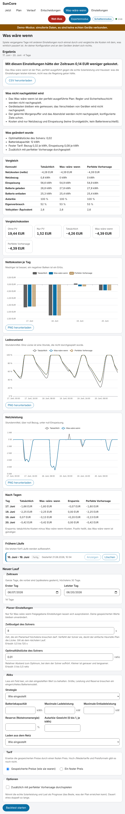

# Was-wäre-wenn und Backtest

**Was-wäre-wenn** spielt den echten SunCore-Planer über vergangene Tage mit Einstellungen durch,
die du wählst, und vergleicht das Ergebnis mit dem, was wirklich geschah. So kannst du fragen:
"Hätte sich ein größerer Akku oder eine andere Reserve gelohnt?", bevor du etwas änderst. Es
schreibt nichts an deine Geräte und lässt deine gespeicherten Einstellungen unverändert.

Es ist eine Experten-Funktion: Schalte den [Expertenmodus](expert-mode.md) ein, dann erscheint
der Link **Was-wäre-wenn** in der Kopfzeile (`#/whatif`). Bei ausgeschaltetem Expertenmodus zeigt
ein Deep-Link nur einen Hinweis.

## 1. Einen Lauf starten

Unter **Neuer Lauf**:

1. **Zeitraum:** ganze Tage, die vorbei sind (spätestens gestern). Standard sind die letzten 14
   Tage, höchstens 30.
2. **Planer-Einstellungen:** nur für Was-wäre-wenn freigegebene Einstellungen, derzeit das
   Zeitbudget des Planers (auf 10 s begrenzt) und die Solver-Lücke.
3. **Akku:** Strategie, Größe, Lade- und Entladeleistung, Reserve, Autarkie-Gewicht, Laden aus dem
   Netz "nie" oder "bis zu einem Preis". Lass ein Feld leer, um den eingestellten Wert zu
   behalten. Größe, Leistung und Reserve brauchen ein eingerichtetes Batteriemodell.
4. **Tarif:** die gespeicherten Preise oder ein fester Bezugs- und Einspeisepreis.
   Hoch-/Niedertarife und Preisformeln gibt es noch nicht.
5. **Zusätzlich mit perfekter Vorhersage durchspielen:** nimmt die echte Solarleistung und Last
   als Prognose, das Beste, was der Plan erreichen kann. Das verdoppelt die Laufzeit etwa.

Drücke **Backtest starten**. Es läuft immer nur ein Lauf, und keiner startet, während der Planer
rechnet (der Server antwortet 409; versuche es gleich nochmal). Du kannst abbrechen. Die letzten
fünf Läufe bleiben gespeichert und lassen sich anzeigen oder löschen.

## 2. Was durchgespielt wird

Für jede Stunde jedes Tages baut SunCore die Planer-Eingaben aus dem, **was damals bekannt war**:
die jüngste vor dieser Stunde gespeicherte PV- und Lastprognose, die gespeicherten Preise (die
Preise des Folgetags gelten ab 13:00 Ortszeit als bekannt) und den simulierten Ladestand. Der
echte Planer (HiGHS plus regelbasierter Rückfall) berechnet einen Plan, und die Stunde wird
innerhalb des Plan-Bands gegen die tatsächliche Solarleistung und Hauslast ausgeführt. Auf
denselben bepreisten Intervallen werden verglichen: **Ist** (gemessen), **Was-wäre-wenn** und
optional **perfekte Vorhersage**. Die Vergleichswerte ohne PV und nur PV aus dem Verlauf stehen
ebenfalls dabei.

## 3. Das Ergebnis lesen

Das Urteil sagt, dass der Zeitraum weniger, mehr oder gleich viel gekostet hätte. Darunter:

- **Was nicht nachgebildet wird** (immer lesen),
- die Liste der Änderungen mit den tatsächlich verwendeten Werten (ein Wert über der
  Hardware-Grenze oder ein begrenztes Budget steht als gewünscht und als verwendet),
- eine Vergleichstabelle, Diagramme für Nettokosten je Tag, Ladestand und Netzleistung mit PNG,
  eine Tagestabelle mit CSV und die **übersprungenen Tage** mit Grund.

Ein Tag wird übersprungen, wenn weniger als 80 % gemessen wurden, keine Preise gespeichert sind
oder keine PV- oder Lastprognose gespeichert ist (Prognosen werden 45 Tage aufbewahrt, Preise
400 Tage).

## 4. Grenzen

Das Ergebnis ist **der perfekt ausgeführte Plan**: eine Schätzung dessen, was die Einstellungen
leisten können, kein Versprechen, was der Regler getan hätte.

- Regler und Sicherheitsschicht werden nicht nachgespielt. Die Ausführung folgt dem Akku-Band des
  Plans wie ein Eigenverbrauchs-Wechselrichter, nicht dem geplanten Sollwert.
- Geräte behalten ihre gemessene Last. Das Verschieben von Geräten wird nicht nachgespielt.
- Der gelernte Morgenpuffer und das Abendziel werden nicht nachgespielt; es gelten die
  eingestellten Ziele, und die Lastprognose kommt aus den Profilen statt aus dem ML-Modell.
- Kosten sind nur der Netzaustausch: keine Grundgebühren, kein Akku-Verschleiß.
- Preise gelten ab ihrer Veröffentlichung am Vortag als bekannt.
- Das Zeitbudget des Planers ist begrenzt, ein Lauf kann also leicht vom echten Planer abweichen.

### Erwartete Genauigkeit

Ohne jede Änderung gespielt, sollte der Lauf nahe an den aufgezeichneten Kosten landen. Der
eigene Test von SunCore verlangt, dass der Lauf innerhalb von **5 %** der aufgezeichneten Kosten
liegt; auf den letzten 14 Tagen der Demo liegt er +1,1 % daneben. Betrachte 5 % als erwartete
Toleranz: Ein Was-wäre-wenn, das um weniger als das billiger ist, liegt im Rauschen. Auf deinen
eigenen Daten ist dieser Wert noch nicht gemessen.

## 5. Laufzeit auf kleiner Hardware

Auf einem Rechner in Desktop-Klasse brauchen 14 Tage etwa 9 s (etwa 17 s mit perfekter
Vorhersage) und 30 Tage etwa 23 s, bei höchstens rund 80 MB. Ein Lauf endet nach 15 Minuten oder
wenn der Prozess 280 MB überschreitet. Derselbe Lauf auf einem Raspberry Pi 4 oder einem Home
Assistant Green ist **noch nicht gemessen** (`UNVERIFIED`); beginne mit einem kurzen Zeitraum.

## Siehe auch

[Verlauf und Analyse](history-and-analysis.md) · [Expertenmodus](expert-mode.md)
