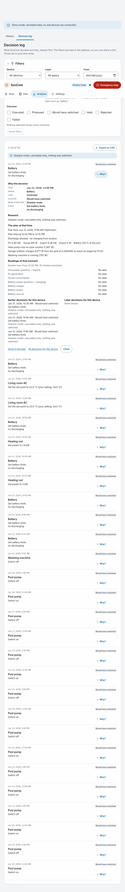

# Decision log and "Why?"

Every time SunCore switches a device, holds it, or refuses to, it writes a decision with its
reasons. **Analysis → Decision log** lists them, and **Why?** explains one decision
together with what the system knew at that moment. This works in shadow mode as well: the
entries then say what SunCore *would* have done.

## 1. Filter the list

The list is a table (cards on a phone) with 50 rows per page. Filters:

- **Device** and **outcome** (for example accepted, failed, would have).
- **Layer:** who made the decision: planner, controller, you, or the safety layer.
- **Reason:** a reason key or the beginning of one.
- **Text:** searches the device id and the stored decision (reason keys and values), not the
  rendered sentence.
- **From** and **to** date. The end date is inclusive.

The filters are part of the address (`#/decisions?device=...&from=...`). Copy the link to come
back to the same view. Values that do not fit are dropped from a pasted link. New entries appear
live on page 1 only.

**CSV** downloads the filtered list.

## 2. Why?

Press **Why?** on a row (keyboard: Enter; Escape closes the panel and returns the focus to the
row). The panel shows:

- the decision and its reasons in plain language,
- the plan interval it fell into: the band the planner allowed and the expected flows,
- the readings of that moment: grid, PV, house load, battery, state of charge, and the device's
  own power and state,
- the decisions just before and after.

The readings are the raw ones of that time, not a re-derived surplus.

From the panel you can jump to the **plan at that time** (`#/plan?at=<time>`, the interval is
marked), to the **device card** on the Now view, and to the **log of that device**.

## 3. Reading the answer

"Why did the heat pump not switch on at 12:10?" Typical answers: the surplus was below the
threshold for too short a time (hysteresis), the plan preferred the battery at that price, the
minimum pause had not passed, or the safety layer blocked the write. Each is a reason with its
numbers. A decision without a reason is a bug; please report it.

The plan snapshot that belongs to a decision is kept for 14 days; after that the plan link says
that no plan is stored.

## See also

[Plan chart](plan-chart.md) · [Surplus control](surplus-control.md) ·
[Planning and battery control](planning-and-battery.md)
