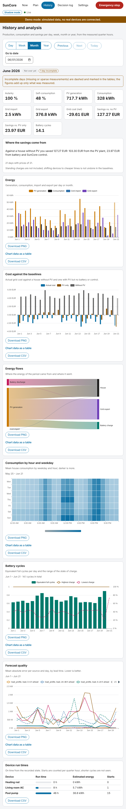

# History and analysis

The **History** view answers "what did my house do, and what did SunCore save me?" for a day,
a week, a month or a year. It reads the measured quarter hours that SunCore stores, so it works
in shadow mode too. It never changes anything on your devices.

## 1. Choose a period

Open **History** in the header. Pick **Day**, **Week**, **Month** or **Year** and move with
**Previous**, **Next** and **Today**, or jump with **Go to date**. The period is part of the
address (`#/history?period=week&date=2026-06-10`), so you can bookmark or share a link.

- A period that is not over yet is marked **Not over yet**.
- A day with fewer than 80 % of its quarter hours measured is **incomplete**: it is dashed in the
  charts, marked in the tables, and left out of averages.
- After an update SunCore rebuilds up to 365 days of past energy from the long-term statistics of
  Home Assistant. Those hours are marked **rebuilt from HA statistics** (the share is shown).
  They have no stored prices, so they have no cost.
- There is no free date range yet, only the four periods and the date jump.

## 2. The tiles

| Tile | Meaning |
|---|---|
| Autarky | Share of your consumption that did not come from the grid |
| Self-consumption | Share of your solar energy that you used yourself (house and battery) |
| Grid cost (net) | Import cost minus feed-in revenue, from the prices stored at that time |
| Savings vs. no PV | Cost of a house without PV and battery minus your actual cost |
| Savings vs. PV only | Cost of a house with your PV but no battery and no SunCore control, minus your actual cost |
| Battery cycles | Equivalent full cycles, counted over the **usable** capacity |

Plus PV generation, consumption, import, export, and the lowest and highest state of charge.

### What the savings mean

There is no single "saving", so SunCore shows two baselines and the split between them:

- **Without PV** is what the plant adds: every kWh of your load bought from the grid.
- **PV only** is a house with your solar plant, but no battery and no SunCore control: measured
  house load, surplus exported. The difference to your actual cost is what the **battery and
  SunCore** add. The attribution box states both parts in numbers.

What is not in the numbers: standing charges and one-off fees are not part of the cost, battery
wear is not part of the cost, and shifting devices to cheaper times is **not** undone in the
baselines (SunCore does not know what the unshifted load would have been). Cost exists only for
days where SunCore stored prices. SunCore never estimates past prices from today's tariff, and a
tariff edit does not change a day that is already closed.

## 3. The charts

Every chart has a data table as a text alternative, a **CSV** link and a **PNG** button.

- **Energy:** generation, consumption, import and export per day or month.
- **Cost against the baselines:** actual cost next to the two baselines.
- **Energy flows (Sankey):** where the energy came from and where it went. The rule is fixed:
  PV serves the house first, then the battery, then the grid. The battery serves the house first.
  The grid charges the battery only for what PV cannot.
- **Consumption by hour and weekday:** a heatmap of the mean house load. It covers at least the
  last 28 days.
- **Battery cycles:** equivalent full cycles per day and the range of the state of charge.
- **Forecast quality:** mean absolute error and bias per source, by lead time. Lower is better.
  Bias is actual minus forecast.
- **Device run times:** per controlled device, how long it ran and how often it started.

**Plan chart for this day** links to the plan view for a day in the past (see
[Plan chart](plan-chart.md)); it works as long as the plan snapshots are kept (14 days).

## 4. Export

- **CSV:** UTF-8, comma as separator, dot as decimal mark, ISO 8601 time with the offset of your
  site, units in the column names. The numbers equal the ones in the charts. An Excel variant
  with semicolon and decimal comma is not offered yet.
- **PNG:** drawn in your browser from the chart, with title and period.

## 5. When there is nothing to see

- **Collecting data** means there are no measurements for this period yet.
- **The history is not available** means the time-series database could not be opened. Look at
  the log of the app.
- Days from before SunCore was running come from HA statistics only if your Home Assistant kept
  them. How far back that reaches is `UNVERIFIED`.

## See also

[Decision log and "Why?"](decision-log.md) · [Plan chart](plan-chart.md) ·
[What-if and backtesting](what-if-and-backtesting.md)
