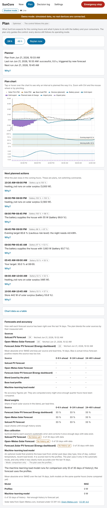

# Plan chart

The **Plan** view shows what SunCore intends for the next 24 or 48 hours and, since Phase 5, how
that compares with what was measured. This page covers what is new. For what the planner does,
see [Planning and battery control](planning-and-battery.md).

## 1. What you see

- **Planned** price, solar power with the P10 to P90 band, house load, state of charge, battery
  power, grid import and export.
- **Measured** values as wide, faint lines under the planned ones. The window starts three hours
  before now so you can hold the plan against reality. Measured values use 15-minute resolution.
- A **schedule per controlled device and for the battery** (Gantt): planned bars are outlined,
  measured bars are solid. A device counts as having run if it was on for at least half of the
  interval. The battery shows charge, discharge and lock periods.
- **Tooltips** with the reasons of the interval.
- A colour key and, under the charts, tables and a text version of the schedule for screen
  readers.

## 2. Zoom and pan

The panels share one time axis. Use the buttons or the keyboard on the chart: arrow keys pan,
**+** and **-** zoom, **0** resets. The zoom state is not stored in the address.

## 3. Look back and compare

The **Look back and compare** panel sets deep links:

- **Day** shows a past day (`#/plan?day=YYYY-MM-DD`; the History view links here).
- **Plan as of** shows the plan that was valid at a past time (`#/plan?at=<time>`; the decision
  log links here and the interval of the decision is marked).
- **Compare with the plan from** draws the second plan's state of charge and battery power as
  dashed lines and lists the intervals that differ.

Plans are kept for **14 days**. For an older time the view says that no plan is stored; the
measured values still show. For a window in the past the planned values come from one snapshot
at the window start, not from a new plan every hour.

## 4. Export

**Plan as CSV**, **Measured values as CSV** (the five site signals and at most three devices) and
**Comparison as CSV**, plus **PNG**.

## See also

[History and analysis](history-and-analysis.md) · [Decision log and "Why?"](decision-log.md)
