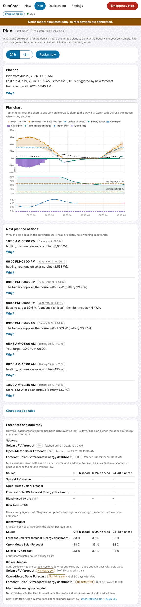

# Planning and battery control

SunCore can look ahead. It reads the solar forecasts and prices of the integrations you already
run, learns your house's consumption, computes a plan for the next 48 hours and, if you allow it,
sets limits on your home battery. This page explains what the planner does, what you can set,
how the battery is controlled **safely**, and how you take your first battery from shadow to
assisted mode.

Everything here starts in **shadow mode**: the plan is calculated and shown, and **nothing is
written to your battery or inverter until you say so**. Read
[Known limitations and UNVERIFIED](#10-known-limitations-and-unverified) before you rely on it:
the planner and the battery control have never run against real hardware yet.

## 1. What the planner does

The planner computes a schedule for the **next 48 hours in steps of 15 minutes**. It runs
**every 15 minutes** and again **when something changes**: new prices, a new forecast, a changed
setting, a manual change on a device, a large deviation from the plan (the battery is more than
10 percentage points away from the planned charge, or the grid power is more than 1.5 kW off for
30 minutes), or when you press **Replan now**. Runs closer than a minute are merged.

For every 15-minute interval the plan holds the expected solar power, house load, battery power,
grid import and export, the planned charge of the battery and the prices, **and the reasons**.
It minimises what you pay (import cost, minus feed-in revenue, plus a small wear cost for the
battery), within the limits you set. Cost is not everything: your targets (morning buffer,
evening target, your own target charge) are part of the model, and a small bonus for
self-sufficiency keeps the plan sensible when prices are flat (see
[the self-sufficiency weight](#the-self-sufficiency-weight)).

- **Solver or rule-based.** Normally an optimiser (HiGHS) finds the plan. It has a time budget
  (8 seconds by default) and a rule-based plan is computed first as a safety net. If the
  optimiser does not finish in time, cannot solve the model, is not available or produces a plan
  that fails the feasibility check, the **rule-based plan** is used and the plan view says so
  (badge **Rule-based** instead of **Optimiser**, with the reason). The rule-based plan is
  simpler: battery first up to the morning buffer, then consumers on surplus while the evening
  target stays reachable, grid charging only to reach a target.
- **"Why?"** Every interval carries reasons in plain language, for example "Evening target
  60.6 % (cautious risk level): the night needs 4.6 kWh" or "Hold the battery at 0.287/kWh: its
  energy is worth more at 19:00". You find them in the plan view (tooltip, list **Next planned
  actions**) and on the **Now** view.
- **The plan guides, the controller decides.** The real-time controller of
  [Surplus control](surplus-control.md) keeps the last word every few seconds. The plan sets
  bands (how much power a device may use, "battery first until X %") and the controller compares
  them with what really happens. A **stale plan** (older than 2 hours) or no plan at all means
  the controller behaves exactly as without a planner. Shadow, assisted and automatic apply to
  the plan's effects as before.

The **Plan** view shows a chart of the next 24 or 48 hours (solar with its P10 to P90 band,
house load, battery power, grid import and export, the planned charge with the morning buffer
and evening target as lines, and the import and export price), the planner's status (last run,
trigger, next run, failures), the **Next planned actions** with **Why?**, a table version of the
chart for screen readers and the panel **Forecasts and accuracy**. The plan is a plan, not a
switching command: every device still follows its own operating mode.

## 2. Forecasts

### Solar

SunCore does not call a weather service by itself. It reads the forecasts of integrations you
have installed, in setup step 4 (**Solar**, section **Forecast sources**):

| Source | Notes |
|---|---|
| Solcast | Reads the integration's forecast attributes (P10, P50, P90), or its read-only query action. SunCore never calls the Solcast API. |
| Forecast.Solar | The core integration, read through the Energy dashboard. With several entries you choose the one for this plant. |
| Open-Meteo Solar Forecast | The HACS integration. |
| Generic | A template that maps an entity's attributes to a forecast curve. |

You can use **several sources** at once. Their forecasts are **blended by their measured
accuracy**: each night SunCore compares every source with what your solar panels really produced
over the last 14 days and gives better sources more weight (every source keeps a minimum share).
Until enough days have been compared all sources count equally. You can also set a fixed share
per source (**Weight in the blend**).

On top of that SunCore learns each source's **systematic error** (for example "too high in the
morning when it is overcast") per hour of the day, season and weather class, and corrects it.
This **calibration becomes active after 30 days with data**; before that the forecasts are used
as delivered, and the panel shows "0 of 30 days with data". Hours in which the inverter or the
export limit **clipped** the output are recognised and left out of the learning, so a limited
plant does not teach the forecast to be too pessimistic.

The panel **Forecasts and accuracy** (below the plan chart) shows for every source how fresh
its data is, its error (MAE) and bias per lead time (0 to 6, 6 to 24 and 24 to 48 hours ahead),
the blend weights and the state of the calibration. Bias is actual minus forecast: positive means
the source was too low. Figures appear after the first night with enough data (**Collecting
data** until then).

**Open-Meteo:** the data of the Open-Meteo Solar Forecast integration is licensed under
**CC BY 4.0**. SunCore shows the attribution "Solar data from Open-Meteo.com, licensed under
CC BY 4.0" in the panel as soon as an Open-Meteo source is configured. SunCore itself ships no
built-in Open-Meteo or other internet fallback in this version; without a forecast source the
plan assumes no solar power at all.

### House load

The load forecast learns what your house uses **without the controlled devices**: the base load
is the house consumption minus every device SunCore may control (those are planned separately).
It builds a profile for every quarter hour of **workdays, weekends and holidays** with a slowly
fading memory (recent weeks count more), and rebuilds the last **28 days** at the first start
from Home Assistant's long-term statistics, so it does not start from zero. Until three days are
known it uses a flat guess with a wide band; without any history the plan uses a flat 500 W and
plans no consumers (a plan hint says so).

Two optional inputs in step 4 (**Load forecast inputs**) improve it:

- A **workday sensor** (the Home Assistant Workday integration). SunCore uses its state for
  today and asks `workday.check_date` for other days. If your sensor has a `days_offset`, SunCore
  handles it: Home Assistant evaluates the sensor for the date plus the offset, and SunCore
  corrects for that.
- A **weather entity**. Home Assistant keeps no statistics of a weather entity, so SunCore
  records its outdoor temperature itself. The temperature term of the load forecast becomes
  active after 14 days with a recorded temperature.

A machine-learning load model is **not available yet**; the panel says so. The profiles work from
day one.

## 3. Tariffs

Step 6 (**Tariff**) tells the planner what energy costs. Import prices can be:

- **Dynamic** from Tibber, Nord Pool, ENTSO-E, EPEX Spot or Octopus Energy, through the
  integration you already run (choose the tariff template; Nord Pool needs the id of its
  configuration entry, which you can look up under **Developer tools → Actions**), or a
  **generic price list** or a **price sensor** only.
- **Fixed**, or **fixed time-of-use (HT/NT)** with periods per weekday, midnight crossing and
  months.

**Price formula.** Many sources deliver only the **spot price** (the market price). The planner
cannot optimise on that, because you pay grid fees, levies, margin and VAT on top. In **What the
price contains** choose **Spot price only (fees and taxes on top)**, switch on **Turn the spot
price into my end price** and enter the multiplier, grid fee, levies, margin and VAT (end price =
(spot × multiplier + grid fee + levies + margin) × (1 + VAT)); optional time-variable grid fees
(section 14a EnWG module 3) can be added as time windows. The formula is **only for spot
prices**: Tibber's `price` is an all-in end price (choose **End price (everything included)**), and a
fixed price needs no formula. A source that delivers bare spot prices **without** a formula is
refused by the planner: it plans without price optimisation (self-sufficiency only) and says so
("delivers bare spot prices and no price formula is configured"), and the system check warns.

**Feed-in** is **fixed**, **tiered by plant size** (you enter the rate of every tier, for example
the two German rates up to and above 10 kWp, and the last tier must cover the whole plant; the
region profile does not carry the official table yet) or **none**. **Negative-price rule:** in a
region where feed-in is not remunerated at negative prices (profile `de`), the plan values export
at zero in those intervals and prefers to put the surplus into the battery and consumers instead.
Actual curtailment of the inverter is not controlled yet.

Tomorrow's day-ahead prices are expected from 13:00 local time; until they arrive, later hours
without a price are filled with the median and marked ("planned with the median price"), and
**grid charging never relies on an estimated or unknown price**.

## 4. Targets and strategies

All of this is set in step 5 (**Battery**: sections **Battery model for the planner** and
**Strategy**) and step 8 (**Priorities and goals**).

### Risk level

Forecasts are wrong sometimes, and the battery should not run empty because of it. The **risk
level** says how sure the plan must be to reach the battery targets:

| Risk level | Plans for | Meaning |
|---|---|---|
| **Cautious** (default) | a poor forecast (90 %) | The targets are met in about **9 of 10 cases**. |
| **Balanced** | 75 % | The targets are met in about 3 of 4 cases. |
| **Bold** | the median forecast | The targets are met in about half of the cases. |

SunCore learns how wrong the forecasts really are, per weather class, from the difference between
the net energy that was forecast (solar minus load) and what happened. Until 30 days of history
exist it uses the sources' own P10/P90 bands (labelled as such). The learnt error decides how
large the buffers are: more uncertainty, bigger buffer.

### Morning buffer, evening target, bridging

- **Morning buffer** ("battery first until X %"). Until the battery has reached X %, solar surplus
  charges the battery before consumers get it. X is computed from the forecast: higher when the
  day is uncertain, lower when plenty of solar is expected. In the plan chart it is the dashed
  line **Morning buffer**. **Minimum morning buffer** (step 5) is your own floor under the
  learnt value; empty means learnt only. Above X the surplus goes to consumers **as long as the
  plan says the evening target is still reachable**. SunCore compares X with the **live** charge
  every few seconds, so a day that deviates from the plan is handled correctly.
- **Evening target** (dashed line **Evening target**). The charge the battery should have at the
  start of the evening deficit, so that it carries the house through the night: the night's
  consumption plus, with **Bridge into the next day** on, the missing energy of a weak next day
  (the 48-hour horizon shows it), at the chosen risk level, up to your maximum charge. It is
  never below your own target.
- **Your target.** The goal **Have the battery at a target charge by a time** (step 8) is a
  **floor**: the plan keeps the battery at least at that charge at that time, and the real-time
  controller keeps the battery first while it is below. The plan can ask for more, never less.

Hard limits (reserve, maximum charge, your target, the minimum morning buffer) are always set by
you and always win over what is learnt.

### Strategies

| Strategy (step 5) | What it does |
|---|---|
| **Self-consumption** (default) | Learnt buffers as above; the battery covers the night and bridges a poor next day where that pays. |
| **Keep the battery as full as possible** (`prefer_full`) | "Battery first" up to the maximum charge, always. Consumers only get surplus the battery cannot take. |
| **Reach a target by a time** (`target_by_time`) | Uses the goal of step 8 (target charge and time) as a firm target, on top of the buffers. |

### The self-sufficiency weight

Step 8 has the expert field **Self-sufficiency weight per kWh**, default **0.01** (1 cent per
kWh in your currency). Think of it as a tiny bonus for every kWh you use from your own panels
instead of buying: the plan values it at 1 ct/kWh more than the price. It only decides between
options whose cost differs by **less than 1 ct/kWh**, so it costs at most 1 ct per kWh; it prevents
the optimiser from picking arbitrarily among equal-cost plans on a flat tariff. **0** means pure
cost.

### Grid charging

**Off by default.** In step 8, **Charging from the grid**: **Allow charging the battery from the
grid** only works together with at least one rule:

- a **price level** ("charge only at or below this import price"), and/or
- a **weekly schedule** (windows in which charging is allowed; **Fill with the night window
  22:00–06:00** gives you a start). With both set, both must hold.

On a **dynamic tariff** there is a third rule, the **spread**: SunCore only charges when a later
price is high enough above the charging price (plus the wear cost and a margin of about 3 ct per
kWh) to pay for the losses. **Without a known price SunCore never charges from the grid**, and it
needs your **import limit** (step 3) so it can never exceed the connection. Charging is only
planned for intervals the plan allows, with the live price checked again at execution.

Whether your inverter can actually be told to charge is a question of the adapter, see
[section 7](#7-adapters). **Kostal Plenticore cannot be forced to charge from the grid by
SunCore:** the plan shows it as "would charge", and nothing is written.

## 5. Control: shadow, assisted, automatic

The battery has its own **Battery** card on the **Now** view and its own mode, like a device:

| Mode | What SunCore does with the battery |
|---|---|
| **Shadow mode** (default) | Calculates and shows what it **would** set ("SunCore would set"). Writes nothing. |
| **Assisted mode** | Proposes limits under **Suggestions waiting for you**; **Confirm** carries one out, and it still passes the safety checks. |
| **Automatic mode** | Writes limits itself within all limits. |

The battery acts in the **lower** of the overall mode and its own mode, exactly like a device.
**Switching the battery to assisted or automatic** asks for a confirmation that carries the
battery's **identity** (the adapter, its mapped entities and the site's charge and power
sensors). If you change the adapter or those entities, or import a configuration, the battery
**falls back to shadow**, and a stored settings document cannot raise the mode by itself.

**What SunCore writes: limits only.** Never a power set-point. SunCore tells the inverter how
much the battery **may** charge or discharge, or at which charge it must stop (a minimum charge),
and the inverter's own self-consumption control does the rest. Charging from solar needs no write
at all. When the plan needs no limit, SunCore **releases** the battery: it restores what the
inverter had before (its "baseline"), and the inverter works on its own again. SunCore never
writes values above that baseline, so it can only **restrict**, never open up.

**The effective reserve** protects the energy you rely on. It is the **higher** of the minimum
charge of your inverter (step 5, **Minimum charge**) and the **reserve plus the BMS drift
margin** (**Battery model for the planner**; the drift margin, 5 % by default, is for batteries
whose reading sags at night). The plan never goes below it, and the safety layer refuses to
write a minimum charge below it. SunCore holds **no permanent minimum-charge floor** on the
inverter: it writes a minimum charge only for planned intervals where the plan wants to keep
energy for later, and your own, lower floor outside such an interval stays as it is.

**Checks.** Every write is read back from the device (both Kostal paths can fail without an
error), only happens on change and is limited in rate. Three failed writes in a row pause
battery control. A battery value that freezes, an unknown charge, a stale plan or any
fault pauses control and **releases** the battery. A release is complete only when the read-back
shows the original values; until then SunCore retries and writes nothing else.

**If you change something yourself.** A limit you set by hand (in the inverter's app or in Home
Assistant) is recognised by its value and **respected**: SunCore lets go without writing and keeps
its hands off until **04:00 the next day**. One documented corner case: a value you choose that
SunCore **itself had already tried or written in the same control phase** looks like SunCore's
own value, and is reset to the baseline at the release. That is the safe direction (the
inverter's own settings), but it means your manual choice is lost in that one case; repeat it
after the release. Anything else you changed stays.

**Emergency stop.** The red button in the header releases the battery like every device within
10 seconds and nothing is written until you end the stop. A normal **Stop**, restart or update of
the app also releases the battery before the connection closes. After a crash the record of what
SunCore held is persisted, and at the next start, once Home Assistant is connected, the battery is
released.

**Assisted until the timer is measured.** Some adapters can fall back to the inverter's own
limits by themselves when SunCore goes silent (Kostal Modbus does, through a timer in the
inverter). Until you have **measured** that timer on your system (see
[section 7](#measuring-the-fallback-timer)), such a battery is **capped at assisted mode**: the
card says so, and automatic acts like assisted.

## 6. Walk-through: your first battery to assisted

Do this on a day with sun, with the battery well above its reserve and while you are at home.

1. **Prepare.** Finish the setup assistant. In step 5 enter the capacity, the maximum charging
   and discharging power and the reserve (**Battery model for the planner**), choose the
   **strategy** and **risk level** (the defaults are fine), and choose a **Battery adapter**
   (see [section 7](#7-adapters)). In step 3 enter your **import limit**. Export a backup under
   **Settings**.
2. **Stay in shadow.** Open the **Plan** view for a day or two. Does the chart look plausible?
   Read the reasons under **Next planned actions**. Is the evening target near what the night
   really needs? Does the plan say "Rule-based" or show warnings (see
   [Troubleshooting](#9-troubleshooting))? On the **Now** view the battery card shows
   **Current limits** (what the inverter has now) and, when relevant, **SunCore would set**.
3. **Check the forecasts.** After the first night look at **Forecasts and accuracy**. A source
   with a huge bias or very stale data is worth fixing first.
4. **Switch the battery to assisted.** On the battery card choose **Assisted mode**, read the
   dialog and confirm. The overall mode must be **Assisted** or **Automatic** as well (step 9 or
   **Settings → Operating mode**), otherwise the battery stays in the lower one. Devices keep
   their own modes.
5. **Wait for a proposal.** Proposals appear when the plan wants a limit, for example a
   discharge lock ("Battery discharge held back" in **Next planned actions**). That can take
   hours or days: with a flat tariff and a full battery the plan may never need one. A proposal
   is valid for 2 minutes. **Confirm** only if the reason makes sense; **Dismiss** otherwise.
6. **Watch the first write.** After **Confirm** the card shows **SunCore holds these limits**.
   Look at the inverter's own display or the Home Assistant entity: the value must match (SunCore
   checks this itself and reports a mismatch). Kostal REST needs up to 35 seconds.
7. **Know your exits.** **Shadow mode** on the card releases the battery. **Emergency stop** in
   the header releases it at once. Setting a limit yourself makes SunCore let go until 04:00.
8. **Only then think about automatic**, after several days of sensible proposals. Adapters
   without a hardware fallback (generic, Kostal REST) are not capped, but a limit stays on the
   inverter until SunCore releases it or restarts: stay in assisted for a long time, and consider
   that a conscious choice.

## 7. Adapters

In step 5, **Control**, choose the **Battery adapter**. The default is **Observe only (SunCore
never writes)**: the battery is part of the plan, but you set it yourself. The battery card
lists what the adapter **can set**.

### Generic: Home Assistant entities

**Battery with number entities (generic).** Maps up to four optional `number` entities of your
battery integration: minimum charge (%), maximum charge power, maximum discharge power (W or kW)
and a forced grid-charge power. SunCore sets whichever you map; roles you leave empty are not
used. It also restores whatever the numbers held before. The adapter has never been driven on a
real battery (**Not verified with real hardware**); start in shadow and compare. This is the
adapter to use if your integration can force grid charging through a number.

### Kostal Plenticore through the Home Assistant integration

Adapter **KOSTAL PLENTICORE (Home Assistant integration, minimum SoC)**. It can set **only the
minimum charge** (`Battery:MinSoc`): SunCore uses it as a **discharge lock** for planned
intervals and gives it back afterwards. It **cannot limit the power and cannot charge from the
grid** (the REST interface has no such set-point): a planned grid charge is only **shown**
("would charge from the grid, but the adapter cannot force charging"), never executed. Because
the inverter's number has steps of 5 %, SunCore rounds **up**. A failed write is silent in this
integration, so SunCore reads the value back after about 35 seconds and only believes what it
sees. Without hardware fallback the lock stays until SunCore releases it: SunCore only locks for
planned intervals, never open-ended.

**The `Battery:MinSoc` entity is disabled by default in Home Assistant.** Enable it:

1. Open **Settings → Devices & services** and the **Kostal Plenticore** integration, then your
   inverter device.
2. Show the disabled entities (a note such as "+N entities not shown" lets you expand them, or
   use the filter for disabled entities) and open the number **Battery min SoC**.
3. Open its **settings** (gear icon), switch **Enabled** on and save. Home Assistant reloads the
   integration after about 30 seconds; the entity then shows a value between 5 and 100 %.
4. Compare the value with the minimum charge of your inverter's own display.
5. In SunCore step 5, **Control**, choose the Kostal adapter and map the role **"Battery min SoC"
   number of the inverter**. If the picker does not list it yet, tick **Also show hidden and
   diagnostic entities**. The optional select **Battery charging / usage mode** is read only.
6. Check the signs in the **Check the sign** panel of step 5 (the battery sign of the Kostal REST
   integration is `UNVERIFIED`), then keep the battery in **shadow** and watch the first
   proposals in assisted mode.

(The menu names are from memory of Home Assistant, not clicked through for this guide; they differ
between versions.)

### Kostal Plenticore through Modbus (§3.5 limits)

Adapter **KOSTAL PLENTICORE G3 battery limits over Modbus (§3.5)**. It can set the **maximum
charge and discharge power** and has a **hardware fallback**: SunCore re-writes the limits every
20 seconds; if it stops, the inverter returns to its fallback limits after a timer (60 seconds
by default). It cannot force grid charging either. It needs:

- **External battery management via Modbus enabled by the installer** (register 1080 must read
  `2`; SunCore refuses to write otherwise). How it is enabled is not documented here.
- A **`modbus` hub** in Home Assistant (whether it can be created in the UI is `UNVERIFIED`;
  assume YAML) with the inverter's unit id (Kostal default 71) and one sensor per register:
  1080, 1280, 1282, 1284, 1286, 1288, 1076, 1078, and register 5. Each is mapped to the role
  with that register's name in step 5.
- The **word order of register 5** (**Little endian** or **Big endian**) entered under **Modbus
  link**. SunCore never guesses it.

This adapter **runs in the simulator only** so far, because the maintainer's inverter does not
have external battery management enabled yet. It is **capped at assisted** until
`fallback_measured` is set.

#### Measuring the fallback timer

Do this **once**, while you are at home. It proves that the inverter really returns to its own
limits when SunCore goes silent, which is why automatic is allowed at all.

**Safe test, in short:** put the battery in assisted, confirm **one** discharge limit, end
SunCore **without** a hand-back, and watch when the inverter returns to its own limits. Expected:
at most the fallback timer (60 s) plus one step of the sensors.

Before you start:

- The battery is well above its reserve, the house load is moderate, and it is not an
  emergency-stop situation. A discharge limit of 0 W makes the house **import** for a few
  minutes: pick a time when that does not matter.
- In Home Assistant: the sensor of register 1080 shows `2`; the timer sensor (1288) shows
  `60`; the fallback sensors 1284 and 1286 show the battery's own limits (or higher); you
  know the battery's own limits (1076, 1078).
- You can see the **battery power** and the **grid power** with timestamps (a history graph).
- You know how to reach the Home Assistant host's shell (for example the "Advanced SSH & Web
  Terminal" app with protection mode off) **or** can otherwise end the app abruptly.
- **Turn the app's Watchdog switch OFF** (the app's **Info** page) before the test. With the
  watchdog on, the Supervisor restarts a killed container at once, SunCore releases the battery
  and writes the limits itself within the 60 seconds, and the test shows a fall-back that never
  happened (a false positive). Turn the watchdog back on afterwards. (Behaviour read in the
  Supervisor source, `supervisor/apps/app.py` watchdog, on 2026-10-28; `UNVERIFIED` on HA OS.)
- **Abort criteria:** a modbus error in the log, register 1080 not `2`, a sensor that does not
  show what SunCore wrote, the charge approaching the reserve, grid import near your
  connection limit, SunCore running again before you observed the fall-back (see step 4), or
  anything you do not understand. Then do not continue: start the app (it
  releases the battery after reconnecting), switch the battery card to **Shadow mode** and
  check the log. If the limit does not return on its own, restore the inverter by hand (its
  own settings or, in the installer menu, the external management off).

Steps:

1. Set the battery to **Assisted mode** (see [section 6](#6-walk-through-your-first-battery-to-assisted)).
2. Wait for a proposal that contains a **discharge limit** (the plan shows "Battery discharge
   held back"). **Confirm** it once. The card shows **SunCore holds these limits**, and the
   register 1282 sensor shows the value.
3. Confirm the effect: with a discharge limit of 0 W the battery power goes to about 0 W and the
   house imports. Wait for at least one heartbeat (20 s) to see the value held.
4. Note the time (to the second). **Stop SunCore without a hand-back.** A normal **Stop** or
   restart of the app does **not** work for this: SunCore then releases the battery first, and
   the inverter returns to its own limits immediately, which proves nothing about the timer. End
   the container instead, for example with `docker kill` in the shell (find the name with
   `docker ps`; it ends in `suncore`; the exact name is `UNVERIFIED`). Check on the app page and
   with `docker ps` that the app **stays stopped**. Later, in the SunCore log after you start it,
   note the time of the recovery line: it must be **after** the fall-back you observed, otherwise
   SunCore wrote the limits itself and the measurement is void.
5. Watch the battery power and the grid power. When the inverter falls back, the battery starts
   to discharge into the house and the grid import drops. Note the time when that happens. The
   difference is your measured timer.
6. **Expected:** the return happens within **60 seconds plus one sensor step** (the scan
   interval of your modbus sensors, 15 seconds assumed). If the battery has not started to
   discharge after three times the configured timer (3 minutes), **abort**: start SunCore, and
   take the inverter back by hand as described above.
7. Start the app again. It finds the record of what it held and releases the battery (writes the
   own limits) once Home Assistant is connected.
8. Repeat once for confidence. If both runs return within the timer: **export** the
   configuration under **Settings**, set `"fallback_measured": true` in the `battery` section of
   the file (`sections → battery → body`), and **import** it again. The battery card then no
   longer shows the assisted cap (the setting has no switch in the panel yet). An import resets
   the overall mode and the battery to shadow, as it always does: switch them again, one step
   at a time.

If the timer is longer than configured, leave the cap in place and open an issue with your
measurements.

## 8. What else you will see

- **Settings** lists **Battery (control and planning)** (adapter, strategy, risk level) and
  **PV forecast** (the number of sources). Both can be opened, restored and exported like every
  section.
- **Setup step 10** shows the **First plan**: expected solar, consumption, import and export of
  the next hours and the battery's lowest, highest and final charge. **Update the preview**
  recomputes it.
- The **Decision log** also lists battery decisions with reasons.
- The planner needs the battery's charge. Without it ("Waiting for the battery's state of charge
  before planning") there is no plan.

## 9. Troubleshooting

- **"There is no plan yet: SunCore controls on surplus rules only."** The planner has not run.
  It waits for prices and forecasts and starts at the latest 5 minutes after the first
  connection; the plan view's hint names what is missing (for example "Waiting for the
  battery's state of charge" or "Nothing to plan yet: the site is not set up or Home Assistant is
  not connected"). Press **Replan now** after you fixed it.
- **"The plan is older than … h" / stale.** After 2 hours without a new plan SunCore stops
  using it and controls on surplus rules only (the Phase 3 behaviour). Look at the **Planner**
  block for failures and the log; the last good plan stays shown, flagged as stale.
- **Plan is "Rule-based".** The optimiser did not deliver; the badge's reason says why (time
  budget, solver not available, ...). The rule-based plan is safe but less clever.
- **"No electricity prices: planning for self-sufficiency only"** or **"… delivers bare spot
  prices and no price formula is configured"** (the same warning appears in the system check of
  step 10). The plan runs in a flat mode without price optimisation. Check the price source
  (**Tariff** status) or add the price formula in step 6.
- **"The battery's state of charge is unknown: the battery is left out of the plan"**, **"No
  solar forecast"**, **"No load forecast yet"**. Fix the entity or add a forecast source (step 4);
  the plan names every missing input.
- **A target "cannot be reached".** The plan says "Evening target of 70 % at 18:00 cannot be
  reached: the plan expects 55 %": the day offers too little energy at your risk level, or your
  limits (maximum charge power, import limit) are too tight.
- **The battery card says "Paused: …".** Battery control is paused for a reason (frozen
  reading, stale inputs, a failed release, three failed writes). The reason names it; it
  resumes after the values are plausible again.
- **"The battery adapter cannot force charging: shown only".** Expected for Kostal Plenticore:
  grid charging is planned and shown, but not executable.
- **No accuracy figures.** They are computed each night; wait for the first night with data.
- **More** in the troubleshooting section of the
  [app description](../../../addon/suncore/DOCS.md) and in
  [Surplus control](surplus-control.md).

## 10. Known limitations and UNVERIFIED

- **Never run on real hardware by the project so far.** Planner, forecasts, tariffs and the
  battery path are tested in the simulator and with fixtures read from the integrations' source
  code. Wording and menu paths in this guide were not clicked through on a real Home Assistant.
- **Kostal Modbus** runs in the simulator only: how external battery management is enabled, the
  inverter's fallback timer and the byte order of register 5 and of the timer register 1288
  are unverified. The procedure
  above is meant to measure it.
- **Kostal REST:** the sign of the battery and grid power, how soon the minimum charge is read
  back (35 seconds assumed) and whether out-of-range values are clamped are unverified.
- **Grid charging is not executable on Kostal Plenticore** (neither path has a charge
  set-point). It is planned and shown only. A generic adapter with a forced-charge number can do
  it if your integration offers one.
- **Generic adapter:** exercised in the simulator only.
- **The planner's weights and rules** (penalties for missed targets, the value of energy left at
  the end of the horizon, the device budget) are reasoned, not fitted. On a day with far less sun
  than forecast (below about half of the planned solar energy) the evening target can be
  missed by a few percentage points, because the consumers took their share first. Solve times on a
  Raspberry Pi (aarch64) are not measured; on a PC they are a few milliseconds.
- **Calibration and risk constants** (clear-sky classes, shrinkage, bounds 0.5–1.5, default bands
  per weather class) are reasoned, not fitted to real data; they need your 30 days.
- **Tariffs:** how VAT applies to negative spot prices is assumed; the negative-price rule for
  all-in sources such as Tibber uses the end price as a stand-in; the publication time of
  tomorrow's prices (13:00) is assumed; Nord Pool's configuration entry id must be entered by hand;
  the official German feed-in tier table is not built in.
- **Not modelled:** thermal behaviour of air conditioners and water heaters in the plan (they
  only get the surplus), export limiting through the inverter (curtailment is shown, not
  controlled), peak shaving, wallbox, heat pump, shiftable programs.
- **No history, no what-if.** The plan view is minimal; the full chart, history and analysis
  follow in Phase 5.
- **After a restart** the first plan is computed from scratch (stored plans are not read back).
- **Time series** (`timeseries.db`) are not part of the app backup; SunCore rebuilds 28 days of
  quarter-hour history from Home Assistant's statistics. The learnt corrections need new days.
- **Downgrade:** this version stores its data in database schema 4, which earlier versions
  cannot open. Export the configuration before updating.
- **Compared with EMHASS and Predbat:** both are far more mature optimisers with years of
  field experience; SunCore's planner is new and unproven on hardware. What SunCore adds is one
  app with forecasts, plan, battery control, a safety layer, shadow mode and a reason for every
  decision, set up through a wizard. evcc remains the better choice for charge points.

See also: [Quick start](quick-start.md), [Surplus control](surplus-control.md),
[Contribute a device template](device-templates.md), [compatibility list](../compatibility.md).
