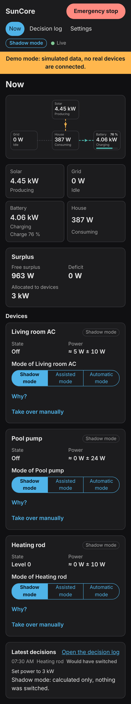

# Quick start

SunCore is **pre-alpha** (Phase 1). This version shows your energy flow
live. It runs in shadow mode: nothing is switched and no set-point is
written. The full app description is in
[`addon/suncore/DOCS.md`](../../../addon/suncore/DOCS.md).

## 1. Install

1. In Home Assistant open **Settings → Apps → App store**.
2. Menu (three dots) → **Repositories** → add
   `https://github.com/pxljake/suncore`.
3. Install **SunCore (beta)** while no stable release exists, then
   **Start** it and enable **Show in sidebar**.

Menu names differ between Home Assistant versions; older versions say
**Add-ons** and **Add-on store** instead of **Apps** and **App store**.

## 2. Try the demo (optional)

Switch on the option `demo_mode` on the app's **Configuration** tab and
restart. A simulated sunny day feeds the panel and nothing of your
installation is read.

## 3. Open the panel

Open **SunCore** in the sidebar (administrators only). The **Now** page
shows solar, grid, battery and house with animated flows.

On a phone the same view stacks vertically, and it follows the dark theme
of your device:

## 4. Pick your sensors

Open **Settings** and choose your grid, solar, battery and (optionally)
house sensors. The live value is shown under each field.

Sign convention: **grid positive = import**, **battery positive =
charging**, PV positive = generation. If a sensor uses the opposite
convention, switch on **Invert sign** for it. Click **Save**.

## What is missing

Forecasts, the planner, device control and the setup assistant come in
later phases; see the [roadmap](../../roadmap.md). Having problems? See the
troubleshooting section in the app description above.
