# Quick start

SunCore is **pre-alpha** (Phase 4). This version helps you describe your
installation with a setup assistant, shows your energy flow live, controls
devices from your solar surplus, and plans the next 48 hours with forecasts,
prices and your battery. It starts in **shadow mode**: nothing is switched and
no limit or set-point is written until you switch a device or the battery to
automatic (or assisted) yourself, see [Surplus control](surplus-control.md) and
[Planning and battery control](planning-and-battery.md). The full app
description is in [`addon/suncore/DOCS.md`](../../../addon/suncore/DOCS.md).

## 1. Install

1. In Home Assistant open **Settings → Apps → App store**.
2. Menu (three dots) → **Repositories** → add
   `https://github.com/pxljake/suncore`.
3. Install **SunCore (beta)** while no stable release exists, then
   **Start** it and enable **Show in sidebar**.

Menu names differ between Home Assistant versions; older versions say
**Add-ons** and **Add-on store** instead of **Apps** and **App store**.

Want to look around first? Switch on the option `demo_mode` on the app's
**Configuration** tab and restart. A simulated, fully set-up house feeds the
panel and nothing of your installation is read.

## 2. Open the panel: the setup assistant starts

Open **SunCore** in the sidebar (administrators only). On the first start
the setup assistant opens by itself. It has ten steps, shows your progress,
saves every step and can be left at any time with **Leave setup**; you
continue where you stopped (**Continue setup** in Settings). If you used the
Phase 1 version, you land in the assistant once with your old sensors
already filled in.

Nothing is switched while you set up (and not afterwards either, until you say so).
Every sensor you pick shows its live
value, so you can check it right away. Sign convention used everywhere:
**grid positive = import**, **battery positive = charging**, solar positive
= generation.

## 3. The ten steps

### Region and language

Choose the **Region profile** (it sets the currency, the time zone and
rules such as feed-in remuneration) and the **Language**. Take the generic
profile if your country is not listed.

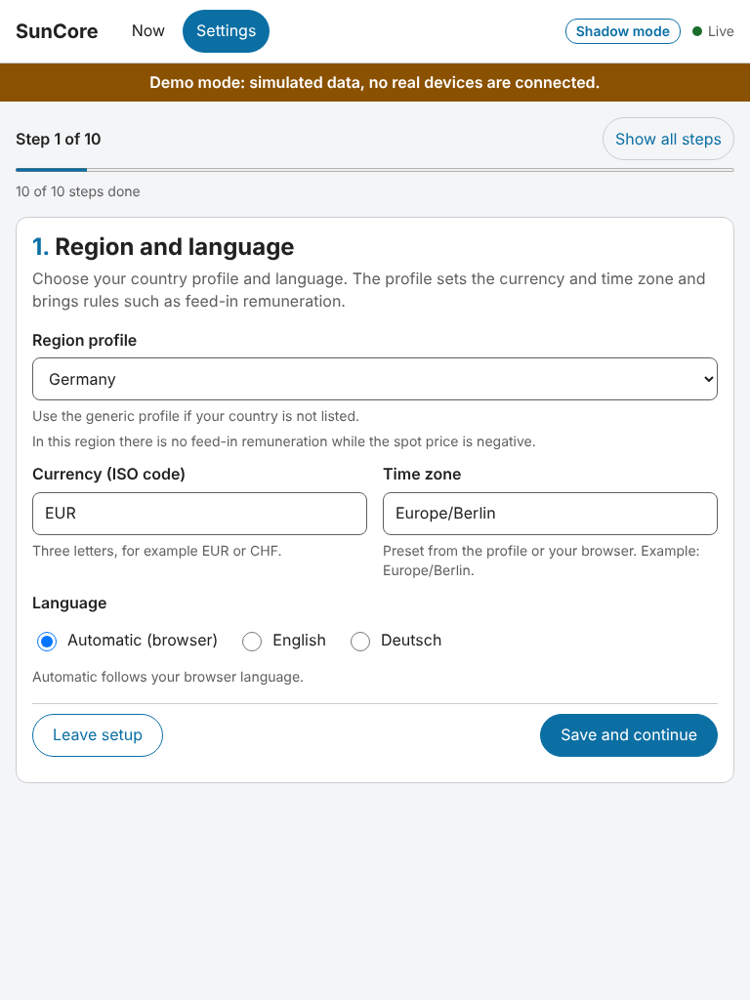

### Energy dashboard

If you already set up Home Assistant's Energy dashboard, SunCore reads it
and suggests sensors for grid, solar and battery. Tick the suggestions you
want and choose **Apply N suggestions and continue** (N is the number you
ticked; with one it reads "suggestion"). Nothing is applied
without your choice, and you can change everything in the next steps. The
dashboard often has only energy counters (kWh), no power sensors; then
SunCore says so and you pick the power sensor yourself. Not set up? Skip
the step.

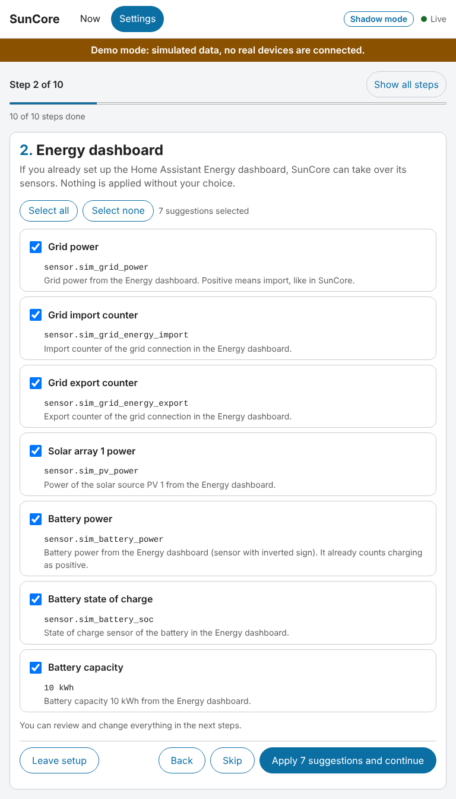

### Grid connection

Choose **One signed sensor** or **Separate import and export sensors**.
Optional: a house consumption sensor (otherwise it is calculated from grid,
solar and battery), limits for import and feed-in, and the grid operator
signal for section 14a EnWG (Germany).

The **Check the sign** panel asks, for example, "The grid connection is importing
… right now. Is that correct?" Answer **Yes, correct** or **No, invert the
sign**. Idle at the moment? Check again when something clearly flows.

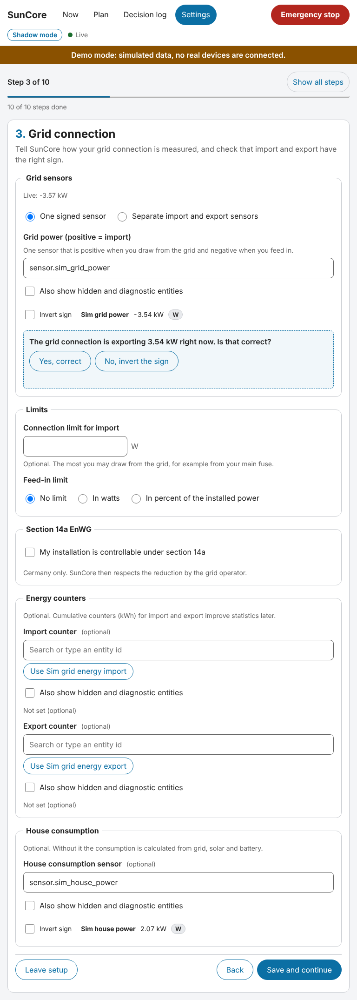

### Solar

Add each solar array with its **Power sensor**, installed power in kWp,
tilt and orientation (azimuth: 0 = north, 180 = south). Under **Forecast
sources** choose one or **several** solar forecasts (Solcast, Forecast.Solar,
Open-Meteo Solar Forecast or a generic template); SunCore offers the ones it
finds in Home Assistant and blends them by how well each has been right (the
**Weight in the blend** is automatic unless you set a fixed share). With
Forecast.Solar and several linked entries, choose the **Forecast.Solar entry**
of this plant. Optionally add a **Workday sensor** and a **Weather entity**
under **Load forecast inputs**: they improve the house load forecast. No
forecast source at all is allowed; the plan then assumes no solar power. See
[Forecasts](planning-and-battery.md#2-forecasts).

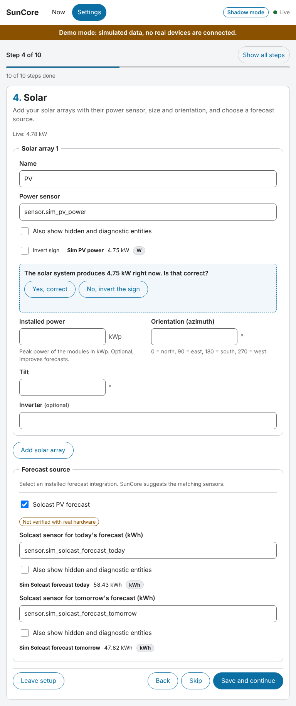

### Battery

Select the battery power sensor (positive = charging) and the state of
charge sensor, or choose **No battery**. Capacity, the minimum and maximum
charge and the power limits are optional for observing, but the planner needs
them. Under **Control** choose a **Battery adapter**: the default **Observe
only (SunCore never writes)** leaves the battery to you; an adapter (generic
Home Assistant entities, Kostal Plenticore through the Home Assistant
integration or through Modbus) lets SunCore set limits later, and the battery
still starts in shadow mode. Then fill the **Battery model for the planner**
(capacity, power limits, reserve, BMS drift margin) and choose the
**Strategy** (self-consumption, keep the battery as full as possible, or reach
a target by a time), the **Risk level** (cautious is the default and the
targets are then met in about 9 of 10 cases), an optional **Minimum morning
buffer** and **Bridge into the next day**. Everything is explained in
[Planning and battery control](planning-and-battery.md#4-targets-and-strategies);
the adapters in [Adapters](planning-and-battery.md#7-adapters).

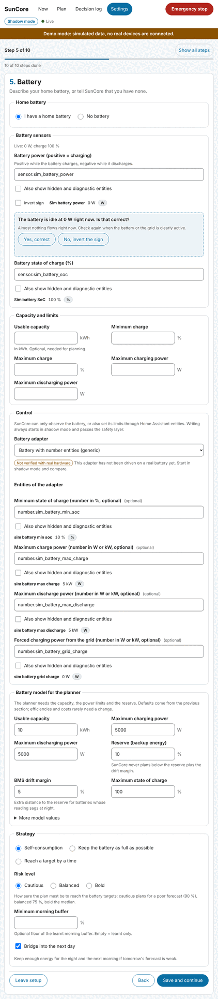

### Tariff

Enter the **Import price** (**Fixed price**, **Fixed time-of-use (HT/NT)** or
**Dynamic price**) and the
**Feed-in remuneration** (fixed, tiered by plant size, or none). A dynamic
price needs a price sensor or a tariff template (Tibber, Nord Pool, ENTSO-E,
EPEX Spot, Octopus Energy or a generic price list). If the source delivers
only the bare spot price, choose **Spot price only** under **What the price
contains** and enter your **Price formula** (grid fee, levies, margin, VAT);
without it the planner cannot optimise on prices. The planner uses these
prices; see [Tariffs](planning-and-battery.md#3-tariffs).

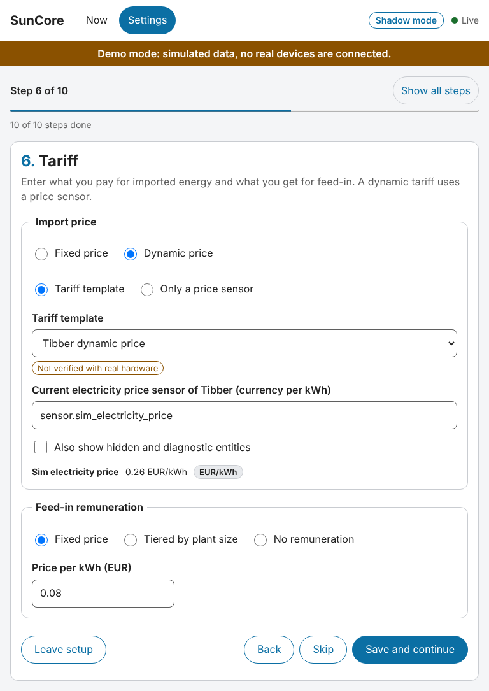

### Devices

Add the devices SunCore may control later. Search the gallery, **Choose** a
template (for example an LG ThinQ air conditioner, a switch or an adjustable
load), map its entities, check the power model and the protection times, and
save. The assistant ranks your entities and tells you why a candidate
matches. New devices always start in shadow mode.

An air conditioner template has an optional **Power sensor**. Use it if
another device measures the unit's power, for example a smart plug or the
HACS integration `smartthinq_sensors` (sensor "Energy current"): SunCore then
preselects the **Measured** power model. Such sensors often update only every
few minutes (5 minutes for `smartthinq_sensors`), so the value is slow. If you
run the same air conditioner through two integrations (for example `lg_thinq`
and `smartthinq_sensors`), control it through **one** of them only: the editor
shows a hint when you pick a second entity of a unit that is configured
already, and the system check at the end warns about it. Both compare the
device names in Home Assistant and only react to two *different* integrations
with the same device name; if you renamed one of the devices in Home Assistant
(its own name), the hint and the warning stay silent.

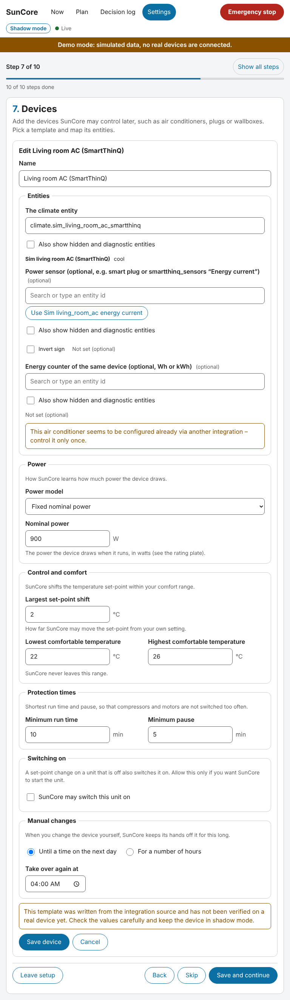

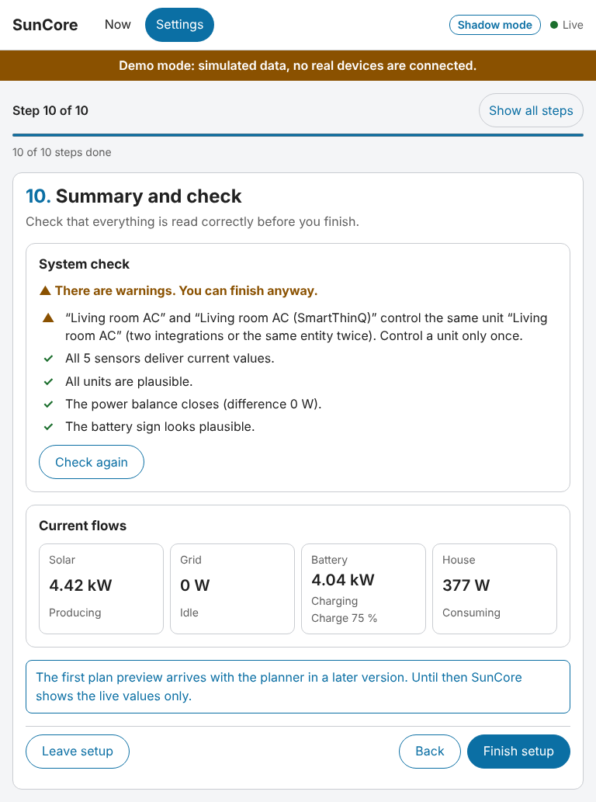

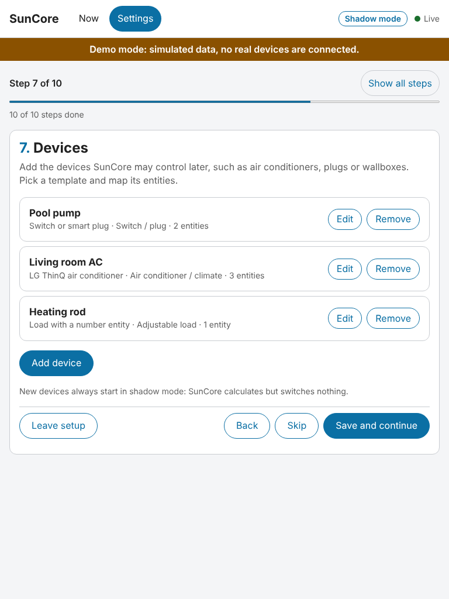

Is your device missing? See
[Contribute a device template](device-templates.md) and the generated
[compatibility list](../compatibility.md).

### Priorities and goals

Drag devices by their handle, or use the arrow buttons or the arrow keys,
to decide who gets surplus first. Position 1 is served first. Goals decide
whether the battery's charging power counts as surplus for devices (target
charge of the battery, climate before export); see
[Battery and goals](surplus-control.md#battery-and-goals). Under **Charging
from the grid** you can allow the battery to be charged from the grid, only
below a price level and inside a weekly schedule (off by default; see
[Grid charging](planning-and-battery.md#grid-charging)). The expert field
**Self-sufficiency weight per kWh** is a small tie-breaker for the planner
([explained here](planning-and-battery.md#the-self-sufficiency-weight)).

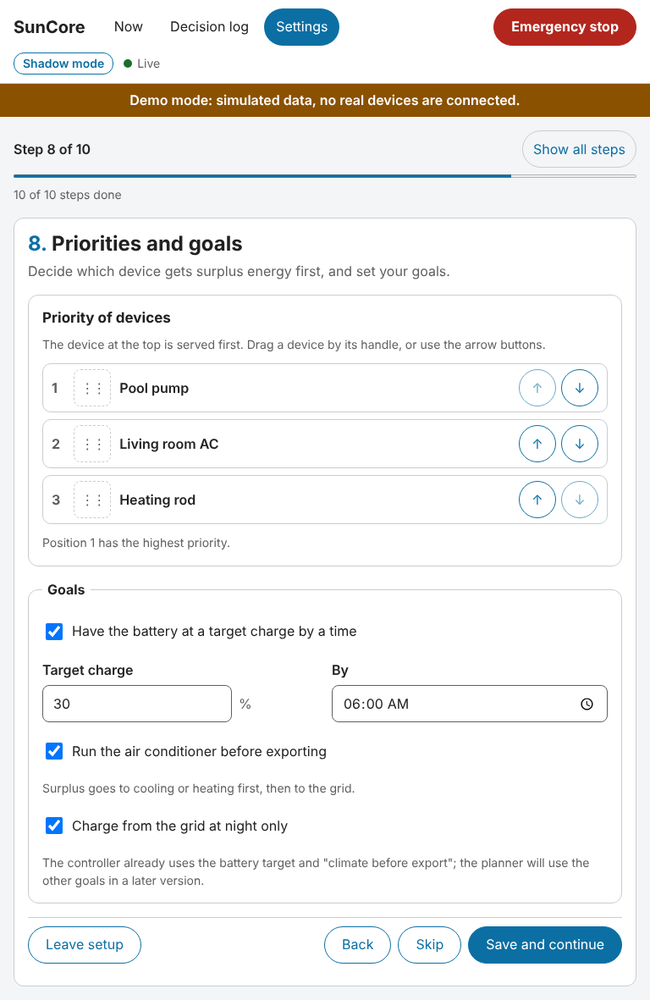

### Operating mode

Choose the **overall mode**: **Shadow mode** (the default: SunCore calculates
and logs, switches nothing), **Assisted mode** (it suggests, you confirm) or
**Automatic mode** (it acts by itself). This step only sets the overall mode.
Each device has its own mode, which you change on the **Now** view, and a device
acts only in the lower of the two, so automatic needs both. Leave it on shadow
for now.

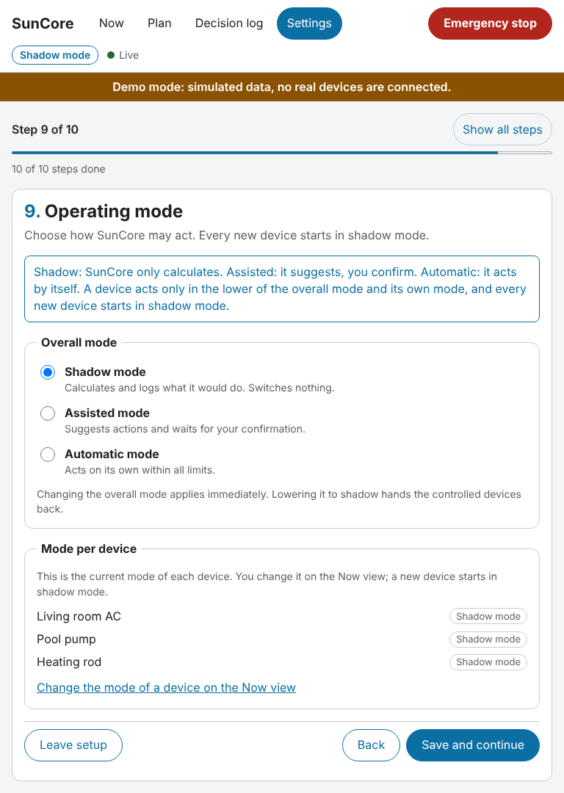

### Summary and check

The **System check** looks at units, signs, the power balance and whether
sensors deliver current values. Fix everything marked with a cross (open the
step from the list), choose **Check again**, then **Finish setup**.
Warnings do not block you. A warning that the tariff delivers bare market
prices without a price formula means the plan cannot optimise on prices:
add the formula in the **Tariff** step. The summary also shows the **First
plan**: the expected solar energy, consumption, import and export of the next
hours and the battery's lowest, highest and final charge. **Update the
preview** recomputes it.

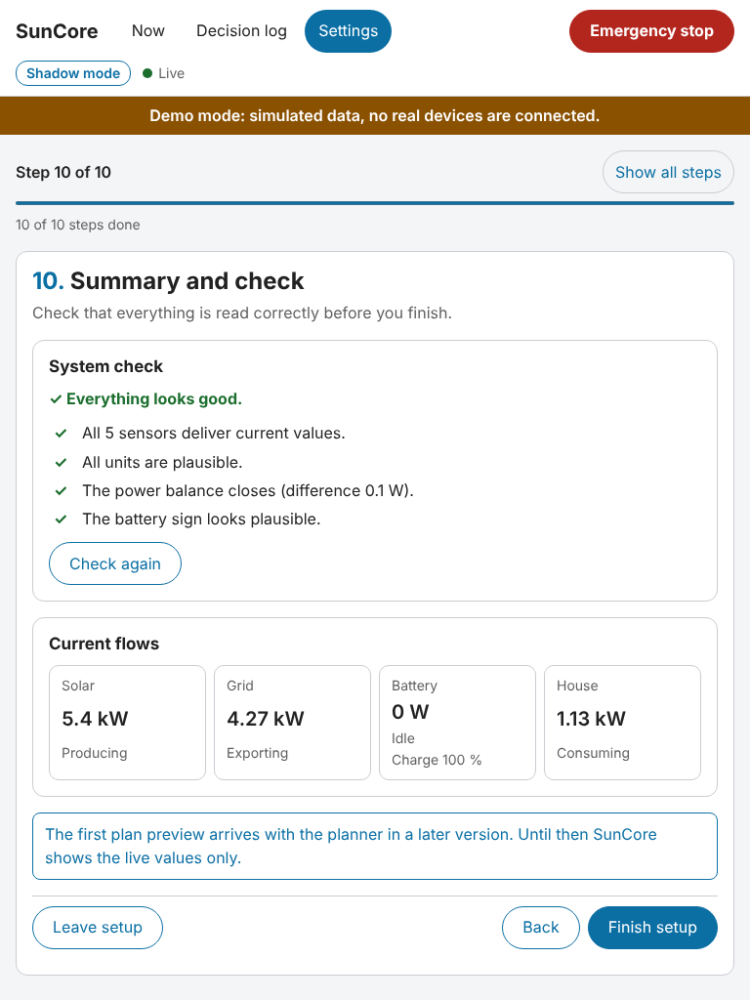

The panel follows the dark theme of your device as well:

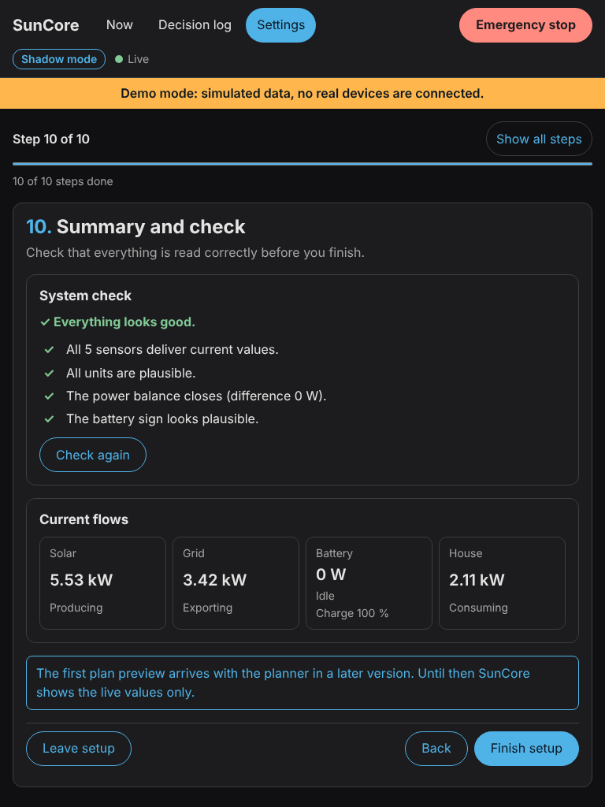

## 4. What shadow mode means

SunCore calculates what it would do and logs it as **Would have switched**, but
switches nothing and writes no set-point. Shadow mode is the default for the
whole system and for every new device. A device is only controlled when **both**
the overall mode and the device's own mode are set to automatic (or assisted,
where you confirm every action). Run in shadow mode for a day or more, read the
log and only then switch a single device: the step-by-step guide is
[Take your first device to automatic](surplus-control.md#8-take-your-first-device-to-automatic).

## 5. The Now view

After **Finish setup** the **Now** page shows solar, grid, battery and house
with animated flows, the **Surplus** card, a **Battery** card (state of charge,
power, the limits in force, the battery's mode switch and **Why?**), the
**Next planned actions** and a card for every device with its state, estimated
power, mode switch and **Why?**. The red **Emergency stop** button in the
header hands every device and the battery back at once. The **Plan** page
shows the 24 or 48 hour plan with the forecasts and their accuracy.

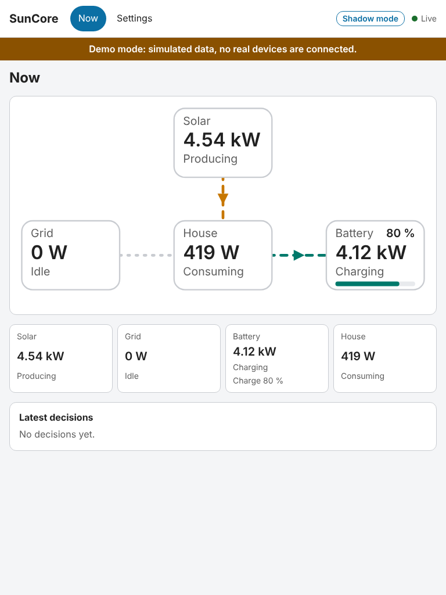

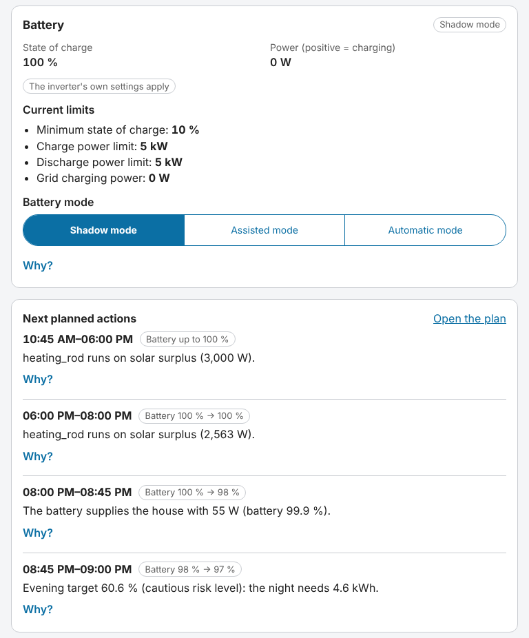

The **Decision log** lists every decision with its reasons. How it all works,
what happens when you change a device yourself and what SunCore does when
something fails is in [Surplus control](surplus-control.md); the plan, the
forecasts and the battery are in
[Planning and battery control](planning-and-battery.md), including a
walk-through to take your first battery to assisted mode.

## 6. Change things later

Open **Settings**. It lists every section of your setup (**Region**,
**Site (grid, solar, battery)**, **Tariff**, **PV forecast**, **Battery
(control and planning)**, **Devices**, **Goals**, **Operating mode**) with a short
summary and an **Open** link to the matching step.

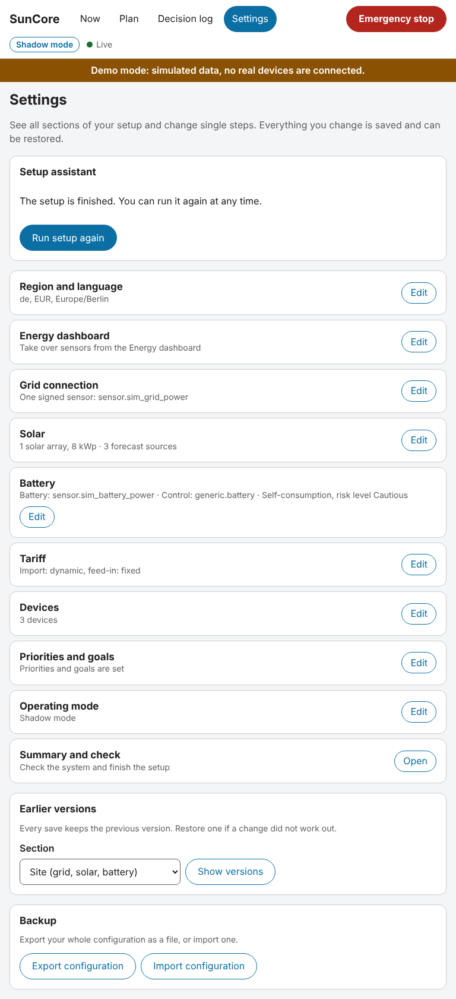

- **Run setup again** restarts the assistant with your current values.
- **Earlier versions**: every save keeps the previous version. Use **Show
  versions** and **Restore** if a change did not work out.
- **Backup**: **Export configuration** saves everything as a file,
  **Import configuration** loads one. Use it before experiments and when
  you move to a new installation.
- Unsaved edits are guarded: leaving a page asks before they are discarded.

## Troubleshooting

- **The sign check says the balance does not close.** A sensor, unit or
  sign is wrong. The system check names the part ("Inverting the sign of
  the grid would close the power balance"); go back to that step and answer
  **No, invert the sign**.
- **A sensor is rejected for its unit.** Power sensors must report W or kW,
  energy counters Wh or kWh, charge levels %. SunCore never guesses units;
  pick another entity or fix the integration.
- **"has not updated for a while" or "is unavailable".** The source
  integration stopped delivering. Check the integration in Home Assistant;
  SunCore marks the value instead of using it.
- **No suggestions or ranking, or a hint that the registry is not
  available.** SunCore reads Home Assistant's entity, device and area
  registry for detection. If that is not available it falls back to a plain
  list of states with simpler rules: you still find your entities with the
  search field, only the ranking is less precise. Update Home Assistant if
  it persists, and report your version.
- **The Energy dashboard step is empty.** Either it is not set up in Home
  Assistant or it has only energy counters. Skip the step and choose power
  sensors yourself.
- **A device is not in the gallery.** See
  [Contribute a device template](device-templates.md), or use a generic
  template (switch, climate, adjustable load).
- More in the troubleshooting section of the
  [app description](../../../addon/suncore/DOCS.md).

## What SunCore cannot do yet

Be aware before you rely on it. SunCore now has forecasts, tariffs, a 48 hour
planner and battery control, but **none of it has ever run against real
hardware**: that is what your shadow-mode run is for. The battery starts in
shadow mode, and until the inverter's fallback timer has been measured on your
system a Kostal Modbus battery is capped at assisted mode. Kostal Plenticore
cannot be told to charge from the grid. There are no history charts or what-if
analysis yet (the plan view is minimal), no thermal models for air conditioners
and water heaters in the plan, no charge point (wallbox) control and no Home
Assistant entities. Compared with evcc (charge points and heaters), EMHASS and
Predbat (battery optimisation), SunCore's planner is new and unproven, while
its surplus control and safety layer are its strengths. The list of open points
is in [Known limitations](planning-and-battery.md#10-known-limitations-and-unverified)
and in [Surplus control](surplus-control.md#known-limitations-and-unverified);
the [roadmap](../../roadmap.md) shows when each part arrives.
