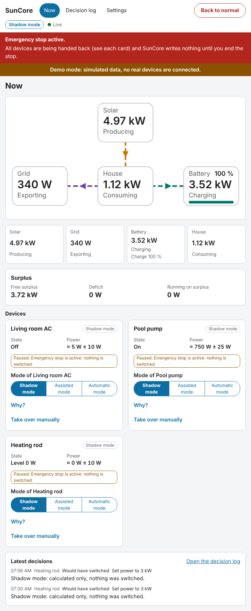
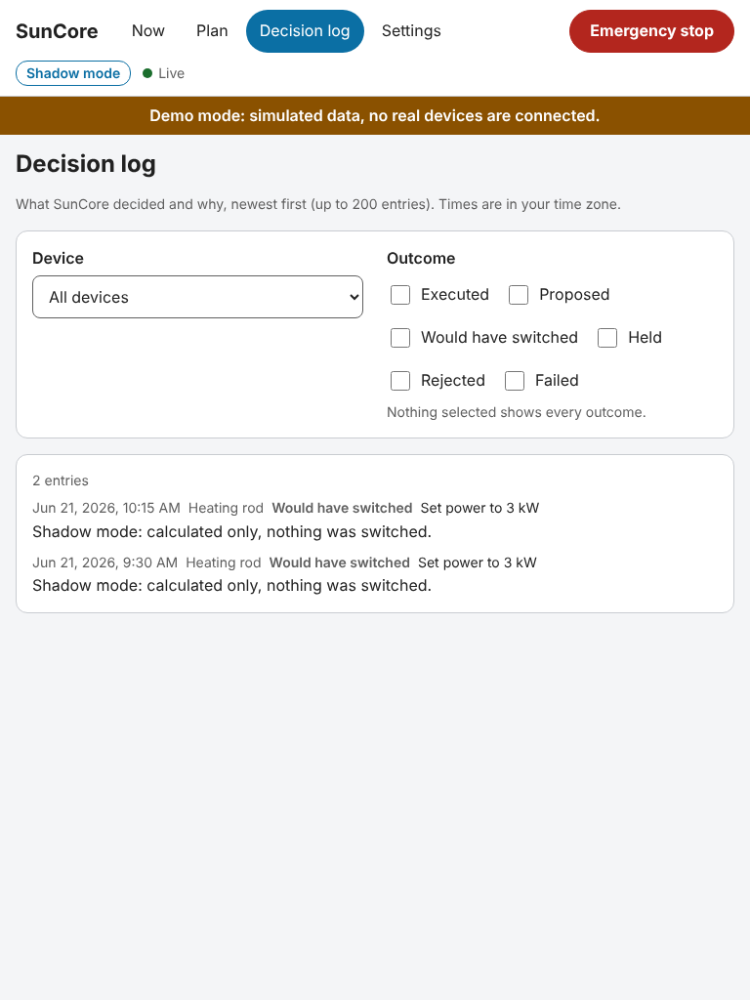

# Surplus control

SunCore can distribute your real solar surplus to air conditioners, water heaters and switchable
or adjustable loads every few seconds. This page explains how it decides, what it does when
something goes wrong, and how you take over your first device **safely**. It is written for
the version in which control exists but **nothing is ever written until you say so**: shadow
mode is the default for the whole system and for every new device.

Read [What SunCore cannot do yet](#known-limitations-and-unverified) before you rely on it.

## 1. How surplus control works

Every 5 seconds (app option `controller_interval_s`) the controller does the same four things.

1. **Free surplus.** It adds up what is available to your controlled devices: the power
   that currently flows into the grid, plus the battery's charging power **if your goals allow
   it** (see [Battery and goals](#battery-and-goals)), plus what the controlled devices draw
   right now. It keeps 100 W unallocated (measurement noise, small loads) and subtracts
   what the devices already hold. What is left is the **free surplus** you see in the
   **Surplus** card on the **Now** view, next to **Deficit** and **Allocated to devices**.
2. **Smoothing against cloud flicker.** The available value is the median of the last
   60 seconds, so a single cloud edge does not move it. The spread of the values in that
   window counts as uncertainty: when the sun flickers, the band widens, and SunCore only
   **adds** load when the free surplus minus this uncertainty still covers what the device
   needs plus the hysteresis. A device that is already running is judged by the median, so
   a short cloud alone never switches it off.
3. **Priorities.** Devices are served in the order you set in the setup step *Priorities and
   goals* (position 1 first). Each device gets what it can use; the rest goes on to the
   next. A lower priority never takes surplus that a higher one is still waiting for.
4. **Hysteresis and protection times.** A device is switched on (or one level up) only when
   the surplus covers its power plus the **hysteresis** (default 100 W) and the condition has
   held for the **hysteresis delay** (default 60 s). It goes down when the surplus falls
   below minus the hysteresis for the same delay. On top of that every device has
   **minimum run** and **minimum pause** times, a **maximum number of switches per hour**
   (default 6), a **settle time** after each write and a write rate limit (at most one write
   per device every 5 s). The LG ThinQ air conditioner template ships with 10 minutes
   minimum run and 5 minutes minimum pause; these are compressor-protective design
   defaults, not manufacturer data. Hysteresis, delay, switches per hour and settle time come
   from the template (or the app defaults); the device editor offers the minimum run and
   pause times, and expert settings for the rest follow in a later version.

The controller only **proposes** what to do. A separate safety layer judges every single
write again with the same numbers, can reject it with a reason, and is the only part that is
allowed to touch a device.

### No grid import caused by SunCore

This is the central rule. Controlled devices may only use **real surplus**.

- SunCore never adds load unless the safe surplus covers it, and it waits while the house
  is importing from the grid.
- If a running device suddenly draws more than expected (a compressor ramping up, a large
  temperature difference), your battery buffers the short deficit. If grid import or battery
  discharge **caused by the controlled devices** lasts longer than 30 seconds (half of that
  when a device's power is only a rough estimate) or the battery has covered about 50 Wh,
  SunCore **backs off step by step**: the device with the lowest priority first, one level at a
  time (a climate set-point moves back toward your own value, steps and adjustable loads go
  to a lower level, a switch goes off only after its minimum run time, otherwise the next
  device is tried). It waits for the settle time before the next step.
- **Battery reserve and import limit back off at once, without buffering.** If the battery
  is at or below its minimum charge, it is never used to cover devices. If the house imports
  more than the connection limit you entered, SunCore backs off immediately.

Import that has nothing to do with SunCore (an electric kettle, an oven) is not
"caused by SunCore": the controller does not add load while it lasts, but it does not
switch other devices off for it unless the controlled devices are the reason.

### Battery and goals

In this version SunCore does not control the battery; it only decides whether the
battery's **charging power** counts as surplus for devices:

- With the goal *Have the battery at a target charge by a time* and a charge below the
  target: the battery charges first, devices get no share of the battery's charging power.
  The time of day is not evaluated yet, the target counts all day.
- With *Run the air conditioner before exporting*, or when the target is reached:
  charging power is available to devices.
- With **no goal at all**: the battery comes first, and devices only get what would be
  exported. This is a conservative default and `UNVERIFIED` against what you actually
  want; set one of the two goals if you want devices to use the power that would charge
  the battery.

## 2. Operating modes

There are three modes, per device and for the whole system (the **overall mode**).

| Mode | What SunCore does |
|---|---|
| **Shadow** (default) | Calculates and logs what it **would have** done. Writes nothing, ever. |
| **Assisted** | Proposes actions in the panel and waits for your confirmation. |
| **Automatic** | Acts on its own within all limits. |

A device acts in the **lower** of the overall mode and its own mode. Automatic therefore
needs **both**: the overall mode set to automatic (setup step *Operating mode*, or
**Settings → Operating mode**) **and** the device switched to automatic on its card on the
**Now** view. Every new device starts in shadow mode. The setup step only sets the overall
mode; the modes of the devices are changed on the **Now** view.

- **Assisted proposals** appear under **Suggestions waiting for you**. **Confirm** carries
  the action out now (it still has to pass the safety checks and can be rejected with a
  reason), **Dismiss** discards it. A proposal is valid for 2 minutes and then expires.
- **Switching a device to automatic** asks for a confirmation. The request carries the
  device's **identity** (id, template and mapped entities). If the device changed in the
  meantime you get "This device changed in the meantime. Reload and check it". A device
  whose entities or template you change falls back to shadow, an import always resets the
  overall mode to shadow, and a stored settings document cannot raise a mode by itself.
- **Lowering the overall mode to shadow** applies immediately: SunCore stops writing and hands
  the controlled devices back (see [Handing back](#5-handing-back-and-the-emergency-stop)).

## 3. Devices

### Climate (air conditioner)

SunCore does not turn the unit on and off by default. It **shifts the set-point** inside your
comfort band: with heating up (at most the template's maximum shift, 2 °C for the LG template),
with cooling down, in steps of 1 °C (or the device's own step), and back to **your** set-point
when the surplus is gone. The set-point never leaves the **comfort band** you set in the
device editor. Only the modes *heat* and *cool* are shifted; in any other mode, or when your
own set-point is outside the comfort band, SunCore leaves the unit alone and says so.

- **Switching on** is an opt-in per device: *Switching on* in the device editor, together with
  the HVAC mode to switch on with. Without it, a unit that is off stays off ("The unit is
  off and SunCore may not switch it on").
- **LG ThinQ has no power sensor.** The `lg_thinq` integration only provides an energy counter
  that counts whole watt-hours per **hour**. SunCore derives the power from that counter and
  learns the unit's real power over time (starting from the nominal power you entered). Its
  estimate is uncertain, so the hysteresis is widened by that uncertainty: the controller needs
  more surplus before it shifts and reacts **more slowly and more conservatively** than with
  a measured value. A smart plug or the HACS integration `smartthinq_sensors` (sensor
  "Energy current") gives a measured power and is the better choice if you have one.
- **A slow power sensor** is not an outdated one: that `smartthinq_sensors` sensor updates every
  300 seconds. Enter **Update interval of the power sensor** = 300 in the device editor,
  otherwise SunCore treats the value as stale and pauses the device. Measured values are
  still slower than a plug that reports every few seconds.

### Water heater

`UNVERIFIED`: the water heater templates are tested in the simulator only; the maintainer
has no water heater, so nothing was ever run against real hardware.

Two templates exist: a heater with power levels in a **select** entity
(`generic.water_heater_steps`) and one with **one to three relays**
(`generic.water_heater_relays`). SunCore moves between the levels like any stepped load.
The step names and their power in the template are placeholders: set them to what your
heater offers and draws.

The **maximum temperature** of the comfort band is enforced through the tank sensor
(`temperature` role, in °C): at or above the maximum SunCore adds no more heat, the safety layer
refuses to write more, and an **unknown, outdated or non-°C reading counts as full**. Without a
tank sensor the maximum is **not** enforced; the heater's own thermostat must limit the
temperature.

### Switchable and adjustable loads

A switch (a pool pump, a smart plug) goes on and off with the hysteresis and protection times
above. An adjustable load (a heating rod through a number entity) follows the surplus in its
configured range with a dead band.

## 4. If you change something yourself

SunCore respects manual changes. It recognises them by the **value**: after the settle time, a
device that is in a state other than the one SunCore wrote has been changed by someone else.
(Answers that arrive late, for example from the LG cloud, are recognised as SunCore's own
writes.)

- A unit you switch **off** (remote control, the LG app) **stays off**.
- A **temperature** you change becomes the **new base value**: SunCore shifts from your value
  from then on.
- SunCore then keeps its hands off the device. The card shows **Held until ...**. It takes
  over again **the next day at 04:00 local time** (default) or after a number of hours (1 to
  48). You choose this per device under **Manual changes** in the device editor.
- **Resume now** on the card ends the hold at once.
- What the release gives back later is **what you left**, not the state of the first takeover.

**Take over manually** on the card opens the explicit overrides:

- **Hold**: SunCore leaves the device alone for a number of minutes (1 to 1440), then takes
  over again. SunCore drives nothing during a hold.
- **Pause**: the same until a time you choose, or until you resume. A pause also hands a
  device SunCore currently controls back (after its minimum run or pause time).
- **Resume**: ends a hold or a pause.

## 5. Handing back and the emergency stop

SunCore remembers, per device, the state **before it took over** (for a climate unit the
set-point and HVAC mode). **Handing back** restores that state. It happens on the emergency
stop, when SunCore stops, when you lower a device or the overall mode to shadow, on a watchdog
trip, after a connection loss and when a device is removed or re-mapped.

The **Emergency stop** button is in the header of every view, one click and no confirmation:

- Every device under control is handed back within 10 seconds, and SunCore **writes nothing**
  until you end the stop.
- The stop is **persisted**: it survives an app restart or an update.
- **Back to normal** (with a confirmation) ends it. Your modes are unchanged: a device in
  shadow or assisted mode still does nothing on its own, and devices in automatic mode are
  taken over again as surplus allows.

Handing back that is not urgent (lowering the mode to shadow, a device fault, a restored
connection, a configuration change) **waits for the device's minimum run or pause time**, so
a compressor is not short-cycled. SunCore stops writing at once; the card shows **Handing
back by ...**. The emergency stop and shutdown do not wait.

## 6. Fail-safe

| Situation | What happens |
|---|---|
| App stops, restarts or updates | All devices are handed back within 10 s before the connection to Home Assistant closes. |
| Crash or power loss | The record of what SunCore controlled is persisted. At the next start, once Home Assistant is connected, those devices are handed back. Until then the device stays as it was. |
| Home Assistant connection lost | SunCore cannot write: control is paused and nothing is decided. When the connection is back, devices are handed back (after their protection time) and the controller starts again from the then current state, including changes you made meanwhile. |
| Input fault (stale, unavailable, wrong unit, implausible jump, frozen PV in daylight, power balance does not add up) | A fault in grid, PV or battery pauses **all** devices and hands them back; a fault of one device's own sensors pauses that device. Control resumes after the values have been plausible for a cool-down (2 minutes). |
| Three writes in a row fail | The device is paused. |
| You change the configuration | The controller restarts. Unchanged devices are handed back after their protection time, changed ones at once and fall back to shadow. |

## 7. "Why?" and the decision log

Each device card has **Why?**, showing the latest reasons in plain language, such as "Waiting
for the minimum run time, 240 s left" or "Not switched on: 1200 W needed, only 800 W of safe
surplus", and the **Last decision**. Reasons are given in your language.

The **Decision log** lists what SunCore decided, newest first (up to 200 entries, times in your
time zone), and can be filtered by device and outcome: **Executed**, **Proposed**, **Would have
switched** (shadow), **Held (manual change)**, **Rejected** and **Failed**. An entry is made
only when something **changes**, not every 5 seconds. The log keeps 30 days and at most
200 000 entries.

## 8. Take your first device to automatic

Do this with **one** device you can watch, such as the air conditioner or a pool pump, on a
day with sun. The window of a few days is the point: you decide on evidence, not hope.

1. **Prepare.** Finish the setup assistant and read the system check. For a climate unit enter
   the comfort band and the nominal power, and decide whether SunCore may switch it on. Check
   the **Surplus** card against what you see in Home Assistant. Export a backup under
   **Settings**.
2. **Stay in shadow mode** (the default). SunCore now logs **Would have switched** entries.
   Open the **Decision log** in the evening, filter for the device and read the reasons.
3. **Watch for a day, better two or three.** Ask yourself: do the entries happen when there
   really was surplus? Are there entries every few minutes (too nervous: raise the minimum
   run and pause time in the device editor) or never (the goals keep the battery first, see
   [Battery and goals](#battery-and-goals))? Does the unit's estimated power on the card look
   plausible? Does nothing say "Held" that you did not cause?
4. **Optional: assisted mode.** Set the overall mode and the one device to **Assisted mode**.
   SunCore now proposes and you confirm with **Confirm**. Every confirmed action is still
   checked by the safety layer.
5. **Automatic for one device.** Set the **overall mode** to *Automatic mode*, then switch **only
   this device** to *Automatic mode* on its card and confirm the dialog. All other devices stay in
   shadow. Stay with it for the first hours and watch the **Now** view and the decision log:
   entries now say **Executed**.
6. **Know your exits.** **Emergency stop** (header), **Shadow mode** on the card (hands the
   device back after its protection time), **Take over manually → Pause**, or simply use the
   device yourself and SunCore keeps its hands off.
7. **Report.** Open an issue with what you saw (decision log, app log with `log_level: debug`).
   Especially useful: how the counter-only climate estimate behaved and how late the cloud
   echo arrived.

## Known limitations and UNVERIFIED

- **Never run on real hardware by the project so far.** The behaviour is verified in the
  simulator (cloud flicker, minimum run, counter-only and slow-sensor climate, inverter
  hang, connection loss, manual override, water heater, grid limit, restart, a 7-day run). The
  first live writes happen with your first automatic device.
- **Water heater**: simulator only, `UNVERIFIED` (see above). The `lg_thinq` climate writes
  (a `TypeError` on `set_temperature` without a step, the push delay after a command,
  `climate.turn_on` for modes not listed in `hvac_modes`) come from reading the integration's
  source, not from a live write.
- **Controller tuning** (deficit delay and budget, the spread of the smoothing, the extra surplus
  a counter-only climate needs before it shifts, "battery first" without a goal) is a first
  guess and meant to be tuned from your shadow-mode run.
- **Default sensor cadences** (power sensor 60 s, energy counter 300 s unless set) are
  assumptions: set **Update interval of the power sensor** for slower sensors.
- **No plan**: there are no forecasts, tariffs or planner in control yet. SunCore does not
  shift load to cheaper hours, does not pre-heat for the weather and does not write to the
  battery or the inverter. The goals *battery target* and *climate before export* only decide
  whether the battery's charging power counts as surplus; the target's time is not evaluated.
- **Time windows and quiet hours** are honoured by the controller but cannot be edited in the
  panel yet (templates and imported configuration only).
- A removed or re-mapped device that cannot be given back (for example after a crash) is
  reported ("please check it by hand"), not retried forever.
- **Downgrade**: this version stores its data in database schema 3, which earlier versions cannot
  open. Export the configuration before updating.
- **Compared with evcc, EMHASS and Predbat**: evcc is the better choice for charge points and
  has years of hardware experience; SunCore has no wallbox control yet. EMHASS and Predbat
  optimise the battery over time, SunCore does not yet. What SunCore adds is one app with a
  safety layer, shadow mode and a reason for every decision; see the
  [roadmap](../../roadmap.md).

See also: [Quick start](quick-start.md), [Contribute a device template](device-templates.md),
[compatibility list](../compatibility.md).
