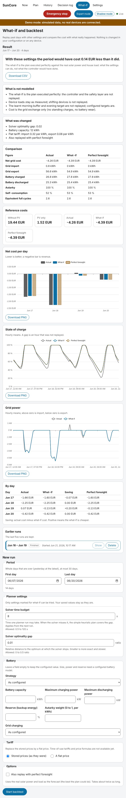

# What-if and backtesting

**What-if** replays the real SunCore planner over past days with settings you choose, and
compares the result with what really happened. Use it to ask "would a larger battery or a
different reserve have paid off?" before you change anything. It writes nothing to your devices
and keeps your saved settings as they are.

It is an expert feature: turn on [Expert mode](expert-mode.md) to get the **What-if** link in the
header (`#/whatif`). With expert mode off, a deep link shows only a hint.

## 1. Start a run

In **New run**:

1. **Period:** whole days that are over (yesterday at the latest). The default is the last 14
   days, at most 30.
2. **Planner settings:** only settings tagged for what-if, currently the planner time budget
   (capped at 10 s) and the solver gap.
3. **Battery:** strategy, size, charge and discharge power, reserve, autarky weight, grid
   charging "never" or "up to a price". Leave a field empty to keep the configured value. Size,
   power and reserve need a configured battery model.
4. **Tariff:** the stored prices, or a flat import and export price. Time-of-use tariffs and
   price formulas are not available yet.
5. **Also replay with perfect foresight:** uses the real solar power and load as the forecast,
   the best the plan could do. It roughly doubles the run time.

Press **Start backtest**. Only one run works at a time, and none starts while the planner is
solving (the server answers 409; try again in a moment). You can cancel. The last five runs are
kept and can be shown or deleted.

## 2. What is replayed

For every hour of every day SunCore builds the planner inputs from **what was known then**: the
newest stored PV and load forecast issued before that hour, the stored prices (the next day's
prices count as known from 13:00 local time) and the simulated state of charge. The real planner
(HiGHS plus the rule-based fallback) computes a plan, and the hour is executed against the actual
solar power and house load inside the plan's band. Compared on the same priced intervals:
**actual** (what was measured), **what-if**, and optionally **perfect foresight**. The no-PV and
PV-only baselines of the History view are listed too.

## 3. Reading the result

The verdict says that the period would have cost less, more, or the same. Below it:

- **What is not modelled** (always read it),
- the list of changes with the values really used (a value above the hardware limit, or a capped
  budget, is shown as requested and as used),
- a comparison table, charts of net cost per day, state of charge and grid power with PNG, a daily
  table with CSV, and the **skipped days** with their reason.

A day is skipped when less than 80 % of it was measured, no prices are stored, or no PV or load
forecast was stored (forecasts are kept 45 days, prices 400 days).

## 4. Limitations

The result is **the plan executed perfectly**: an estimate of what the settings can do, not a
promise of what the controller would have done.

- The controller and the safety layer are not replayed. Execution follows the plan's battery
  band like a self-consumption inverter, not the planned set-point.
- Devices keep their measured load. Shifting devices is not replayed.
- The learnt morning buffer and evening target are not replayed; the configured targets apply,
  and the profile load forecast is used instead of the ML model.
- Cost is the grid exchange only: no standing charges, no battery wear.
- Prices count as known from their day-ahead publication.
- The planner time budget is capped, so a run can differ slightly from the live planner.

### Expected accuracy

Run without any change, the replay should land close to the recorded cost. SunCore's own test
requires the replay to be within **5 %** of the recorded cost; on the demo's last 14 days it
differs by +1.1 %. Treat 5 % as the expected tolerance: a what-if that is cheaper by less than
that is within noise. On your own data this figure has not been measured yet.

## 5. Run time on small hardware

On a desktop-class machine 14 days take about 9 s (about 17 s with perfect foresight) and 30 days
about 23 s, with a peak of about 80 MB. A run is stopped after 15 minutes, or when the process
passes 280 MB. The same job on a Raspberry Pi 4 or a Home Assistant Green is **not measured yet**
(`UNVERIFIED`); start with a short period.

## See also

[History and analysis](history-and-analysis.md) · [Expert mode](expert-mode.md)
